<div align="right" dir="rtl">

### النسخة الأساسية ضمن الأدلة

هذا هو رابط دليل Arena القديم الذي تمت مشاركته سابقًا في واتساب، **وسيظل يعرض الدليل كاملًا**. وأصبح للدليل أيضًا مكان منظم داخل مجلد الأدلة: **[فتح دليل Arena من Guides](guides/Arena/README.md)**.

</div>

<div align="right" dir="rtl">

# **برنامج Arena Simulation**

**إعداد:** Talal bin Ibrahim Alsultan  
**آخر تحديث:** 26 أكتوبر 2026

</div>

<div align="right" dir="rtl">

> **دليل عملي لتنزيل Arena 17 وتثبيته وتشخيص مشكلات التشغيل**
>
> جمعت هنا خطوات تنزيل **Arena 17** وتثبيته بالطريقة التي أحتاجها في المادة، من تجهيز حساب Rockwell إلى تشغيل البرنامج. أضفت أيضًا أوامر بسيطة لفحص متطلبات Windows، خاصة لمن يفتح عنده Arena لكن بعض الأدوات لا تعمل. وضعت الروابط الأصلية وصورًا توضح أين نضغط في كل مرحلة.

</div>

<div align="right" dir="rtl">

## إصدار Arena المستخدم في الشرح

</div>

الشرح هنا على **Arena 17**، وتحديدًا **17.00.01**. ستجد هذا الإصدار في [صفحة تنزيل Rockwell](https://compatibility.rockwellautomation.com/Pages/MultiProductFindDownloads.aspx?crumb=112&mode=3&refSoft=1&versions=65330). تأكد من رقم الإصدار قبل البدء، فهناك نسخ وتحديثات أخرى في القائمة.

في التسجيل الذي اعتمدت عليه، تظهر الملفات داخل `C:\RA\17.00.01.10_x64\17.00.01.10_x64\MediaImage`. ستلاحظ أن شاشة المثبّت تحمل اسم **Arena 2026**، رغم أن رقم حزمة التنزيل يبدأ بـ17. وبحسب [تنبيهات Rockwell الأمنية](https://www.rockwellautomation.com/en-us/trust-center/security-advisories.html)، توجد تحديثات أمنية للإصدارات السابقة، لذلك من الأفضل مراجعة التحديث المتاح وعدم الاكتفاء بإصدار أقدم.

**ملاحظة:** بعض صفحات متطلبات Rockwell لا تزال تعرض الإصدار **16.20.02**؛ عند اختلاف المتطلبات، ارجع إلى وثائق الحزمة التي حمّلتها.

<div align="right" dir="rtl">

## المحتويات
1. ‏[قبل البدء](#1-قبل-البدء)
2. ‏[الحد الأدنى للمواصفات](#2-الحد-الأدنى-للمواصفات)
3. ‏[فحص Windows والذاكرة والمساحة](#3-فحص-windows-والذاكرة-والمساحة)
4. ‏[فحص وتثبيت .NET Framework](#4-فحص-وتثبيت-net-framework)
5. ‏[فحص جميع إصدارات Microsoft Visual C++](#5-فحص-جميع-إصدارات-microsoft-visual-c)
6. ‏[فحص SQL Server Compact 4.0](#6-فحص-sql-server-compact-40)
7. ‏[فحص Office](#7-فحص-office)
8. ‏[تحميل Arena وتثبيته رسميًا](#8-تحميل-arena-وتثبيته-رسميًا)
9. ‏[فحص الترخيص وتشغيل نموذج تجريبي](#9-فحص-الترخيص-وتشغيل-نموذج-تجريبي)
10. ‏[حل مشكلة الأدوات والقوائم غير المفعّلة](#10-حل-مشكلة-الأدوات-والقوائم-غير-المفعلة)
11. ‏[الأسئلة الشائعة والمراجع](#11-الأسئلة-الشائعة-والمراجع)

</div>

---

<div align="right" dir="rtl">

## 1. قبل البدء

</div>

<div align="right" dir="rtl">

إذا كان Arena مثبتًا عندك ويفتح بشكل طبيعي، لكن أدوات **Create** أو **Process** أو **Dispose** غير مفعّلة، فلا تحذفه مباشرة. جرّب فتح نموذج جديد أولًا، ثم افحص الترخيص والمتطلبات. الهدف هنا أن تعرف ما ينقص جهازك بدل إعادة تثبيت كل شيء من البداية.

</div>

- ‏احفظ نماذجك وملفات المشروع قبل إجراء أي تعديل.
- ‏حمّل البرامج من **Microsoft** و**Rockwell** مباشرة.
- ‏لفتح نافذة الأوامر، اكتب **CMD** في قائمة Start. معظم أوامر الفحص لا تحتاج إلى صلاحيات المدير.
- ‏إذا ظهر فوق الأمر `cmd` فشغّله في **Command Prompt**، وإذا ظهر `powershell` فشغّله في **Windows PowerShell**.
- ‏انتبه لمعمارية الحزمة المطلوبة (**x86** أو **x64**)؛ ليس بالضرورة أن تكون جميع البرامج على جهازك بنفس المعمارية.

<div align="right" dir="rtl">

### روابط التنزيل الرسمية المختصرة

</div>

<div align="right" dir="rtl">

الروابط في الجدول تنقلك إلى صفحات الشركات مباشرة. افتح ما تحتاجه فقط، ولا تثبّت حزمة موجودة أصلًا ما لم تكن بحاجة إلى إصلاحها.

</div>

| البرنامج | المصدر الرسمي | متى أحتاجه؟ |
| :---: | :---: | :---: |
| Arena Simulation | [Rockwell Automation: تنزيل Arena](https://www.rockwellautomation.com/en-us/products/software/arena-simulation/buying-options/download.html) | تنزيل البرنامج أو إعادة تثبيته بعد التشخيص |
| .NET Framework 4.8.1 Runtime | [Microsoft: .NET Framework 4.8.1](https://dotnet.microsoft.com/en-us/download/dotnet-framework/net481) | إذا تطلّبه Arena وكانت النسخة المثبتة أقدم وكانت 4.8.1 متوافقة مع Windows |
| Visual C++ Redistributable x64 | [Microsoft: تنزيل مباشر x64](https://aka.ms/vc14/vc_redist.x64.exe) | للتطبيقات ذات معمارية 64-bit التي تحتاج مكتبات v14 |
| Visual C++ Redistributable x86 | [Microsoft: تنزيل مباشر x86](https://aka.ms/vc14/vc_redist.x86.exe) | للتطبيقات ذات معمارية 32-bit التي تحتاج مكتبات v14، حتى على Windows 64-bit |
| Visual C++ الإصدارات القديمة | [Microsoft: جميع الإصدارات المدعومة والقديمة](https://learn.microsoft.com/en-us/cpp/windows/latest-supported-vc-redist) | عند إثبات احتياج إصدار أقدم محدد |
| SQL Server Compact 4.0 SP1 | [Microsoft Download Center](https://www.microsoft.com/en-us/download/details.aspx?id=30709) | **اختياري** فقط عند ثبوت الحاجة |
| Microsoft Office | [Microsoft 365](https://www.microsoft.com/microsoft-365) | إذا كانت ميزات تقارير Excel مطلوبة ولم يكن Office موجودًا |

<div align="right" dir="rtl">

**للتوضيح:** [متطلبات النظام المنشورة لدى Rockwell](https://www.rockwellautomation.com/en-us/products/software/arena-simulation/support/system-requirements.html) تشير إلى **16.20.02**. استخدمها كمرجع مبدئي، ثم راجع متطلبات إصدار Arena 17 في ملفات التنزيل.

</div>

<div align="right" dir="rtl">

## 2. الحد الأدنى للمواصفات

</div>

<div align="right" dir="rtl">

هذه المواصفات مأخوذة من صفحة Rockwell للإصدار **16.20.02**، وأضعها هنا للمقارنة قبل التثبيت:

</div>

| العنصر | الحد الأدنى في صفحة Rockwell | الموصى به |
| :---: | :---: | :---: |
| RAM | 8 GB | 16 GB |
| مساحة القرص الحرة | 2 GB | 4 GB |
| المعالج | Intel ثنائي النواة، 3 GHz | بحسب تعقيد النموذج |
| نظام التشغيل | Windows 10 / 11 Pro أو Enterprise بحسب قائمة دعم Rockwell | نظام تدعمه النسخة المستهدفة |
| Microsoft Office | يُستخدم لعرض تقارير إحصاءات Excel | تحقق من التوافق |
| صلاحيات التثبيت | صلاحيات Administrator | مطلوبة للتثبيت |

<div align="right" dir="rtl">

إذا وجدت في شرح قديم أن **4GB RAM** تكفي، فلا تعتمدها وحدها. صفحة المتطلبات أعلاه تذكر **8GB** كحد أدنى لذلك الإصدار، وقد تختلف متطلبات Arena 17.

</div>

<div align="right" dir="rtl">

## 3. فحص Windows والذاكرة والمساحة

</div>

<div align="right" dir="rtl">

### معرفة إصدار Windows

</div>

<div align="right" dir="rtl">

افتح CMD:

</div>

```cmd
winver
```

<div align="right" dir="rtl">

**شكل النتيجة المتوقع (مثال):**

</div>

```text
[تفتح نافذة About Windows في واجهة النظام]
Windows 11
Version: 23H2 (مثال فقط)
```

<div align="right" dir="rtl">

**ماذا تعني؟** هذا الأمر يفتح نافذة رسومية؛ لا يطبع تقريرًا داخل CMD. الرقم المعروض على جهازك قد يختلف.

</div>

<div align="right" dir="rtl">

أو:

</div>

```cmd
ver
```

<div align="right" dir="rtl">

**شكل النتيجة المتوقع (مثال):**

</div>

```text
Microsoft Windows [Version 10.0.22631.XXXX]
```

<div align="right" dir="rtl">

**ماذا تعني؟** يعرض إصدار نظام Windows في نافذة CMD؛ قيمة XXXX موضعية وليست نتيجة فعلية.

</div>

<div align="right" dir="rtl">

لمعلومات أوسع: اضغط `Win + R`، واكتب `msinfo32`. ستجد `OS Name` و`System Type` و`Installed Physical Memory`.

</div>

<div align="right" dir="rtl">

### قياس الذاكرة RAM بواسطة CMD

</div>

```cmd
powershell -NoProfile -Command "Get-CimInstance Win32_ComputerSystem | Select-Object @{N='RAM_GB';E={[math]::Round($_.TotalPhysicalMemory/1GB,2)}}"
```

<div align="right" dir="rtl">

**شكل النتيجة المتوقع (مثال):**

</div>

```text
RAM_GB
------
 16.00
```

<div align="right" dir="rtl">

**ماذا تعني؟** 16.00 تعني سعة ذاكرة RAM قدرها 16 جيجابايت في هذا المثال فقط.

</div>

<div align="right" dir="rtl">

### قياس المساحة الحرة على القرص C:

</div>

```cmd
powershell -NoProfile -Command "Get-PSDrive C | Select-Object Name,@{N='Free_GB';E={[math]::Round($_.Free/1GB,2)}}"
```

<div align="right" dir="rtl">

**شكل النتيجة المتوقع (مثال):**

</div>

```text
Name Free_GB
---- -------
C      125.50
```

<div align="right" dir="rtl">

**ماذا تعني؟** Free_GB هي المساحة الحرة المتبقية على محرك C، وليست المساحة الإجمالية.

</div>

<div align="right" dir="rtl">

إذا كانت الذاكرة والمساحة مناسبة، انتقل لفحص بقية المكونات. هذه الأرقام وحدها لا تعني أن الترخيص أو جميع إعدادات Arena سليمة.

</div>

<div align="right" dir="rtl">

## 4. فحص وتثبيت .NET Framework

</div>

<div align="right" dir="rtl">

### الأمر الأول (CMD)

</div>

```cmd
reg query "HKLM\SOFTWARE\Microsoft\NET Framework Setup\NDP\v4\Full" /v Release
```

<div align="right" dir="rtl">

**شكل النتيجة المتوقع (مثال):**

</div>

```text
HKEY_LOCAL_MACHINE\SOFTWARE\Microsoft\NET Framework Setup\NDP\v4\Full
    Release    REG_DWORD    0x80ea8
```

<div align="right" dir="rtl">

**ماذا تعني؟** القيمة السداسية 0x80ea8 تساوي 528040 بالنظام العشري، وتمثل .NET Framework 4.8 في إحدى بيئات Windows.

</div>

<div align="right" dir="rtl">

### الأمر البديل (PowerShell)

</div>

```powershell
(Get-ItemProperty 'HKLM:\SOFTWARE\Microsoft\NET Framework Setup\NDP\v4\Full').Release
```

<div align="right" dir="rtl">

**شكل النتيجة المتوقع (مثال):**

</div>

```text
528040
```

<div align="right" dir="rtl">

**ماذا تعني؟** يعرض PowerShell القيمة نفسها بالأرقام العشرية؛ 528040 قيمة نموذجية لـ .NET Framework 4.8.

</div>

<div align="right" dir="rtl">

### تفسير أشهر قيم Release

</div>

| القيمة | نسخة .NET Framework |
| :---: | :---: |
| 528040 أو 528049 أو 528372 أو 528449 | 4.8 (تختلف قيمة التسجيل بحسب Windows) |
| 533320 أو 533325 أو 533509 | 4.8.1 |

<div align="right" dir="rtl">

توجد قيم أخرى بحسب إصدار Windows. الرقم **528040 أو أعلى** يدل عادة على وجود .NET Framework 4.8 أو إصدار أحدث ضمن سلسلة 4.x. المرجع: [Microsoft: كيفية التعرف إلى الإصدارات المثبتة](https://learn.microsoft.com/en-us/dotnet/framework/install/how-to-determine-which-versions-are-installed).

</div>

<div align="right" dir="rtl">

**عند الحاجة للتثبيت:**

</div>

1. ‏ادخل [صفحة Microsoft الرسمية لـ .NET Framework 4.8.1](https://dotnet.microsoft.com/en-us/download/dotnet-framework/net481).
2. ‏اختر **Runtime** لتشغيل البرامج؛ ليس **Developer Pack**.
3. ‏تأكد من توافق النسخة مع Windows عندك.
4. ‏نفّذ مثبت Microsoft الرسمي وأعد تشغيل الجهاز **إذا طُلب منك ذلك**.
5. ‏كرّر أمر قراءة `Release` للتحقق.

<div align="right" dir="rtl">

لا تثبّت .NET 4.8.1 إذا كان Windows يحتوي عليه بالفعل.

</div>

<div align="right" dir="rtl">

## 5. فحص جميع إصدارات Microsoft Visual C++

</div>

<div align="right" dir="rtl">

هنا أضع أمرين لفحص حزم **Visual C++**: الأمر القديم الموجود في بعض الشروحات، ثم بديله الذي يعرض أسماء الحزم وإصداراتها على Windows الحديث.

</div>

<div align="right" dir="rtl">

### الطريقة الأولى: أمر المستودع القديم باستخدام WMIC

</div>

```cmd
wmic product where "name like '%%Visual C++%%'" get name,version
```

<div align="right" dir="rtl">

**شكل النتيجة المتوقع (مثال):**

</div>

```text
'wmic' is not recognized as an internal or external command,
operable program or batch file.
```

<div align="right" dir="rtl">

**ماذا تعني؟** هذه رسالة فشل محتملة على Windows 11 الحديث؛ عند ظهورها استخدم الطريقة الثانية بدل إعادة تثبيت WMIC.

</div>

<div align="right" dir="rtl">

الأمر الأول يستخدم **WMIC**، وهي أداة قديمة لم تعد متاحة في كثير من إصدارات Windows 11. وقد يكون الفحص بها بطيئًا أو لا يعرض كل الحزم. أدرجته حتى تعرف لماذا قد يفشل إذا وجدته في شرح آخر.

</div>

<div align="right" dir="rtl">

**إذا ظهر خطأ WMIC، استخدم الأمر التالي مباشرة.** لا تحتاج إلى إعادة تثبيت الأداة القديمة.

</div>

<div align="right" dir="rtl">

### الطريقة الثانية: أمر بديل يعمل داخل CMD ويُظهر الأسماء والإصدارات

</div>

<div align="right" dir="rtl">

انسخ **السطر كاملًا** في نافذة CMD:

</div>

```cmd
powershell -NoProfile -Command "Get-ItemProperty 'HKLM:\SOFTWARE\Microsoft\Windows\CurrentVersion\Uninstall\*','HKLM:\SOFTWARE\WOW6432Node\Microsoft\Windows\CurrentVersion\Uninstall\*' -ErrorAction SilentlyContinue | Where-Object { $_.DisplayName -like '*Microsoft Visual C++*' } | Sort-Object DisplayName,DisplayVersion | Select-Object DisplayName,DisplayVersion | Format-Table -AutoSize"
```

<div align="right" dir="rtl">

**شكل النتيجة المتوقع (مثال):**

</div>

```text
DisplayName                                                  DisplayVersion
-----------                                                  --------------
Microsoft Visual C++ 2013 x86 Minimum Runtime                12.0.40664
Microsoft Visual C++ 2015-2022 Redistributable (x64)          14.40.33816
Microsoft Visual C++ 2015-2022 Redistributable (x86)          14.40.33816
```

<div align="right" dir="rtl">

**بعد ظهور القائمة، ابحث عن Visual C++ 2022 أو حزمة v14 متوافقة.**

بعد تنفيذ الأمر، ابحث في عمود `DisplayName` عن **Microsoft Visual C++ 2015–2022 Redistributable**، أو حزمة **Visual C++ v14 أحدث متوافقة مع Visual Studio 2022**. تأكد من المعمارية المناسبة: `(x64)` لبرامج 64-bit و`(x86)` لبرامج 32-bit. ويُفضّل فحص وجود النسختين على Windows بنظام 64-bit عند استخدام برامج مختلفة المعمارية.

**إذا لم تظهر حزمة متوافقة، راجع روابط Microsoft الرسمية:** [تحميل x64](https://aka.ms/vc14/vc_redist.x64.exe) | [تحميل x86](https://aka.ms/vc14/vc_redist.x86.exe).

**تنبيه:** قد يتغير اسم الحزمة في الإصدارات الأحدث؛ لا يُشترط ظهور لفظ `2022` حرفيًا إذا كانت حزمة **v14** المثبتة أحدث ومتوافقة. هذه **خطوة تحقق في الدليل** وليست إثباتًا بأن Arena 17 يشترط حزمة باسم 2022 تحديدًا.

</div>

<div align="right" dir="rtl">

**ماذا تعني؟** يعرض العمود الأول أسماء الحزم ومعماريتها، والثاني الإصدارات المثبتة. الصفوف هنا أمثلة وليست بيانات جهازك.

</div>

<div align="right" dir="rtl">

أفضل استخدام هذا الأمر عند فحص الحزم؛ فهو يقرأ أسماء البرامج المسجلة في Windows ويعرض عمودين:

</div>

- ‏`DisplayName`: اسم الحزمة، وغالبًا يظهر فيه x86 أو x64.
- ‏`DisplayVersion`: رقم الإصدار المثبت.

<div align="right" dir="rtl">

قد لا تظهر بعض الحزم غير المسجلة في هذه القائمة، لذلك استخدم النتيجة لفحص البرامج المثبتة، لا لفحص جميع ملفات DLL.

</div>

<div align="right" dir="rtl">

### الطريقة الثالثة: تنفيذ الأمر مباشرة داخل PowerShell

</div>

<div align="right" dir="rtl">

إذا أردت استخدام PowerShell بدل CMD:

</div>

```powershell
Get-ItemProperty 'HKLM:\SOFTWARE\Microsoft\Windows\CurrentVersion\Uninstall\*','HKLM:\SOFTWARE\WOW6432Node\Microsoft\Windows\CurrentVersion\Uninstall\*' -ErrorAction SilentlyContinue |
  Where-Object { $_.DisplayName -like '*Microsoft Visual C++*' } |
  Sort-Object DisplayName, DisplayVersion |
  Select-Object DisplayName, DisplayVersion |
  Format-Table -AutoSize
```

<div align="right" dir="rtl">

**شكل النتيجة المتوقع (مثال):**

</div>

```text
DisplayName                                                  DisplayVersion
-----------                                                  --------------
Microsoft Visual C++ 2015-2022 Redistributable (x64)          14.40.33816
Microsoft Visual C++ 2015-2022 Redistributable (x86)          14.40.33816
```

<div align="right" dir="rtl">

**ماذا تعني؟** نفس المبدأ عند استخدام PowerShell مباشرة. قد تختلف القائمة والإصدارات، وقد تظهر صفوف إضافية.

</div>

<div align="right" dir="rtl">

### الطريقة الرابعة: واجهة Windows

</div>

<div align="right" dir="rtl">

`Settings > Apps > Installed apps` ثم ابحث عن `Microsoft Visual C++`. تظهر النتائج حسب البرامج المسجلة في النظام.

</div>

<div align="right" dir="rtl">

### تنزيل حزم Microsoft عند الحاجة فقط

</div>

1. ‏راجع معمارية **Arena** المطلوبة: x86 أو x64.
2. ‏افتح [صفحة Microsoft للإصدارات المدعومة](https://learn.microsoft.com/en-us/cpp/windows/latest-supported-vc-redist).
3. ‏للحزم الحديثة المتوافقة مع v14: [x86](https://aka.ms/vc14/vc_redist.x86.exe) أو [x64](https://aka.ms/vc14/vc_redist.x64.exe).
4. ‏إذا ظهرت نافذة **Install / Repair / Uninstall** وكانت الحزمة نفسها مثبتة، جرّب **Repair** عندما توجد أدلة على فسادها، بدل حذفها عشوائيًا.
5. ‏لا تحذف حزم 2008/2010/2012/2013 لمجرد أنها قديمة؛ قد تستخدمها برامج أخرى، وهي تُثبّت جنبًا إلى جنب مع الحزم الأحدث.
6. ‏أعد تشغيل Windows إذا طلب المثبت، ثم افحص الإصدارات مجددًا.

<div align="right" dir="rtl">

**تنبيه:** تثبيت نسخة x64 وحدها لا يغطي جميع تطبيقات x86. وفي المقابل، ليس كل برنامج Arena بحاجة إلى جميع إصدارات Visual C++ المذكورة.

</div>

<div align="right" dir="rtl">

مراجع: [Microsoft VC++ downloads](https://learn.microsoft.com/en-us/cpp/windows/latest-supported-vc-redist) | [Microsoft WMIC removal](https://support.microsoft.com/en-us/servicing/os/windows/docs/2025/09/windows-management-instrumentation-command-line-wmic-removal-from-windows).

</div>

<div align="right" dir="rtl">

## 6. فحص SQL Server Compact 4.0

</div>

<div align="right" dir="rtl">

ذكرت بعض شروحات Arena مكوّن **SQL Server Compact 4.0**. أضع طريقة فحصه هنا، لكن لا تثبّته لمجرد أنه مذكور؛ لم أجد ما يثبت أنه مطلوب لكل نسخ Arena 17.

</div>

<div align="right" dir="rtl">

### فحص مسار السجل الأساسي باستخدام CMD

</div>

```cmd
reg query "HKLM\SOFTWARE\Microsoft\Microsoft SQL Server Compact Edition\v4.0" /v Version
```

<div align="right" dir="rtl">

**شكل النتيجة المتوقع (مثال):**

</div>

```text
HKEY_LOCAL_MACHINE\SOFTWARE\Microsoft\Microsoft SQL Server Compact Edition\v4.0
    Version    REG_SZ    4.0.8876.1
```

<div align="right" dir="rtl">

**ماذا تعني؟** هذه نتيجة افتراضية عند وجود مفتاح Version في هذا المسار. قد يعرض جهازك قيمة أخرى أو عدم وجود المفتاح.

</div>

<div align="right" dir="rtl">

### فحص مسار السجل الثاني عند استخدام Windows 64-bit

</div>

```cmd
reg query "HKLM\SOFTWARE\WOW6432Node\Microsoft\Microsoft SQL Server Compact Edition\v4.0" /v Version
```

<div align="right" dir="rtl">

**شكل النتيجة المتوقع (مثال):**

</div>

```text
ERROR: The system was unable to find the specified registry key or value.
```

<div align="right" dir="rtl">

**ماذا تعني؟** مثال عند عدم العثور على المفتاح في مسار WOW6432Node تحديدًا؛ لا يثبت هذا غياب المكوّن كليًا.

</div>

<div align="right" dir="rtl">

إذا ظهرت `ERROR: The system was unable to find the specified registry key or value.`، فالمعنى أن المفتاح غير موجود في **المسار المحدد**؛ وليس بالضرورة أن المكوّن غير موجود بأي صورة.

</div>

<div align="right" dir="rtl">

### عند إثبات الحاجة إليه

</div>

1. ‏افتح [صفحة SQL Server Compact 4.0 SP1 على Microsoft](https://www.microsoft.com/en-us/download/details.aspx?id=30709).
2. ‏اختر `SSCERuntime_x86-ENU.exe` أو `SSCERuntime_x64-ENU.exe` وفق المتطلب الفعلي.
3. ‏شغّل المثبت الرسمي وتحقق من النتائج.
4. ‏**تحذير أمني:** انتهى دعم SQL Server Compact 4.0 الممتد في **14 يوليو 2021**؛ لا توصي هذه الصفحة بتثبيته افتراضيًا على جهاز حديث. راجع [سجل دورة الحياة الرسمي](https://learn.microsoft.com/en-us/lifecycle/products/microsoft-sql-server-compact-40).

<div align="right" dir="rtl">

## 7. فحص Office

</div>

<div align="right" dir="rtl">

افتح **Excel > File > Account > About Excel** وتحقق من المعمارية والإصدار.

</div>

<div align="right" dir="rtl">

يمكن فحص نظام Click-to-Run عبر CMD:

</div>

```cmd
reg query "HKLM\SOFTWARE\Microsoft\Office\ClickToRun\Configuration" /v Platform
```

<div align="right" dir="rtl">

**شكل النتيجة المتوقع (مثال):**

</div>

```text
HKEY_LOCAL_MACHINE\SOFTWARE\Microsoft\Office\ClickToRun\Configuration
    Platform    REG_SZ    x64
```

<div align="right" dir="rtl">

**ماذا تعني؟** x64 تعني أن إصدار Office Click-to-Run مسجّل بمعمارية 64-bit؛ أما x86 فيشير إلى 32-bit.

</div>

<div align="right" dir="rtl">

القيمتان المحتملتان: `x86` و`x64`. إذا لم يظهر المفتاح، قد يكون Office مثبتًا بطريقة أخرى؛ هذا الأمر وحده لا يكفي للحكم.

</div>

<div align="right" dir="rtl">

ليس ضروريًا أن يكون Office بنسخة **64-bit** في كل الحالات. المهم توافقه مع نسخة Arena التي تستخدمها، ولا أنصح بتغيير نسخة Office ما لم تظهر مشكلة فعلية.

</div>

<div align="right" dir="rtl">

## 8. تحميل Arena وتثبيته رسميًا

</div>

## دليل التثبيت بالصور: Arena 17

<p align="right" dir="rtl">هذا الجزء يوضح خطوات التسجيل والتنزيل كما تظهر في صفحات Rockwell، ثم مكان الملفات على جهاز Windows.</p>

> **قبل الضغط على Download:** تأكد أن بيانات حسابك مكتملة (**Complete Profile**) وأنك أضفت جهتك في **Location**. إذا كنت من جامعة الملك سعود، ابحث عن **King Saud University** وأرسل طلب الإضافة إذا لم تكن موجودة.

> أنصح باستخدام **Microsoft Edge** والبريد الجامعي عند إنشاء الحساب. هذه طريقة مفضلة، وليست شرطًا حصريًا من Rockwell.

الصور أدناه رسومات توضيحية أعددتها اعتمادًا على الشاشات المستخدمة في الشرح، وليست صورًا حرفية من الموقع. وضعت مربعات حمراء حول الأماكن التي تحتاج الضغط عليها.

<p align="center">
<a href="https://compatibility.rockwellautomation.com/Pages/Downloads.aspx?c=118&amp;pid=50026"></a>
</p>

<p align="center"><strong><a href="https://compatibility.rockwellautomation.com/Pages/Downloads.aspx?c=118&amp;pid=50026">فتح صفحة تنزيل Arena 17 الرسمية مباشرة</a></strong></p>

> **انتبه لنوع الملف:** قد يطلب الموقع تسجيل الدخول قبل التحميل. كذلك فإن **Arena 17.00.01 Patch** قد يكون تحديثًا لنسخة مثبتة بالفعل، وليس ملف تثبيت كاملًا.

<h3 align="right" dir="rtl"><a href="images/steps/01-open-account.svg"><strong>01 | فتح قائمة الحساب</strong></a></h3>

<p align="right" dir="rtl">افتح موقع Rockwell باستخدام Edge، ثم اضغط <strong>Sign In</strong>. إذا ما عندك حساب، اختر <strong>Create an Account</strong> وأنشئ حسابًا جديدًا.</p>

<p align="center">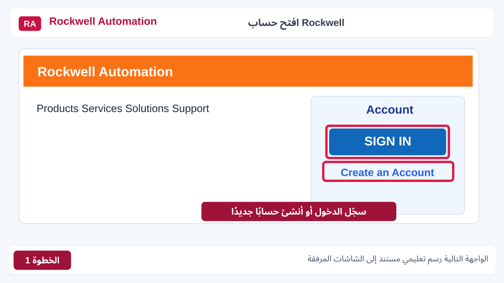</p>

<h3 align="right" dir="rtl"><a href="images/steps/02-university-email.svg"><strong>02 | تسجيل الدخول بالبريد الجامعي</strong></a></h3>

<p align="right" dir="rtl">اكتب البريد الجامعي واضغط <strong>Continue</strong>. استخدامه يساعد في التحقق من انتمائك للجامعة، لكنه ليس شرطًا مطلقًا من الشركة.</p>

<p align="center">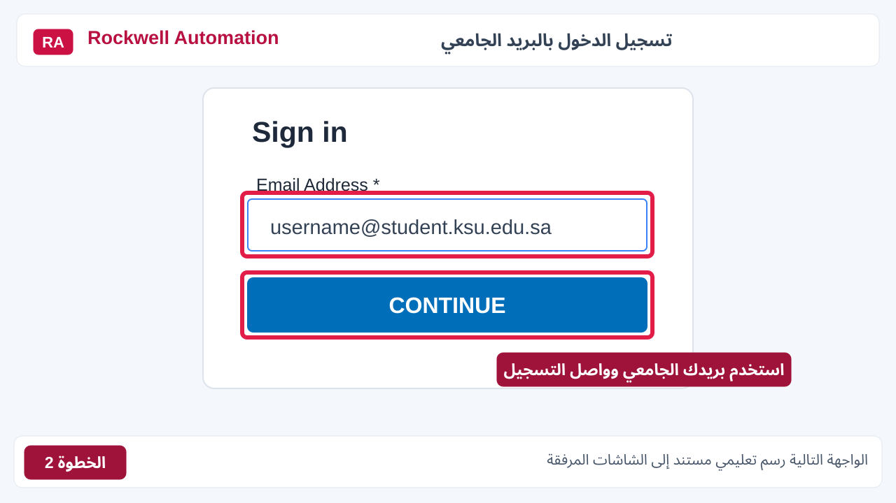</p>

<h3 align="right" dir="rtl"><a href="images/steps/03-my-account.svg"><strong>03 | فتح My Account</strong></a></h3>

<p align="right" dir="rtl">بعد تسجيل الدخول، افتح <strong>My Account</strong>. ستصل إلى الصفحة التي تعرض معلومات الحساب والطلبات.</p>

<p align="center">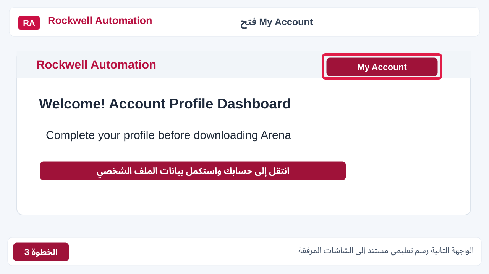</p>

<h3 align="right" dir="rtl"><a href="images/steps/04-complete-profile.svg"><strong>04 | إكمال بيانات الحساب</strong></a></h3>

<p align="right" dir="rtl">من القائمة الجانبية اختر <strong>Profile</strong> ثم <strong>Personal Information</strong>. أكمل الخانات الناقصة واحفظ البيانات قبل الانتقال للتحميل.</p>

<p align="center">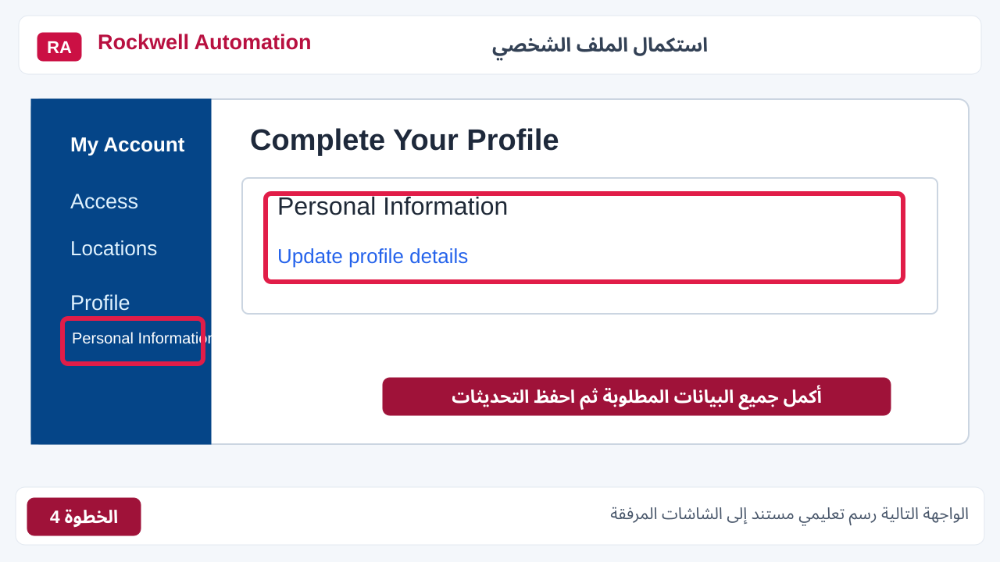</p>

<h3 align="right" dir="rtl"><a href="images/steps/05-approved-location.svg"><strong>05 | إضافة الجهة التعليمية</strong></a></h3>

<p align="right" dir="rtl">افتح <strong>Access → Locations</strong> وابحث عن <strong>King Saud University</strong>. إذا لم تجدها، استخدم <strong>Request Locations</strong> لإرسال طلب إضافتها. بعد الموافقة ستظهر حالة <strong>Approved</strong> بجانب اسم الجامعة.</p>

<p align="center">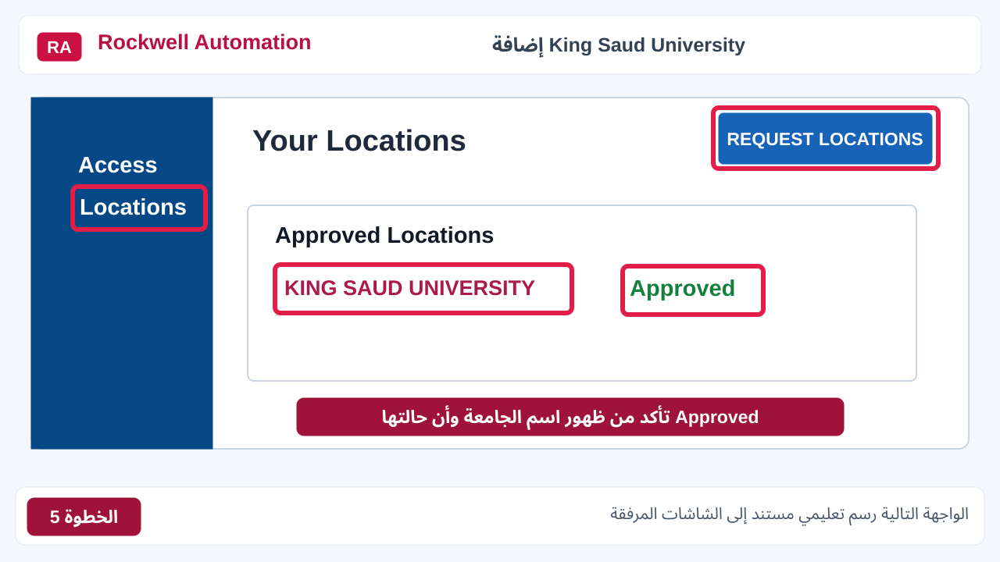</p>

<h3 align="right" dir="rtl"><a href="images/steps/06-arena-search.svg"><strong>06 | البحث عن Arena</strong></a></h3>

<p align="right" dir="rtl">يمكنك كتابة <strong>Arena</strong> في بحث موقع Rockwell واختيار صفحة التنزيل، أو الدخول من الرابط المباشر الموجود أعلى الصور.</p>

<p align="center">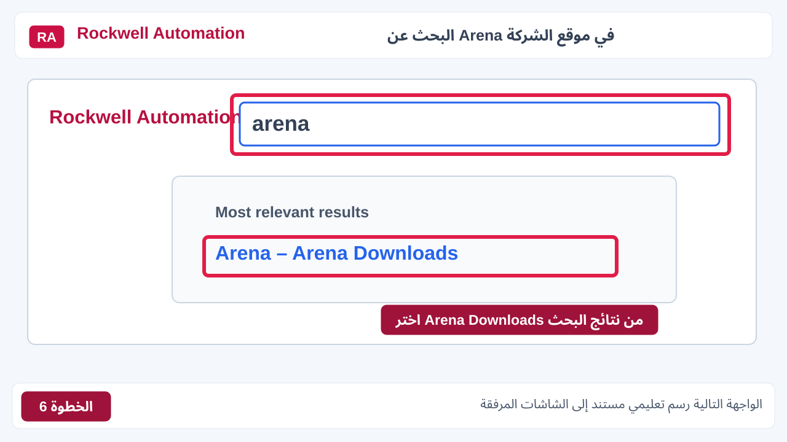</p>

<h3 align="right" dir="rtl"><a href="images/steps/07-arena-17-download.svg"><strong>07 | تحديد إصدار Arena 17.00.01</strong></a></h3>

<p align="right" dir="rtl">اختر الإصدار <strong>17.00.01</strong> وحدد الملف المناسب، ثم اضغط <strong>Download Selections</strong>. انتبه إلى كلمة <strong>Patch</strong> لأنها قد تعني تحديثًا لنسخة موجودة.</p>

<p align="center">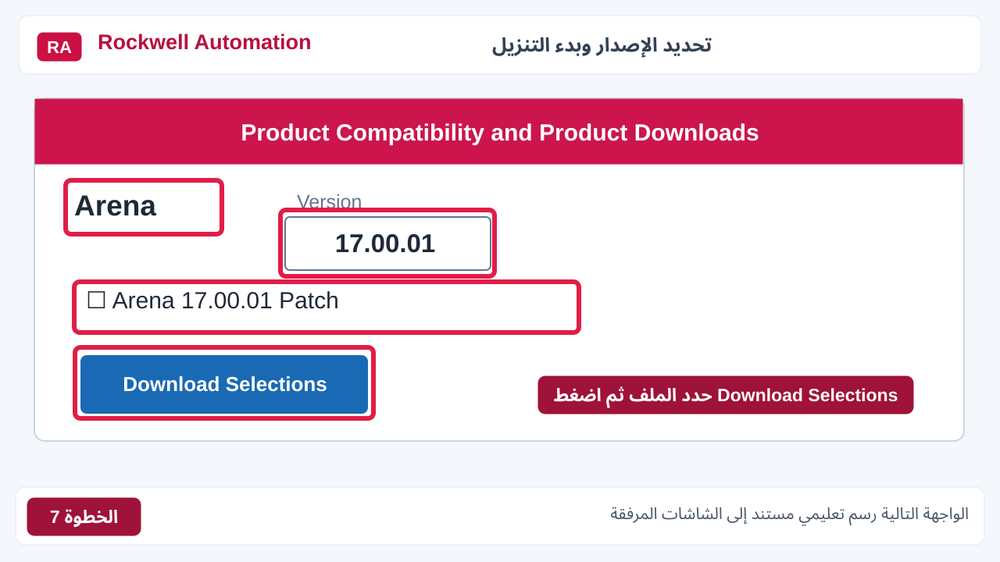</p>

<h3 align="right" dir="rtl"><a href="images/steps/08-accept-license.svg"><strong>08 | الموافقة على اتفاقية الترخيص</strong></a></h3>

<p align="right" dir="rtl">ستظهر اتفاقية الاستخدام. بعد قراءتها والموافقة عليها اضغط <strong>Accept and Download</strong>.</p>

<p align="center">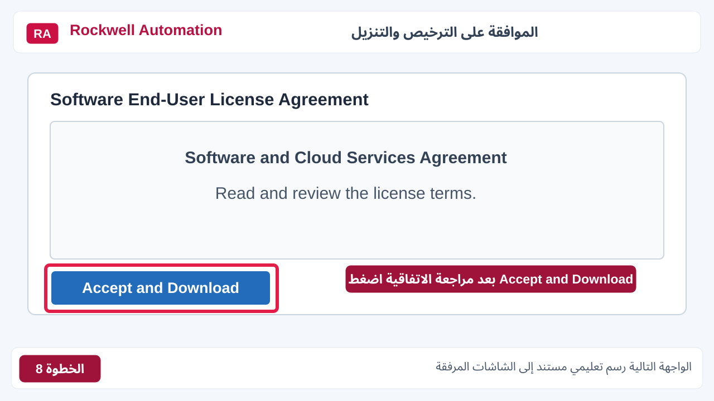</p>

<h3 align="right" dir="rtl"><a href="images/steps/09-save-download.svg"><strong>09 | حفظ مدير التنزيل</strong></a></h3>

<p align="right" dir="rtl">عند ظهور نافذة الحفظ، اختر مجلدًا يسهل الرجوع إليه واضغط <strong>Save</strong>. بعدها شغّل ملف التنزيل الرسمي.</p>

<p align="center">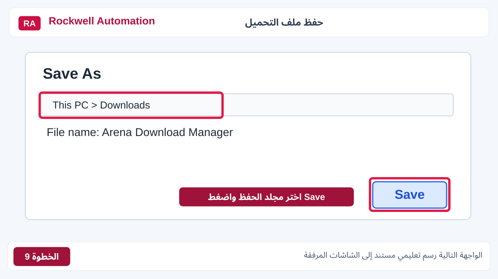</p>

<h3 align="right" dir="rtl"><a href="images/steps/10-drive-ra.svg"><strong>10 | الوصول إلى C:\RA</strong></a></h3>

<p align="right" dir="rtl">بعد اكتمال التحميل، افتح القرص <strong>C:</strong> ثم مجلد <strong>RA</strong>. ابحث عن مجلد الإصدار الذي نزلته، وفك الضغط إن كانت الملفات بصيغة ZIP.</p>

<p align="center">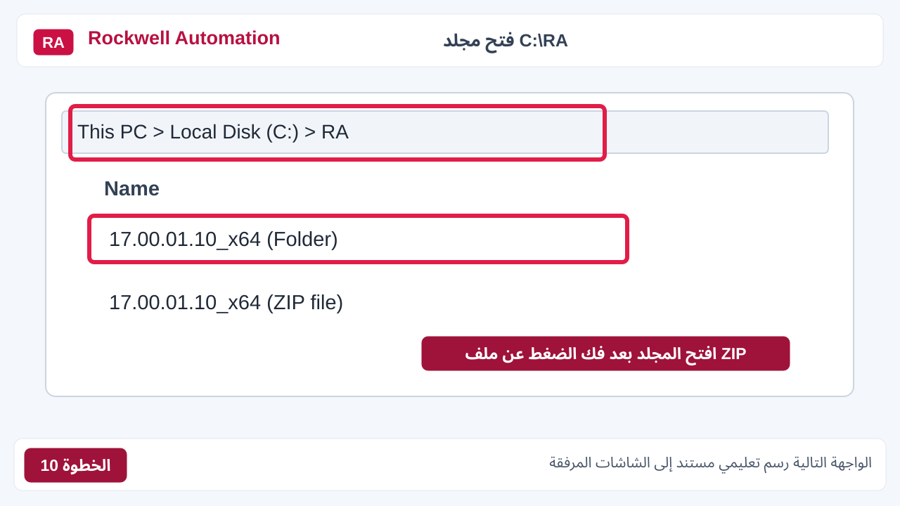</p>

<h3 align="right" dir="rtl"><a href="images/steps/11-mediaimage.svg"><strong>11 | فتح MediaImage</strong></a></h3>

<p align="right" dir="rtl">من المجلد المستخرج، افتح <strong>MediaImage</strong>. هذا هو المجلد الذي يحتوي على واجهة التثبيت.</p>

<p align="center">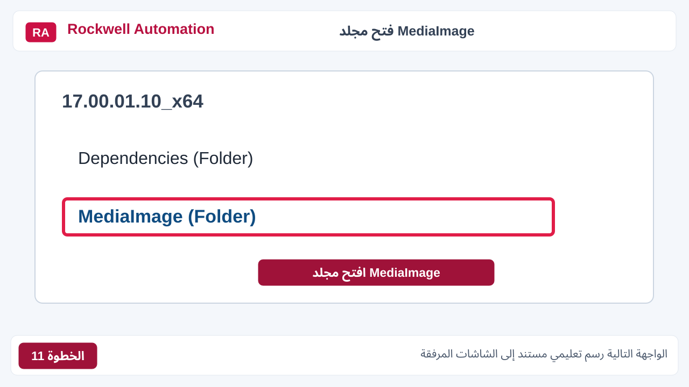</p>

<h3 align="right" dir="rtl"><a href="images/steps/12-autorun.svg"><strong>12 | تشغيل autorun.exe</strong></a></h3>

<p align="right" dir="rtl">ستجد ملفين قد يظهران باسم <strong>autorun</strong>. اختر الذي نوعه <strong>Application</strong> وليس <strong>Setup Information</strong>، ثم اضغط بزر الفأرة الأيمن واختر <strong>Run as administrator</strong>.</p>

<p align="center">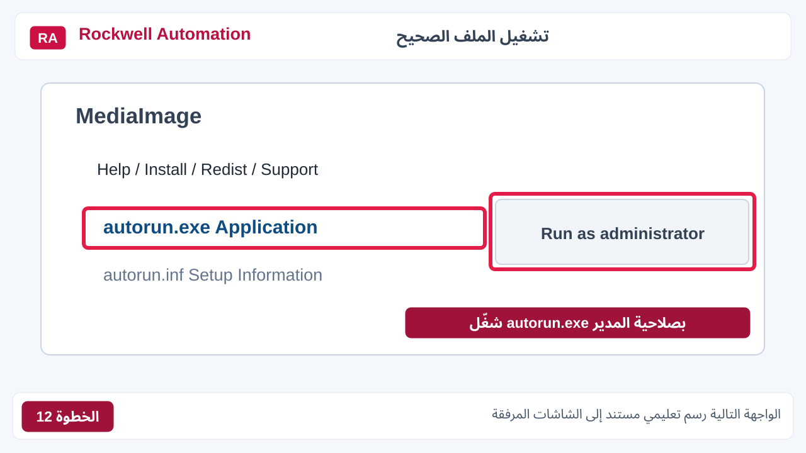</p>

<h3 align="right" dir="rtl"><a href="images/steps/13-install-arena.svg"><strong>13 | تثبيت Arena</strong></a></h3>

<p align="right" dir="rtl">عندما تظهر نافذة <strong>Arena 2026</strong> اضغط <strong>Install Arena</strong> وأكمل خطوات المثبّت. بعد الانتهاء افتح البرنامج وجرب نموذجًا بسيطًا.</p>

<p align="center">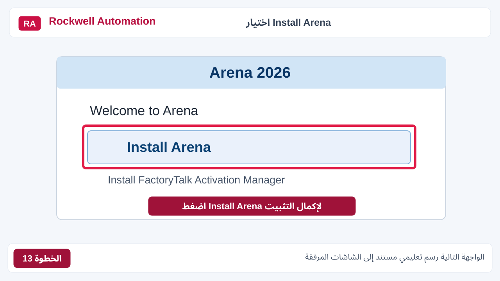</p>

**المصادر:** [Rockwell: شروط الحساب والتنزيل](https://www.rockwellautomation.com/en-us/products/software/arena-simulation/buying-options/download.html) | [فيديو الشرح المرجعي](https://youtu.be/apJPCLteJ0A?si=fJQ-PgGWp7WWCs_q).

### ملاحظتان بعد تنزيل الملفات

- ‏إذا نزلت الملفات داخل `C:\RA` كأرشيف مضغوط، **فك الضغط كاملًا** قبل تشغيل `autorun.exe`.
- ‏اتبع معالج التثبيت واختر الترخيص الذي توفره لك الجامعة أو نسخة الطالب، وأعد تشغيل Windows إذا طلب المثبّت ذلك.

<div align="right" dir="rtl">

### كيف أختار الترخيص؟

</div>

- ‏**Student**: توضح [Rockwell FAQ](https://www.rockwellautomation.com/en-us/products/software/arena-simulation/support/frequently-asked-questions.html) أن كلمة `STUDENT` يمكن إدخالها عندما يطلب مثبت نسخة الطالب رقمًا تسلسليًا، مع تطبيق حدود النموذج الأكاديمي وفق النسخة.
- ‏**ترخيص الجامعة أو الشركة**: استخدم بيانات الترخيص التي منحتها الجهة. قد يلزم **FactoryTalk Activation Manager** مع تراخيص المؤسسات. راجع التعليمات المتاحة داخل مثبت Arena.
- ‏ظهور واجهة Arena وحده ليس دليلًا على أن الترخيص نشط.

<div align="right" dir="rtl">

## 9. فحص الترخيص وتشغيل نموذج تجريبي

</div>

<div align="right" dir="rtl">

بعد التثبيت:

</div>

1. ‏افتح Arena.
2. ‏افتح `File > New` أو استخدم `Ctrl + N` لإنشاء نموذج جديد.
3. ‏تحقق من ظهور لوحة **Basic Process**. طريقة إظهار اللوحة قد تختلف باختلاف نسخة Arena؛ استخدم خيار Attach/Template Panel من قوائم Arena إذا كان متاحًا.
4. ‏ضع **Create** ثم **Process** ثم **Dispose** على مساحة النموذج.
5. ‏صِل الوحدات في اتجاه تدفق الكيانات.
6. ‏افتح إعدادات Process واضبط نشاطًا بسيطًا. تحقّق من صحة مداخل الوحدات ثم احفظ النموذج.
7. ‏جرّب أمر **Run / Go** وفق واجهة نسختك.
8. ‏إذا اشتغلت المحاكاة دون أخطاء، فهذا اختبار عملي أولي على أن الوظائف الأساسية تعمل.

<div align="right" dir="rtl">

إذا كانت أدوات النمذجة رمادية اللون، انتقل للخطوة التالية.

</div>

<div align="right" dir="rtl">

## 10. حل مشكلة الأدوات والقوائم غير المفعلة

</div>

<div align="right" dir="rtl">

إذا فتحت Arena ووجدت بعض القوائم أو الأدوات باللون الرمادي، جرّب الحلول التالية بالترتيب. **لا تحذف البرنامج قبل فحص السبب.**

</div>

| الحالة | الإجراء الأول |
| :---: | :---: |
| الصفحة فارغة أو الأدوات رمادية | افتح نموذجًا جديدًا `File > New` |
| البرنامج في وضع تشغيل محاكاة | أوقف/أنهِ التشغيل ثم أعد محاولة التحرير |
| لوحة Basic Process لا تظهر | افحص عرض لوحات القوالب وإرفاق Basic Process |
| البرنامج يعمل لكن بعض الوظائف محجوبة | افحص فئة الترخيص وحالة FactoryTalk Activation عند استخدامه |
| رسائل عن DLL أو Runtime | افحص نسخة Visual C++ المناسبة عبر الطريقة الثانية |
| رسالة عن .NET | افحص `Release` ثم ثبّت Runtime المطلوب فقط |
| خلل في تقارير Excel | افحص Office وتوافقه |
| تثبيت غير مكتمل أو رسائل Installer | جرّب Repair إن كان متاحًا، ثم إعادة التثبيت رسميًا بعد حفظ المشاريع |
| مشكلة مستمرة خاصة بـ Arena 17 | تحقق من متطلبات الإصدار الفرعية واطلب إرشادات Rockwell مع نص رسالة الخطأ |

<div align="right" dir="rtl">

### إذا استمرت المشكلة، ما المعلومات التي تفيد الدعم؟

</div>

- ‏رقم Arena الدقيق كما يظهر في About.
- ‏إصدار Windows ورقم البناء ومعمارية التطبيق.
- ‏هل يتم فتح `File > New` بنجاح؟
- ‏صورة الشاشة الكاملة للأدوات المعطلة.
- ‏نص رسالة الخطأ (إن ظهرت).
- ‏قائمة Visual C++ الصادرة من أمر PowerShell البديل (الأسماء والإصدارات فقط).

<div align="right" dir="rtl">

</div>

<div align="right" dir="rtl">

## 11. الأسئلة الشائعة والمراجع

</div>

<div align="right" dir="rtl">

### لماذا أمر WMIC لا يعمل؟

</div>

<div align="right" dir="rtl">

لأنه أداة قديمة أزالتها Microsoft من إصدارات Windows 11 المدعومة في 2026. استخدم أمر PowerShell من CMD في القسم الخامس. لا تحتاج إلى إعادة تثبيت WMIC.

</div>

<div align="right" dir="rtl">

### هل يجب تثبيت جميع الإصدارات القديمة من Visual C++؟

</div>

<div align="right" dir="rtl">

لا. ثبّت الحزم التي تتطلبها نسخة Arena أو التي يحددها سجل الخطأ. إصدارات x86 وx64 مختلفة، ولا يصح حذف الحزم القديمة دون سبب.

</div>

<div align="right" dir="rtl">

### هل برنامج Office 64-bit ضروري؟

</div>

<div align="right" dir="rtl">

لا يوجد أساس لتعميم هذا الشرط على جميع إصدارات Arena. اقرأ متطلبات النسخة لديك.

</div>

<div align="right" dir="rtl">

### هل تثبيت SQL Server Compact 4.0 آمن وضروري؟

</div>

<div align="right" dir="rtl">

هو منتج انتهى دعمه؛ لا تنصّبه إلا عند إثبات الحاجة ومع فهم المخاطر.

</div>

<div align="right" dir="rtl">

### هل هذه وثيقة رسمية لإصدار Arena 17؟

</div>

<div align="right" dir="rtl">

لا، هذه صفحة شرح أعددتها لمساعدة زملائي في تنزيل البرنامج وفحص المشكلات الشائعة. أما المتطلبات والملفات الرسمية فمصدرها **Rockwell Automation**. قد تشير بعض صفحات الشركة إلى 16.20.02، لذلك راجع وثائق الحزمة التي تنزلها.

</div>

<div align="right" dir="rtl">

### المصادر (روابط مباشرة)

</div>

1. ‏[Rockwell Automation — تنزيل Arena](https://www.rockwellautomation.com/en-us/products/software/arena-simulation/buying-options/download.html)
2. ‏[Rockwell Automation — متطلبات النظام وخطوات التثبيت](https://www.rockwellautomation.com/en-us/products/software/arena-simulation/support/system-requirements.html)
3. ‏[Rockwell Automation — الأسئلة الشائعة والتراخيص](https://www.rockwellautomation.com/en-us/products/software/arena-simulation/support/frequently-asked-questions.html)
4. ‏[Microsoft — إصدارات Visual C++ Redistributable](https://learn.microsoft.com/en-us/cpp/windows/latest-supported-vc-redist)
5. ‏[Microsoft — إزالة WMIC من Windows](https://support.microsoft.com/en-us/servicing/os/windows/docs/2025/09/windows-management-instrumentation-command-line-wmic-removal-from-windows)
6. ‏[Microsoft — فحص إصدارات .NET Framework](https://learn.microsoft.com/en-us/dotnet/framework/install/how-to-determine-which-versions-are-installed)
7. [Microsoft — .NET Framework 4.8.1 Runtime](https://dotnet.microsoft.com/en-us/download/dotnet-framework/net481)
8. [Microsoft — SQL Server Compact 4.0 SP1](https://www.microsoft.com/en-us/download/details.aspx?id=30709)
9. ‏[Microsoft — دورة حياة SQL Server Compact 4.0](https://learn.microsoft.com/en-us/lifecycle/products/microsoft-sql-server-compact-40)

<div align="right" dir="rtl">

#### مرجع إضافي

اطلعت أثناء إعداد الدليل على [شرح سابق لتجهيز Arena](https://github.com/M02lsayed/Arena/blob/main/README.md)،
واستفدت منه في تحديد بعض فحوصات Windows.

أما خطوات التسجيل والتثبيت والصور والأوامر البديلة، فوضعتها هنا بالتفصيل مع روابط الشركات الرسمية.

</div>

---

<div align="right" dir="rtl">

**حول النتائج:** المخرجات المعروضة أسفل الأوامر مجرد أمثلة لتعرف شكل النتيجة. الأرقام والإصدارات الفعلية ستظهر حسب جهازك.

</div>

<div align="right" dir="rtl">

الأوامر الموجودة هنا للقراءة والفحص فقط. إذا احتجت تثبيت مكوّن، ارجع إلى رابط الشركة الخاص به أولًا.

</div>

<div align="right" dir="rtl">

---

### إعداد الدليل

**Talal bin Ibrahim Alsultan**  
*Applied Information System • Data Science • Decision Sciences*  
King Saud University

[GitHub Profile](https://github.com/talalalsultan246-cell)

</div>
