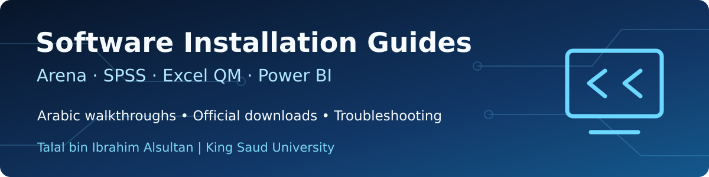

<div align="center">

<h1><strong>أدلة تحميل البرامج وتثبيتها واستخدامها</strong></h1>
<p><strong>إعداد:</strong> Talal Alsultan &nbsp; | &nbsp; <strong>آخر تحديث:</strong> 26 أكتوبر 2026</p>
<p>دليل عربي عملي لطلاب الجامعة والمهتمين بالمحاكاة والإحصاء والتحليل الكمي وذكاء الأعمال.</p>
</div>

---

<div dir="rtl" align="right">

## ابدأ من هنا

إذا كنت تحتاج برنامجًا في المقرر أو المشروع، اختره من الجدول التالي. ستجد شرحًا لما يستخدم فيه، ثم طريقة تحميله وتثبيته خطوة بخطوة، وبعدها تجربة عملية وحلولًا للمشكلات الشائعة. أرفقت روابط الشركات الأصلية حتى تتمكن من الوصول إلى النسخ والتعليمات المحدثة.

| البرنامج | محتويات الدليل | فتح الدليل |
| :---: | :---: | :---: |
| **Arena Simulation 17** | تسجيل حساب Rockwell، تنزيل البرنامج، الصور، التثبيت، Visual C++، الترخيص، معالجة الأعطال | **[دليل Arena](Arena%20Simulation%20%D8%AF%D9%84%D9%8A%D9%84.md)** |
| **IBM SPSS Statistics** | التحميل والتفعيل، صور واجهة البرنامج، الارتباط، الانحدار البسيط والمتعدد، وANOVA | **[دليل SPSS](guides/SPSS/README.md)** |
| **Excel QM / QM for Windows** | الفرق بين البرنامجين، التحميل من Pearson، الإضافة إلى Excel، أمثلة مسائل كمية | **[دليل Excel QM](guides/Excel-QM/README.md)** |
| **Power BI Desktop** | تحميل البرنامج، استيراد Excel، Power Query وDAX، إنشاء التقارير | **[دليل Power BI Desktop](guides/Power-BI-Desktop/README.md)** |
| **Power BI Report Server** | الفرق بين Desktop والخادم الداخلي، تنزيل PBIRS، النشر والصلاحيات والتحديث المجدول | **[دليل Power BI Report Server](guides/Power-BI-Report-Server/README.md)** |

## كيف أستخدم الأدلة؟

1. افتح اسم البرنامج من الجدول.
2. اقرأ فقرة **قبل التحميل** للتأكد من نوع البرنامج والترخيص المناسب.
3. استخدم رابط الشركة الرسمي، ثم اتبع خطوات التثبيت بالترتيب.
4. بعد تشغيل البرنامج، نفّذ المثال المبسط للتأكد من أن الوظائف الأساسية تعمل.
5. إذا ظهرت مشكلة، راجع قسم **الأخطاء الشائعة** في دليل البرنامج نفسه.

## نقطة مهمة في QM وPower BI

- **Excel QM** إضافة تعمل داخل Excel؛ أما **QM for Windows** فهو برنامج مستقل. لكل واحد طريقة تثبيت مختلفة.
- **Power BI Desktop** العادي ليس مطابقًا لنسخة **Power BI Desktop for Report Server**. إذا كان النشر على خادم داخلي، تأكد من توافق النسخة مع الخادم.
- الأدلة تعتمد على روابط ومعلومات من المصادر الرسمية. قد تتغير شاشات التنزيل أو أسماء الأزرار عند تحديث البرامج.

## ترتيب الملفات

```text
Software-Installation-Guides/
├── README.md                        <- الصفحة الرئيسية للأدلة
├── Arena Simulation دليل.md        <- الدليل المصور الحالي
├── assets/                          <- الغلاف
├── images/                          <- صور شرح Arena
└── guides/
    ├── SPSS/README.md
    ├── Excel-QM/README.md
    ├── Power-BI-Desktop/README.md
    └── Power-BI-Report-Server/README.md
```

## المراجع الرسمية الأساسية

- [Rockwell Automation](https://www.rockwellautomation.com/en-us/products/software/arena-simulation/buying-options/download.html)
- [IBM SPSS Statistics](https://www.ibm.com/products/spss-statistics/resources)
- [Pearson Excel OM/QM](https://media.pearsoncmg.com/ph/bp/bridgepages/bp_render_bridgepage/qam_13e/index.html)
- [Microsoft Power BI Desktop](https://learn.microsoft.com/en-us/power-bi/fundamentals/desktop-get-the-desktop)
- [Microsoft Power BI Report Server](https://learn.microsoft.com/en-us/power-bi/report-server/get-started)

---

**Talal Alsultan**  
نظم المعلومات • علم البيانات • علوم القرار  
King Saud University

</div>
