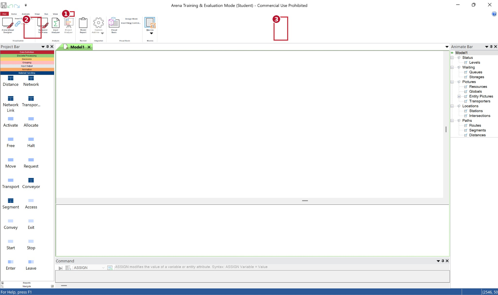

# دليل استخدام Arena Simulation 17 — الواجهة الحديثة والتطبيق على Call Center

**إعداد:** Talal bin Ibrahim Alsultan  
**آخر تحديث:** 27 أكتوبر 2026  
**الإصدار المستهدف:** Arena 17 بواجهة الشريط الحديث **Home · Animate · Draw · Run · View · Tools**.  

> هذا **دليل استخدام** مستقل عن [دليل تحميل وتثبيت Arena](README.md). تم تجنب الصور القديمة التي تعرض واجهة القوائم التقليدية، وحُذفت الخرائط التعليمية التقريبية. الصور الرسمية أو الخارجية المضافة تُوصف بمصدرها ولا تُقدَّم على أنها من جهاز الطالب. ويُراعى أن عنوان صور الجهاز الأصلية يظهر فيه **Training & Evaluation Mode (Student)**، ولا يعني ذلك امتلاك ترخيص تجاري كامل لـ Professional Edition.

في محاضرة يوم الأحد **25 أكتوبر 2026**، استعرض **الأستاذ الدكتور محمود الشربيني** واجهات Arena الأساسية وبعض طرق إنشاء نموذج أولي. يربط هذا الدليل بين واجهة الإصدار الحديث وبين مثال مركز الاتصالات الذي ورد في **الفصل الثاني** من شرائح المحاكاة.

## المحتويات

1. [الصورة العامة ومكونات النافذة](#arena-use-01)
2. [File — فتح وحفظ النموذج](#arena-use-02)
3. [Home — بناء النموذج](#arena-use-03)
4. [Animate — مشاهدة الكيانات](#arena-use-04)
5. [Draw — الرسم](#arena-use-05)
6. [Run — تشغيل المحاكاة](#arena-use-06)
7. [View — طريقة العرض](#arena-use-07)
8. [Tools — أدوات التحليل](#arena-use-08)
9. [Project Bar / Discrete Processing](#arena-use-10)
10. [Call Center: الشرائح والتوزيعات والقوانين](#arena-use-12)
11. [التطبيق خطوة بخطوة](#arena-use-13)
12. [قراءة النتائج](#arena-use-14)
13. [اختصارات مهمة](#arena-use-shortcuts)
14. [المراجع والصور](#arena-use-15)

---

## 1. النافذة الرئيسية: أين أجد الأدوات؟

**مصدر الصورة:** لقطة أصلية من واجهة **Arena 17 – Training & Evaluation Mode (Student)** على جهاز الطالب، مع ترقيم مواضع الأدوات.

| الموضع | وظيفته |
|---|---|
| **الأعلى: Home/Animate/Draw/Run/View/Tools** | اختيار الأدوات |
| **اليسار: Project Bar** | وحدات المحاكاة |
| **الوسط: Model Window** | مساحة إنشاء النموذج |
| **الأسفل: Spreadsheet View** | جدول خصائص الموارد والوحدات |
| **اليمين: Animate Bar** عند ظهوره | عناصر الحركة والمراقبة |
| **أسفل النافذة: Command/Status** | الرسائل وحالة التشغيل |

**قاعدة:** نضع الوحدات في **Model Window** ثم نوصلها بأداة **Connect**. قرب الوحدات من بعضها لا يعني اتصالها.

---

## 2. File — إنشاء النموذج وحفظه

**File → New → Blank Model** لإنشاء ملف جديد، و**Open** لفتح السابق، و**Save / Save As** لحفظه. اسم مقترح: \`Call_Center_Aly_Bander.doe\`.

---

## 3. Home — بناء النموذج

**الصورة الأصلية:** Home: (1) شريط الأدوات، (2) Project Bar، (3) مساحة النموذج، (4) جدول الخصائص، (5) Animate Bar، (6) Connect.

**ما الذي تبحث عنه في صورة Home؟**

- **Attach/Detach:** إظهار اللوحات داخل Project Bar.
- **Select/Zoom/Pan:** التحديد والتكبير والتنقل.
- **Connect:** ربط وحدات النموذج بمسار فعلي.
- **Auto-Connect:** وصل تلقائي عند سحب الوحدة إذا كان الخيار مفعلًا.
- **Check Model / Expression Builder / Manuals:** فحص النموذج والتعبيرات وفتح الأدلة إذا كانت هذه الأوامر ظاهرة.

**جرب:** اسحب \`Create\` ثم \`Process\` ثم \`Dispose\`، واستخدم \`Connect\` لربطها من اليسار إلى اليمين.

---

## 4. Animate — الحركة أثناء التشغيل

**الصورة الأصلية:** Animate: متابعة الحركة والعدادات وحالة الموارد.

تُستخدم أدوات **Animate** لتمثيل حركة الكيانات وحالة الموظفين والطوابير والعدادات أثناء المحاكاة. في المثال: **المكالمة** كيان، و**Aly / Bander** موارد.

**ملاحظة:** حركة النموذج تساعد في التحقق بصريًا، لكن متوسط زمن الانتظار يُستخرج من نتائج التشغيل.

---

## 5. Draw — إضافة الرسم والعناوين

**الصورة الأصلية:** Draw: كتابة النصوص ورسم الأشكال التوضيحية.

استخدم **Text** لعنوان النموذج، و**Line / Rectangle / Ellipse** لتوضيح الأقسام. **Draw Line ليس Connect**؛ الأول للرسم، والثاني لمسار الكيانات الفعلي.

---

## 6. Run — تشغيل المحاكاة

**الصورة الأصلية:** Run: تشغيل النموذج، والتحقق منه، وتحديد فترة المحاكاة.

1. افتح **Run → Check Model**.
2. افتح **Run → Setup**.
3. حدد وحدات الزمن و**Replication Length** و**Number of Replications**.
4. اضغط **Go**، ثم راجع **Reports**.

**انتبه:** \`480 Minutes\` تعني ثماني ساعات **محاكاة**، بينما جدول المحاضرة الأصلي لعدد **100 مكالمة**. لا تقارن النتائج قبل توحيد عدد المكالمات وسياسة انتهاء التشغيل.

---

## 7. View — التحكم في العرض

**الصورة الأصلية:** View: التكبير والتصغير وإظهار اللوحات.

**Zoom / Fit / Pan** لتغيير حجم واتجاه رؤية النموذج؛ ويمكن إظهار أو إخفاء مناطق الواجهة وفق إعدادات النسخة. إذا اختفى **Spreadsheet View** فتأكد من الفاصل السفلي القابل للسحب.

---

## 8. Tools — التحليل والمساعدة

**الصورة الأصلية:** Tools: التحليل والإعدادات والأدوات المساعدة.

توجد أدوات مثل **Input Analyzer** لملاءمة توزيعات البيانات، وأدوات مقارنة المخرجات و**OptQuest** بحسب الترخيص. لا تفترض أن كل إضافة موجودة لدى المستخدم.

للحصول على الدليل المثبت مع النسخة، راجع **Arena Product Manuals** من واجهة البرنامج أو **Arena Help**.

---

## 9. Project Bar → Discrete Processing

**الصورة الأصلية:** Discrete Processing: وحدات Create وProcess وDispose المستخدمة في نموذج مركز الاتصالات.

| الوحدة | وظيفتها في مركز الاتصالات |
|---|---|
| **Create** | توليد المكالمات |
| **Assign** | إعطاء خاصية للمكالمة |
| **Process** | خدمة المتصل وإدارة المورد والطابور عند ضبطه |
| **Seize** | حجز موظف متاح |
| **Delay** | زمن المعالجة |
| **Release** | تحرير الموظف |
| **Dispose** | خروج المكالمة |

**الفرق:** \`Process: Seize Delay Release\` يجمع حجز الموظف ثم خدمته ثم تحريره. أما \`Delay\` وحدها فلا تمثل تلقائيًا انتظار الموظف المشغول.

---

## 10. مثال Call Center — مصدر المثال، الشريحة والقانون

**المصدر الأساسي للمثال:** *Chapter 2 — Simulation Examples*، **Example 2: Call Center Problem**، من شرائح المحاكاة المقدمة في المقرر. الموظف **Aly** أسرع في الخدمة من **Bander**.

| الفصل | الشريحة المطبوعة | ما الذي نأخذه؟ |
|---|---|---|
| **Chapter 2** | **1.2** | شرح الموظفين وثلاث سياسات للتوجيه |
| Chapter 2 | **1.3** | جدول احتمالات الوصول والخدمة |
| Chapter 2 | **1.4** | طريقة حساب الوصول والانتظار والخدمة |
| Chapter 2 | **1.5** | نتائج مثال المحاضرة لعدد 100 مكالمة |
| Chapter 2 | **1.6** | بعض إحصاءات الانتظار |
| Chapter 2 | **1.7** | سياسات بديلة: Bander أولًا، أو اختيار عشوائي |
| Chapter 2 | **1.8** | خوارزمية **Bander أولًا**، وليس التوزيع العشوائي |
| **Chapter 6 — Random-Number Generation** | **6.7** | الانتظام والاستقلال، \`R ~ U(0,1)\` |
| Chapter 6 | **6.16–6.18** | **Linear Congruential Method** |
| **Chapter 7 — Random-Variate Generation** | **7.7** | **Inverse-Transform Technique** |
| Chapter 7 | **7.8–7.10** | أمثلة توليد زمن أُسي للتوضيح النظري، **وليست** توزيعات الكول سنتر |

### جدول الاحتمالات — Chapter 2, Slide 1.3

| المتغير | الأزمنة بالدقائق | الاحتمالات | التراكمية |
|---|---|---|---|
| **الفترة بين وصول المكالمات** | 1، 2، 3، 4 | .25، .40، .20، .15 | .25، .65، .85، 1.00 |
| **خدمة Aly** | 2، 3، 4، 5 | .30، .28، .25، .17 | .30، .58، .83، 1.00 |
| **خدمة Bander** | 3، 4، 5، 6 | .35، .25، .20، .20 | .35، .60، .80، 1.00 |

**تعبيرات Arena الملائمة لهذه البيانات المتقطعة** (مشتقة من جدول المحاضرة):

**Interarrival Time**
\`\`\`text
DISC(0.25,1, 0.65,2, 0.85,3, 1.00,4)
\`\`\`
**Aly Service Time**
\`\`\`text
DISC(0.30,2, 0.58,3, 0.83,4, 1.00,5)
\`\`\`
**Bander Service Time**
\`\`\`text
DISC(0.35,3, 0.60,4, 0.80,5, 1.00,6)
\`\`\`

لا تستبدل هذه التوزيعات بـ \`EXPO(6)\` أو \`TRIA(2,4,6)\` إذا كان الهدف تنفيذ مثال المحاضرة نفسه؛ كانت تلك قيمًا افتراضية لمثال مختلف.

### القوانين التي يعتمد عليها المثال

**الفصل السادس، الشريحتان 6.16 و6.17: مولد الأرقام شبه العشوائية**

\`\`\`text
X(i+1) = (a × X(i) + c) mod m
R(i) = X(i) / m
\`\`\`

حيث \`a\` معامل الضرب، \`c\` الزيادة، \`m\` المقياس، و\`X(0)\` البذرة. المعادلة للتفسير العلمي؛ **لا تُعد إعدادًا يثبت أن Arena يستخدم المعاملات الموضحة في المحاضرة**.

**الفصل السابع، الشريحة 7.7: تحويل المتغير العشوائي**

\`\`\`text
X = F⁻¹(R)
For discrete X: choose the smallest x with F(x) ≥ R
\`\`\`

**مثال:** إذا كان \`R = 0.69\` فإن زمن ما بين الوصولات **3 دقائق**، وزمن خدمة Aly **4 دقائق**، وخدمة Bander **5 دقائق**، لأن القيمة تقع داخل المجالات التراكمية المقابلة.

**الفصل الثاني، الشريحة 1.4: قوانين الكول سنتر**

\`\`\`text
Arrival(k) = Arrival(k−1) + Interarrival(k)
Waiting(k) = ServiceStart(k) − Arrival(k)
Finish(k) = ServiceStart(k) + ServiceTime(k)
TimeInSystem(k) = Finish(k) − Arrival(k)
AverageWaiting = Sum(Waiting(k)) / N
\`\`\`

### سيناريوهات المحاضرة

| السيناريو | السياسة |
|---|---|
| **Scenario 1: Aly First** | عند توافر الاثنين، تكون الأولوية لـ Aly |
| **Scenario 2: Bander First** | عند توافر الاثنين، تكون الأولوية لـ Bander |
| **Scenario 3: Random** | اختيار متاح عشوائيًا؛ في التطبيق المتساوي **50% Aly / 50% Bander** عند توافر الاثنين |

**تنبيه:** طلبت الشريحة 1.7 قاعدة الاختيار العشوائي. أما افتراض تساوي الاحتمال **50/50** فهو تحديد تنفيذي للسيناريو الثالث؛ لا تُنسب له نتائج رقمية من الشريحة 1.5 لأن نتائجها تخص تجربة أخرى. وإذا كان أحد الموظفين فقط متاحًا تُعطى المكالمة له، وإذا كان الاثنان مشغولين تدخل في الطابور.

---

## 11. التطبيق في Arena: من Create إلى Dispose

### الخطوة 1 — Create: دخول المكالمة
- **File → New → Blank Model**.
- **Project Bar → Discrete Processing → Create**.
- الاسم: \`Caller Arrivals\`، ونوع الكيان: \`Caller\`.
- **Time Between Arrivals → Type: Expression**، ثم أدخل:
\`\`\`text
DISC(0.25,1, 0.65,2, 0.85,3, 1.00,4)
\`\`\`
- **Units: Minutes**؛ **Entities per Arrival: 1**.

### الخطوة 2 — تعريف الموارد
- من بيانات الموارد **Resource** أنشئ \`Aly\` و\`Bander\`، مع **Capacity = 1** لكل موظف.
- من **Set** أنشئ \`SupportTeam\` يضم \`Aly\` و\`Bander\`، إذا كانت هذه الوحدة في قالب البيانات الملحق.

### الخطوة 3 — Process
- أضف \`Process\` باسم \`Handle Call\`.
- **Action = Seize Delay Release**.
- اختر موردًا من المجموعة \`SupportTeam\`، مع **Selection Rule = Random** بين الموارد المتاحة عند توافر الخيار في إصدارك.
- احفظ هوية الموظف المختار في **Attribute** لتطبيق توزيع زمن الخدمة الخاص به؛ راجع **Expression Builder** لاختبار التعبير الشرطي وربطه بفهرس المورد الذي تُرجعه نسختك.

> **حد التحقق:** لم يُنفذ النموذج فعليًا داخل نسخة Arena على جهاز الطالب في هذه المحادثة؛ لذلك اختيار العضو العشوائي وحفظ فهرسه وتخصيص توزيعين مختلفين هما **خطوات إعداد تحتاج اختبارًا**، ولا أدعي أنها ملف نموذج \`.doe\` جاهز أو مخرجات فعلية. لا تنشئ طابورين مستقلين للمكالمات دون التصريح بتغيير سياسة الانتظار الأصلية.

### الخطوة 4 — Dispose والربط
أضف \`Dispose\` باسم \`Call Completed\`، ثم صِل:

\`\`\`text
Create: Caller Arrivals  →  Process: Handle Call  →  Dispose: Call Completed
\`\`\`

### الخطوة 5 — التشغيل
- **Run → Check Model** للتحقق من التعابير والوصلات والموارد.
- **Run → Setup** لضبط الزمن والتكرارات.
- **Go** للتشغيل، ثم قراءة تقارير الأداء.
- لتكرار **100 مكالمة** كما في الشريحة 1.5 يجب التحكم في عدد الواصلين ومصير المكالمات الموجودة في النظام عند التوقف، وليس الاكتفاء بفترة ثابتة عشوائية.

---

## 12. قراءة النتائج

| المؤشر | معناه |
|---|---|
| **Average Waiting Time** | متوسط انتظار المتصل |
| **Number Waiting** | عدد المكالمات في الطابور |
| **Time in System** | الزمن من الوصول حتى الانتهاء |
| **Utilization — Aly** | نسبة انشغال Aly |
| **Utilization — Bander** | نسبة انشغال Bander |
| **Number Out** | عدد المكالمات التي غادرت النظام |

للمقارنة العلمية بين السيناريوهات الثلاثة ثبّت توزيعات الوصول والخدمة ووحدات الزمن وشروط انتهاء التشغيل وعدد التكرارات، ثم قارن المتوسطات وعدم اليقين، لا التشغيل المنفرد فقط.

---

## 13. اختصارات ومسارات سريعة

| الأمر | استخدامه |
|---|---|
| **Ctrl + S** | حفظ النموذج |
| **File → New** | إنشاء نموذج |
| **Home → Connect** | ربط الوحدات |
| **Run → Check Model** | التحقق قبل التشغيل |
| **Run → Setup** | إعداد التشغيل |
| **Run → Go** | بدء المحاكاة |
| **Arena Product Manuals / Help** | أدلة البرنامج المثبتة |

> يختلف موضع بعض الأوامر والاختصارات بين إعدادات الإصدارات. اعتمد اسم الأمر الظاهر عندك إذا اختلف مكانه.

---

## 14. المراجع والصور

**مواد المقرر المقدمة من الطالب:**
- محمود الشربيني، *Chapter 2 — Simulation Examples*, Example 2: Call Center Problem، الشرائح المطبوعة **1.2–1.8**. ملف: \`Ch02_Call_Center_Scenarios_Highlighted.pptx\`، مواد مقرر غير منشورة.
- *Chapter 6 — Random-Number Generation*، خاصة الشرائح **6.7** و**6.16–6.18**. ملف: \`06 Random-Number Generation simulation Mah Final(4).pptx\`.
- *Chapter 7 — Random-Variate Generation*، خاصة الشرائح **7.7–7.10**. ملف: \`07 Random-Variate Generation Mah Final [Autosaved](2).pptx\`.

**مصادر البرنامج والصورة الحديثة:**
- [Rockwell Automation — صفحة تنزيل Arena Professional Edition](https://www.rockwellautomation.com/en-us/products/software/arena-simulation/buying-options/download.html).
- [Rockwell Automation — خيارات Arena Professional Edition وDemo/Academic](https://www.rockwellautomation.com/en-us/products/software/arena-simulation/buying-options.html).
- صور واجهة Arena 17 الأصلية التي أرسلها الطالب، محفوظة في مجلد `guides/Arena/images` بالمستودع.

**ملاحظة الصور:** جميع اللقطات السبع أصلية من جهاز الطالب، وقد رُفعت كملفات صور فعلية داخل المستودع، ووُضعت كل لقطة في القسم الذي يشرحها.

