<div dir="rtl" align="right">

# دليل استخدام Arena Simulation

**آخر تحديث:** 27 أكتوبر 2026  
**الإصدار المستهدف:** Arena Simulation 17.

> هذا **دليل استخدام** مستقل عن [دليل تحميل وتثبيت Arena](https://github.com/talalalsultan246-cell/Arena-Simulation-Arabic-Guide/blob/main/guides/Arena/README.md).

في محاضرة يوم الأحد **25 أكتوبر 2026**، استعرض **الأستاذ الدكتور محمود الشربيني مشكوراً** واجهات Arena الأساسية وبعض طرق إنشاء نموذج أولي. يربط هذا الدليل بين واجهة **Arena Simulation 17** وبين مثال **Call Center Problem = مسألة مركز الاتصالات** الوارد في **Chapter 2: Simulation Examples = الفصل الثاني: أمثلة المحاكاة**.


## المحتويات

1. [الواجهة الرئيسية](#arena-use-01)
2. [File](#arena-use-02)
3. [Home](#arena-use-03)
4. [Animate](#arena-use-04)
5. [Draw](#arena-use-05)
6. [Run](#arena-use-06)
7. [View](#arena-use-07)
8. [Tools](#arena-use-08)
9. [Discrete Processing](#arena-use-10)
10. [مصطلحات واجهة Arena](#arena-use-glossary)
11. [مثال Call Center من Chapter 2](#arena-use-12)
12. [تنفيذ المثال داخل Arena](#arena-use-13)
13. [تشغيل النموذج وقراءة النتائج](#arena-use-14)
14. [الأوامر السريعة](#arena-use-shortcuts)
15. [مصادر البرنامج](#arena-use-15)

---

<a id="arena-use-01"></a>
## 1. الواجهة الرئيسية — Home

<div align="center">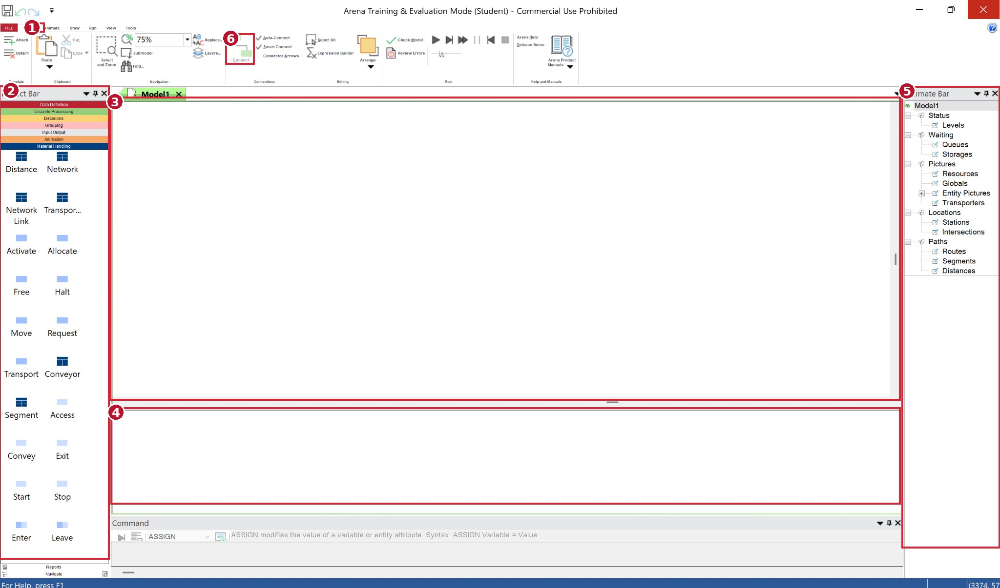</div>

**الأرقام في الصورة:**

<p dir="rtl" align="right"><strong>(1)</strong> <strong>Home = التبويب الرئيسي:</strong> أدوات تحرير نموذج المحاكاة والتحكم في عرضه وربط الوحدات.</p>
<p dir="rtl" align="right"><strong>(2)</strong> <strong>Project Bar = لوحة المشروع:</strong> تعرض مجموعات الوحدات التي تستخدم في إنشاء النموذج.</p>
<p dir="rtl" align="right"><strong>(3)</strong> <strong>Model Window = نافذة النموذج:</strong> المساحة البيضاء التي تسحب إليها الوحدات وترسم فيها تسلسل العمليات.</p>
<p dir="rtl" align="right"><strong>(4)</strong> <strong>Spreadsheet View = عرض الجداول:</strong> إدخال خصائص الوحدات والموارد ومراجعتها.</p>
<p dir="rtl" align="right"><strong>(5)</strong> <strong>Animate Bar = لوحة الحركة:</strong> تعرض عناصر الحركة مثل Queues وResources وEntity Pictures.</p>
<p dir="rtl" align="right"><strong>(6)</strong> <strong>Connect = توصيل الوحدات:</strong> ترسم مسار انتقال الكيان من وحدة إلى أخرى.</p>

---

<a id="arena-use-02"></a>
## 2. File — الملفات والحفظ

- **New = جديد:** إنشاء نموذج.
- **Open = فتح:** فتح نموذج محفوظ.
- **Save / Save As = حفظ / حفظ باسم:** حفظ نموذج Arena بامتداد .doe.

---

<a id="arena-use-03"></a>
## 3. Home — أدوات بناء النموذج

<div align="center"></div>

**الأرقام في الصورة:**

<p dir="rtl" align="right"><strong>(1)</strong> <strong>Home:</strong> التبويب الرئيسي.</p>
<p dir="rtl" align="right"><strong>(2)</strong> <strong>Project Bar:</strong> اختيار وحدات المحاكاة من اللوحة اليسرى.</p>
<p dir="rtl" align="right"><strong>(3)</strong> <strong>Model Window:</strong> سحب الوحدات إلى منطقة بناء النموذج.</p>
<p dir="rtl" align="right"><strong>(4)</strong> <strong>Spreadsheet View:</strong> تعديل البيانات والخصائص.</p>
<p dir="rtl" align="right"><strong>(5)</strong> <strong>Animate Bar:</strong> عرض عناصر الحركة.</p>
<p dir="rtl" align="right"><strong>(6)</strong> <strong>Connect:</strong> ربط مخرج الوحدة الأولى بمدخل الوحدة التالية.</p>

**مثال سريع:** اسحب Create ثم Process ثم Dispose إلى Model Window، واستخدم Connect لتوصيلها بالترتيب.

---

<a id="arena-use-04"></a>
## 4. Animate — عرض الحركة

<div align="center">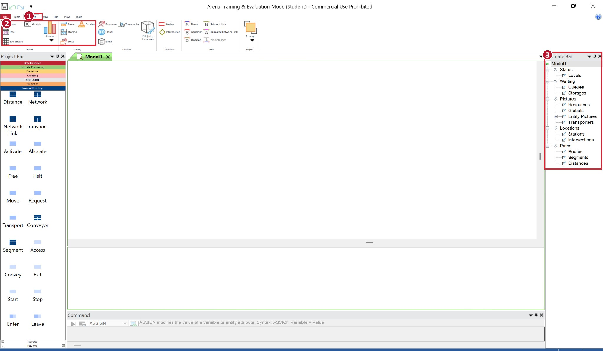</div>

**الأرقام في الصورة:**

<p dir="rtl" align="right"><strong>(1)</strong> <strong>Animate:</strong> التبويب المخصص لعناصر عرض الحركة.</p>
<p dir="rtl" align="right"><strong>(2)</strong> <strong>Status / Waiting / Queue / Resource:</strong> مجموعات لعرض الحالة والطوابير والموارد أثناء المحاكاة.</p>
<p dir="rtl" align="right"><strong>(3)</strong> <strong>Animate Bar:</strong> القائمة اليمنى التي تجمع عناصر الحركة مثل Levels وQueues وResources.</p>

في نموذج Call Center يمكن إظهار حالة الموظفين وعدد المكالمات المنتظرة أثناء التشغيل.

---

<a id="arena-use-05"></a>
## 5. Draw — الرسم

<div align="center">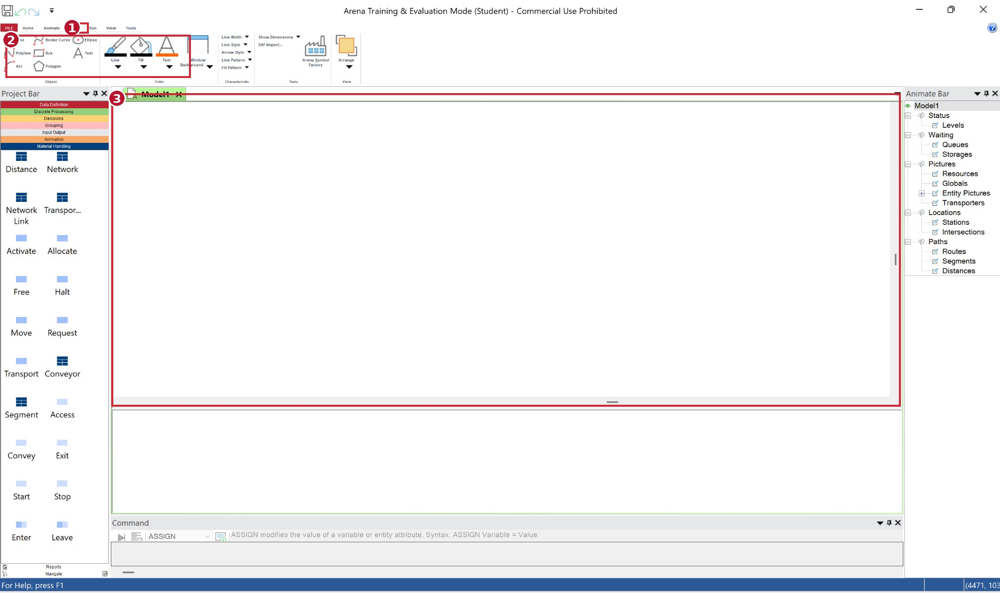</div>

**الأرقام في الصورة:**

<p dir="rtl" align="right"><strong>(1)</strong> <strong>Draw:</strong> تبويب رسم العناصر التوضيحية.</p>
<p dir="rtl" align="right"><strong>(2)</strong> <strong>Line / Fill / Text / Shapes:</strong> رسم الخطوط والأشكال وإضافة النصوص وتنسيقها.</p>
<p dir="rtl" align="right"><strong>(3)</strong> <strong>Model Window:</strong> المكان الذي تظهر فيه الرسوم إلى جانب وحدات النموذج.</p>

استخدم Text لإضافة عنوان Call Center أعلى الرسم. خطوط Draw للتوضيح؛ أما توصيل مسار المكالمات فيتم بواسطة Connect.

---

<a id="arena-use-06"></a>
## 6. Run — التشغيل

<div align="center">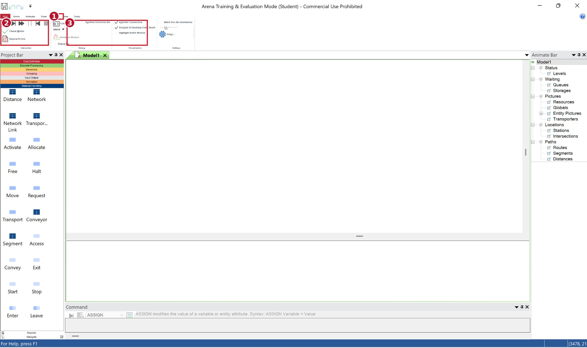</div>

**الأرقام في الصورة:**

<p dir="rtl" align="right"><strong>(1)</strong> <strong>Run:</strong> تبويب تشغيل المحاكاة.</p>
<p dir="rtl" align="right"><strong>(2)</strong> <strong>Go / Pause / Stop / Check Model / Review Errors:</strong> بدء التشغيل والتحكم به وفحص الأخطاء.</p>
<p dir="rtl" align="right"><strong>(3)</strong> <strong>Debug / Visualization:</strong> أدوات متابعة المحاكاة والعناصر المتحركة.</p>

**Run → Setup** يفتح إعدادات التشغيل مثل Replication Length وNumber of Replications.

---

<a id="arena-use-07"></a>
## 7. View — العرض

<div align="center">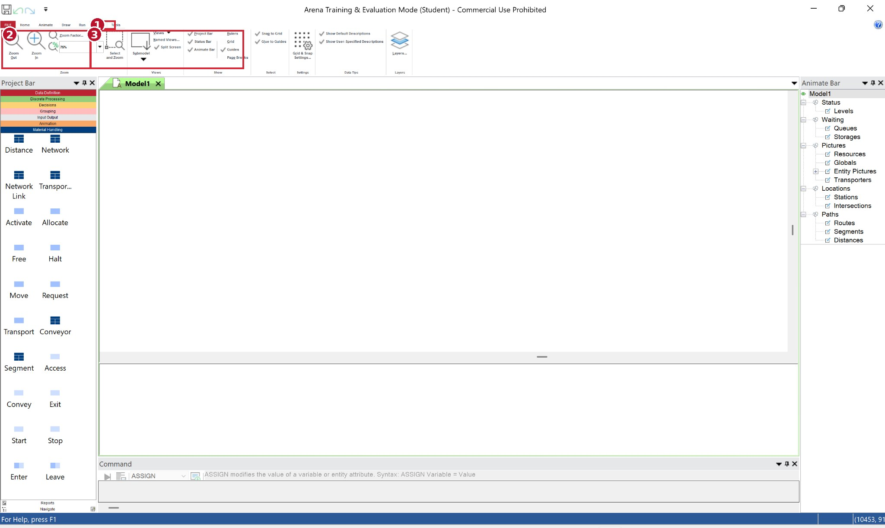</div>

**الأرقام في الصورة:**

<p dir="rtl" align="right"><strong>(1)</strong> <strong>View:</strong> تبويب إعدادات العرض.</p>
<p dir="rtl" align="right"><strong>(2)</strong> <strong>Zoom In / Zoom Out / Zoom Factor:</strong> تكبير نموذج المحاكاة وتصغيره.</p>
<p dir="rtl" align="right"><strong>(3)</strong> <strong>Views / Project Bar / Status Bar / Animate Bar:</strong> إظهار مناطق البرنامج وتنظيم طريقة العرض.</p>

---

<a id="arena-use-08"></a>
## 8. Tools — الأدوات

<div align="center">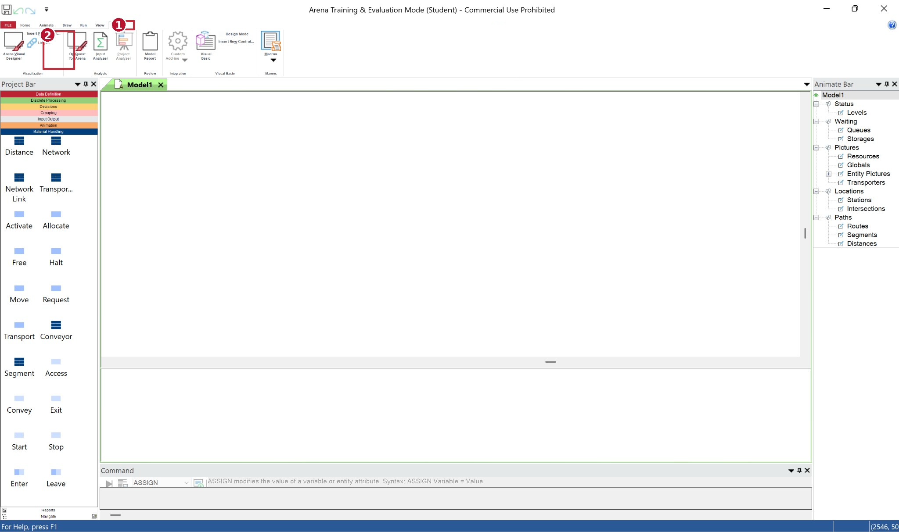</div>

**الأرقام في الصورة:**

<p dir="rtl" align="right"><strong>(1)</strong> <strong>Tools:</strong> تبويب الأدوات المساعدة.</p>
<p dir="rtl" align="right"><strong>(2)</strong> <strong>Object Transfer to Arena:</strong> أداة ضمن مجموعة الربط والتكامل الموجودة يسار الشريط.</p>

من هذا التبويب يمكن الوصول إلى أدوات مثل Input Analyzer وModel Report حسب الأدوات الظاهرة في الشاشة.

---

<a id="arena-use-10"></a>
## 9. Discrete Processing — وحدات بناء النموذج

<div align="center">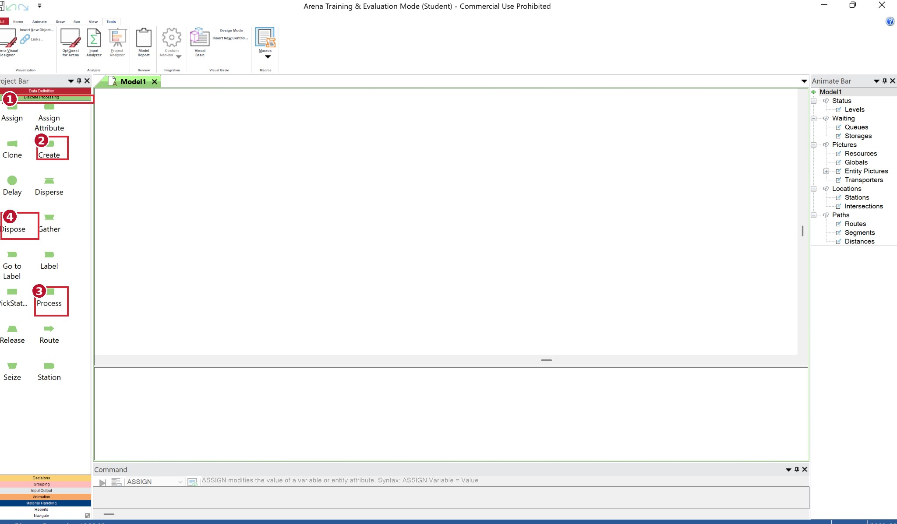</div>

**الأرقام في الصورة:**

<p dir="rtl" align="right"><strong>(1)</strong> <strong>Discrete Processing:</strong> اللوحة التي تضم وحدات مسار الكيانات.</p>
<p dir="rtl" align="right"><strong>(2)</strong> <strong>Create:</strong> إنشاء المكالمات أو الكيانات عند وصولها.</p>
<p dir="rtl" align="right"><strong>(3)</strong> <strong>Process:</strong> تنفيذ عملية الخدمة. يمكنها أن تحجز موردًا وتؤخر الكيان وتحرره حسب إعداد Action.</p>
<p dir="rtl" align="right"><strong>(4)</strong> <strong>Dispose:</strong> إنهاء مسار الكيان بعد اكتمال الخدمة.</p>

تحتوي اللوحة أيضًا على وحدات **Seize = حجز مورد**، **Delay = وقت الخدمة**، **Release = تحرير مورد**. في التطبيق أدناه تنفذ وحدة **Process** العمليات الثلاث بإعداد **Seize Delay Release**، وتختار زمن الخدمة وفق الموظف الذي حجزته المكالمة.

---

<a id="arena-use-glossary"></a>
## 10. مصطلحات واجهة Arena

| English | العربية |
|---|---|
| **Home** | التبويب الرئيسي |
| **Animate** | عرض الحركة |
| **Draw** | الرسم |
| **Run** | التشغيل |
| **View** | العرض |
| **Tools** | الأدوات |
| **Project Bar** | لوحة المشروع |
| **Model Window** | نافذة بناء النموذج |
| **Spreadsheet View** | عرض البيانات والخصائص |
| **Animate Bar** | لوحة الحركة |
| **Discrete Processing** | لوحة وحدات العمليات |
| **Create** | إنشاء كيان |
| **Seize** | حجز مورد |
| **Delay** | تنفيذ تأخير زمني |
| **Release** | تحرير مورد |
| **Process** | تنفيذ عملية |
| **Dispose** | إخراج الكيان من النموذج |
| **Resource** | مورد |
| **Set** | مجموعة موارد |
| **Save Attribute** | حفظ خاصية على الكيان |
| **Connect** | توصيل الوحدات |
| **Check Model** | فحص النموذج |
| **Setup** | إعدادات التشغيل |
| **Go** | بدء التشغيل |
| **Reports** | تقارير النتائج |

---

<a id="arena-use-12"></a>
## 11. بيانات المثال: مركز اتصالات Aly وBander

يمثل كل كيان (Entity) مكالمة واحدة. يبدأ الموظفان متاحين، وتبلغ سعة كل منهما مكالمة واحدة. عند وصول مكالمة، يختار Arena الموظف المتاح بحسب ترتيب المجموعة: Aly أولًا ثم Bander. إذا انشغل الاثنان، تنتظر المكالمة في طابور واحد بترتيب الوصول (FIFO).

اعتمدنا توزيعات الفصل الثاني من ملف المحاضرة المحلي `Ch02 Simulation Examples using Excel Mah Final.pptx`: أولوية Aly في الشريحة 31، والتوزيعات في الشريحة 32، ومنطق المثال في الشريحة 33، وتجربة 100 مكالمة في الشريحة 34. لا يتوافر رابط عام موثوق للملف، ولم أتحقق من مؤلفه أو تاريخ إعداده.

| المدخل | القيم بالدقائق | الاحتمالات |
|---|---|---|
| الزمن بين وصول مكالمتين | 1، 2، 3، 4 | 0.25، 0.40، 0.20، 0.15 |
| زمن خدمة Aly | 2، 3، 4، 5 | 0.30، 0.28، 0.25، 0.17 |
| زمن خدمة Bander | 3، 4، 5، 6 | 0.35، 0.25، 0.20، 0.20 |

تستخدم دالة `DISC` الاحتمالات التراكمية، ولذلك تصبح حدود الوصول: 0.25، 0.65، 0.85، 1.00.

---

<a id="arena-use-13"></a>
## 12. بناء النموذج داخل Arena 17

### الخطوة 1: سحب الوحدات وربطها

1. افتح `File → New`، ثم أظهر لوحة `Discrete Processing` من `Project Bar` على يسار الشاشة.
2. من اللوحة اليسرى اسحب `Create` إلى مساحة النموذج البيضاء (`Model Window`). ضع `Process` على يمينه، ثم `Dispose` على يمينهما.
3. اختر `Home → Connect`، ثم انقر مخرج `Create` ومدخل `Process`. كرر ذلك من `Process` إلى `Dispose`. يجب أن تظهر وصلتا Connect بين الوحدات، لأن تجاورها بصريًا لا ينقل المكالمات.
4. احفظ الملف من `File → Save As` بامتداد `.doe`.

<div align="center"></div>

### الخطوة 2: إعداد وصول المكالمات في Create

انقر وحدة `Create` مرتين، ثم أدخل القيم التالية. إذا ظهرت خانة `Entity Type` في نسختك، يمكن إبقاء الاسم الافتراضي `Entity 1`؛ فهو يمثل المكالمة هنا.

| الحقل | القيمة |
|---|---|
| `Name` | `Calls Arrive` |
| `Time Between Arrivals → Type` | `Expression` |
| `Expression` | `DISC(0.25,1,0.65,2,0.85,3,1,4)` |
| `Units` | `Minutes` |
| `Entities per Arrival` | `1` |
| `Max Arrivals` | `100` |
| `First Creation` | `0` |

تعني `First Creation = 0` أن أول مكالمة تصل عند بداية التشغيل. أما `Max Arrivals` فيوقف توليد مكالمات جديدة بعد المكالمة المئة، لكنه وحده لا ينهي المحاكاة.

<div align="center">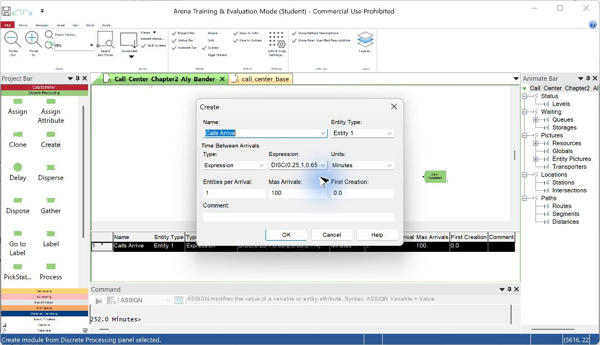</div>

### الخطوة 3: تعريف الموظفين ومجموعة الموارد

1. من بيانات `Resource` في `Project Bar` أضف صفًا باسم `Aly`، واختر `Type = Fixed Capacity` و`Capacity = 1`.
2. أضف صفًا ثانيًا باسم `Bander`، وبالسعة نفسها. فعّل تسجيل إحصاءات الموردين.
3. من بيانات `Set` أنشئ مجموعة باسم `Support Agents` ونوع `Resource`. أضف `Aly` عضوًا أولًا، ثم `Bander` عضوًا ثانيًا. ترتيب العضوين جزء من سياسة أولوية Aly.

### الخطوة 4: إعداد الخدمة في Process

انقر `Process` مرتين، ثم أدخل:

| الحقل | القيمة |
|---|---|
| `Name` | `Technical Support` |
| `Action` | `Seize Delay Release` |
| `Resources → Add → Type` | `Set` |
| `Set Name` | `Support Agents` |
| `Quantity` | `1` |
| `Selection Rule` | `Preferred Order` |
| `Save Attribute` | `aAgent` |
| `Delay Type` | `Expression` |
| `Units` | `Minutes` |
| `Allocation` | `Value Added` |

اكتب في خانة `Expression` النص كاملًا:

```text
(aAgent==1)*DISC(0.30,2,0.58,3,0.83,4,1,5)+(aAgent==2)*DISC(0.35,3,0.60,4,0.80,5,1,6)
```

يحفظ `aAgent` رقم عضو المجموعة الذي حجزته المكالمة: 1 لـAly و2 لـBander. يختار التعبير توزيع زمن الخدمة الموافق له. تنفذ `Seize Delay Release` حجز الموظف، وزمن الخدمة، وتحرير الموظف في وحدة واحدة. إذا لم يتوافر موظف، تدخل المكالمة `Technical Support.Queue` وتنتظر دورها.

<div align="center">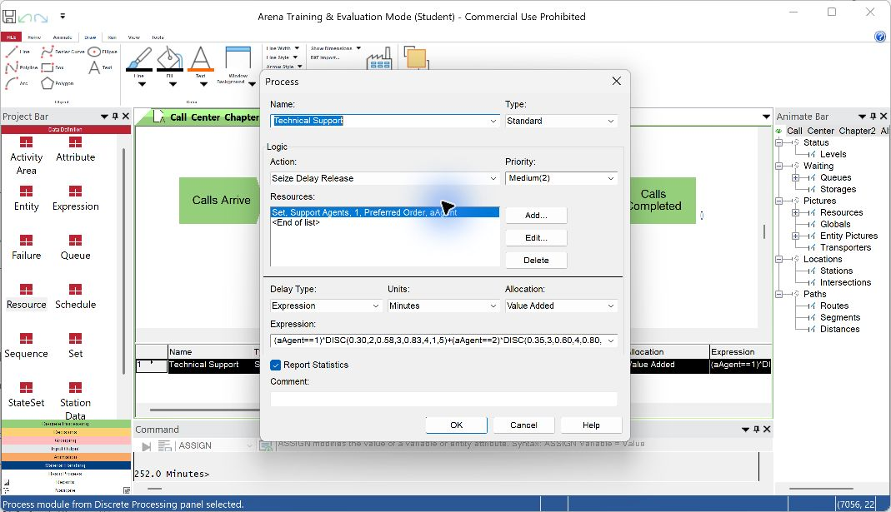</div>

### الخطوة 5: إنهاء المكالمة ومراجعة الشكل

سمِّ وحدة `Dispose` باسم `Calls Completed`، وفعّل `Record Entity Statistics`. راجع الوصلتين واتجاههما. يصبح المسار:

```text
Calls Arrive → Technical Support → Calls Completed
```

<div align="center">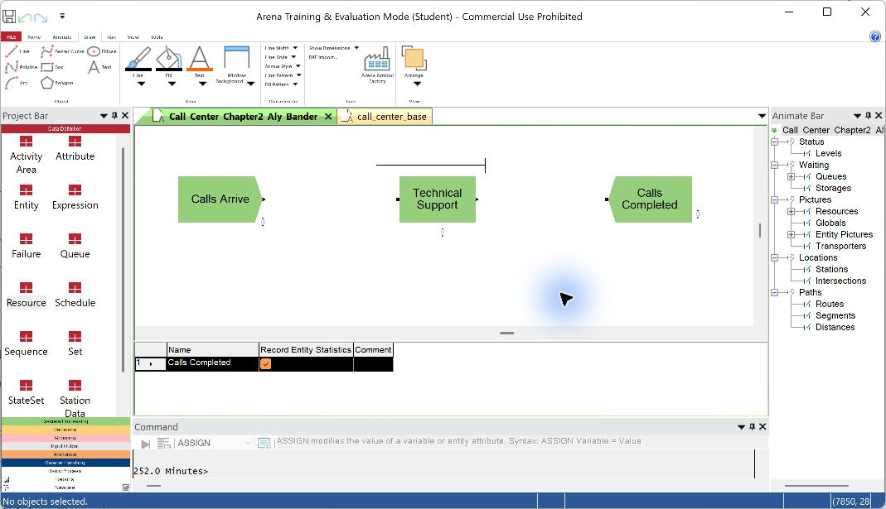</div>

في صورة النموذج تظهر وصلتا `Connect` الأفقيتان بين الوحدات الثلاث. أما الخط القصير الذي قد يظهر أعلى `Technical Support` في وضع التحرير وصور الجدول، فهو تمثيل بصري لطابور `Technical Support.Queue`؛ لا يمثل مسارًا إضافيًا للمكالمات. إذا غابت الوصلات عن العرض، جرّب مستوى تكبير يقارب 120% من `View → Zoom`، ثم تحقق من وجودها في وضع التشغيل. فحص `Check Model` والتشغيل المكتمل يؤكدان اتصال مسار هذا النموذج.

### ماذا يعرض الجدول أسفل مساحة الرسم؟

المساحة الشبكية تحت الرسم اسمها `Spreadsheet View`، وهي جدول إدخال خصائص النموذج، وليست تقرير النتائج. يتغير محتواها حسب العنصر أو نوع البيانات الذي تختاره. يمكن تعديل بعض الخلايا مباشرة، كما يمكن فتح نافذة الوحدة بالنقر المزدوج عليها. اسحب الحد الأفقي بين الرسم والجدول إلى أعلى إذا أردت إظهار صفوف أو أعمدة أكثر.

عند اختيار `Resource` من `Project Bar`، يظهر صف لكل موظف. في المثال يبيّن عمود `Name` الاسمين Aly وBander، و`Type` يحدد `Fixed Capacity`، و`Capacity` تساوي 1 لكل موظف. علامة `Report Statistics` تعني تسجيل إحصاءات استخدام المورد في التقرير.

<div align="center">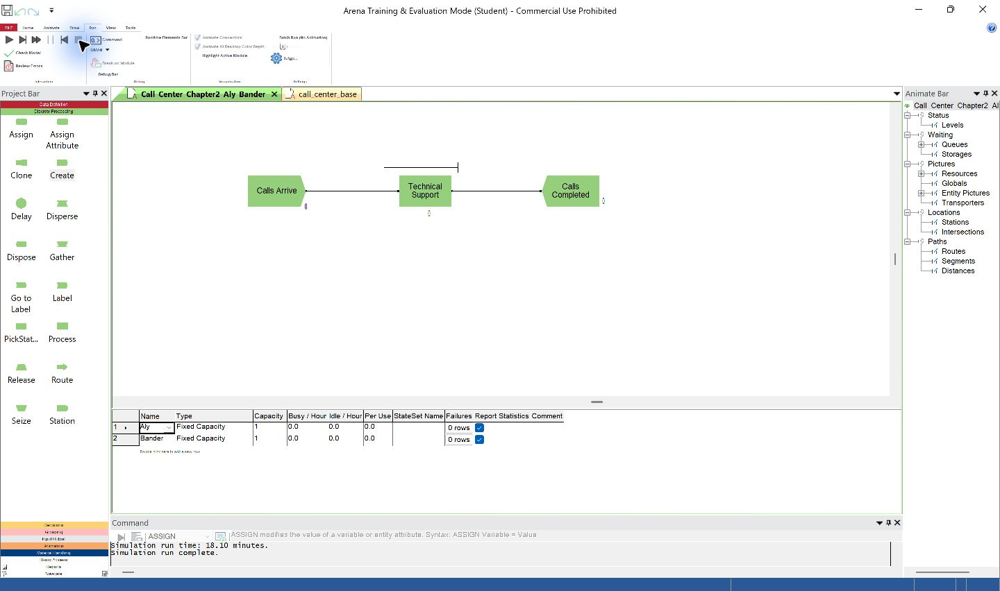</div>

عند اختيار `Process` يظهر صف `Technical Support`. الأعمدة `Action` و`Resources` و`Delay Type` و`Units` و`Allocation` و`Expression` تلخص طريقة حجز الموظف وزمن الخدمة. قيمة `1 rows` في `Resources` تعني وجود تعريف مورد واحد داخل نافذة العملية، وهو مجموعة `Support Agents`؛ لا تعني وجود موظف واحد في المركز. النص الكامل لتعبير زمن الخدمة موجود في الخطوة 4 أعلاه لأن عرض الخلية قد يقتطع نهايته.

<div align="center">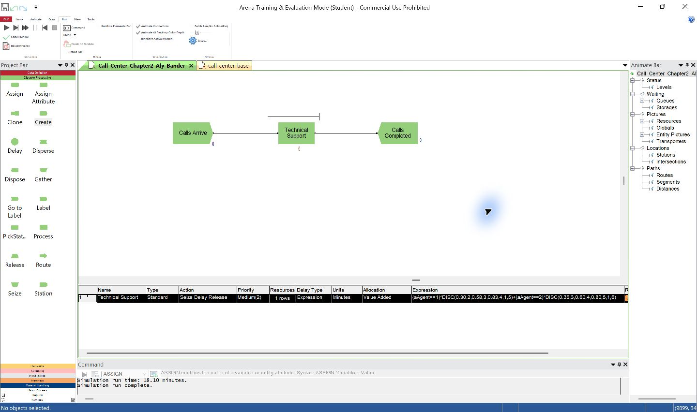</div>

أثناء `Run Mode` يظهر شريط `Command` في أسفل النافذة بدل جدول التحرير. بعد الضغط على `End` يعود `Spreadsheet View`. أما النتائج العددية فتظهر في تقرير Arena بعد انتهاء التشغيل.

---

<a id="arena-use-14"></a>
## 13. التشغيل والنتائج الفعلية

### إعداد التشغيل

1. افتح `Run → Setup` وحدد `Base Time Units = Minutes` و`Number of Replications = 1` و`Warm-up Period = 0`.
2. اجعل `Replication Length = Infinite`، وأدخل شرط الانتهاء `Calls Completed.NumberOut >= 100`. بهذا ينتهي التشغيل بعد اكتمال خدمة المكالمات المئة، مهما بلغ زمنها.
3. فعّل جمع إحصاءات `Entities` و`Queues` و`Resources` و`Processes`.
4. نفّذ `Run → Check Model`، ثم `Run → Go` أو `Fast Forward`. في التشغيل الموثق، اجتاز النموذج الفحص دون أخطاء أو تحذيرات.

<div align="center">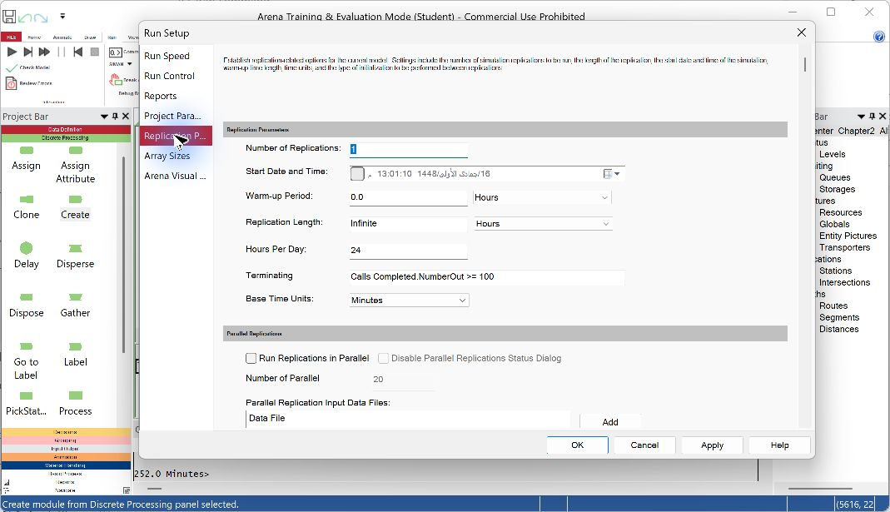</div>

### قراءة التقرير

بعد انتهاء التشغيل، افتح تقرير Arena. يعرض `Wait Time` متوسط انتظار المكالمة قبل الخدمة، و`VA Time` متوسط زمن الخدمة، و`Total Time` متوسط الزمن من الوصول حتى المغادرة. صورة التقرير التالية تعرض هذه المقاييس للتشغيل الموثق:

<div align="center">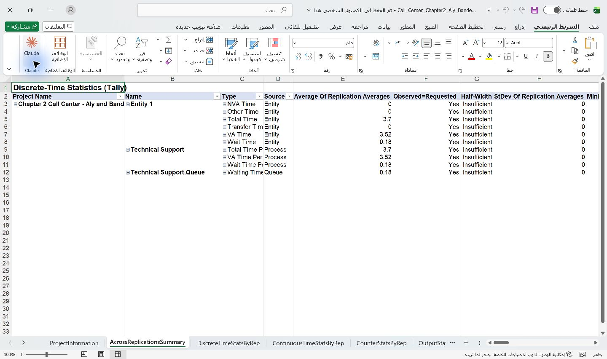</div>

| المقياس | نتيجة تشغيل واحد |
|---|---:|
| المكالمات التي وصلت واكتملت | 100 و100 |
| زمن انتهاء المحاكاة | 252 دقيقة |
| متوسط الانتظار | 0.18 دقيقة |
| متوسط الخدمة | 3.52 دقيقة |
| متوسط الزمن في النظام | 3.70 دقيقة |
| أقصى انتظار | دقيقتان |
| متوسط طول الطابور | 0.07143 مكالمة |
| Aly: عدد المكالمات ونسبة الانشغال | 58 و75.00% |
| Bander: عدد المكالمات ونسبة الانشغال | 42 و64.68% |

تتحقق المجاميع: `58 + 42 = 100`، ومجموع أزمنة الانتظار `18` دقيقة، لذا `18 ÷ 100 = 0.18` دقيقة. ومجموع أزمنة الخدمة `352` دقيقة، لذا `(352 + 18) ÷ 100 = 3.70` دقائق في النظام.

هذه القيم ناتجة عن تكرار عشوائي واحد في Arena 17. يعرض التقرير `Insufficient` لفاصل الثقة، لذلك لا نستخلص منه تقديرًا إحصائيًا دقيقًا أو تفوقًا على سياسة إسناد أخرى. قد تختلف الأرقام عند إعادة التشغيل. كما أن جدول الشريحة 34 يستخدم تسلسلًا عشوائيًا لم يُقدَّم للنموذج، فلا يُتوقع تطابق نتائجه العددية مع هذا التشغيل.

### فيديو تشغيل النموذج

[▶ مشاهدة تسجيل تشغيل Arena والانتقال إلى التقرير (15 ثانية)](https://github.com/talalalsultan246-cell/Arena-Simulation-Arabic-Guide/blob/main/guides/Arena/videos/Arena_Call_Center_Run_Slow.mp4)

إذا لم يعرض GitHub الفيديو في الصفحة، اضغط `View raw` لتشغيل الملف مباشرة.

يعرض المقطع المرفق جزءًا من تشغيل نموذج مركز الاتصالات والانتقال إلى التقرير. الملف الأصلي مدته 10 ثوانٍ، وأبطأنا عرضه إلى نحو 15 ثانية لتسهيل المتابعة؛ ولا يعرض تسجيلًا كاملًا مدته ثلاث دقائق.

---

<a id="arena-use-shortcuts"></a>
## 14. الأوامر السريعة

| الأمر | الوظيفة |
|---|---|
| File → New | نموذج جديد |
| Ctrl + S | حفظ النموذج |
| Home → Connect | توصيل الوحدات |
| Run → Check Model | فحص النموذج |
| Run → Setup | إعداد تشغيل المحاكاة |
| Run → Go | بدء المحاكاة |
| Reports | قراءة نتائج التشغيل |

---

<a id="arena-use-15"></a>
## 15. مصادر البرنامج

- [Rockwell Automation — تنزيل Arena](https://www.rockwellautomation.com/en-us/products/software/arena-simulation/buying-options/download.html)
- [Rockwell Automation — Arena Basic Edition User's Guide، إعداد Resource Set](https://www.manualsdir.com/manuals/580146/rockwell-automation-arena-basic-edition-users-guide.html?page=39)
- [Getting Started with Arena — وصف Seize وRelease وSelection Rule](https://studylib.net/doc/28102816/getting-started-with-arena)

---

### إعداد الدليل

**Talal bin Ibrahim Alsultan**  
*Applied Information System • Data Science • Decision Sciences*  
King Saud University

[GitHub Profile](https://github.com/talalalsultan246-cell)

</div>
