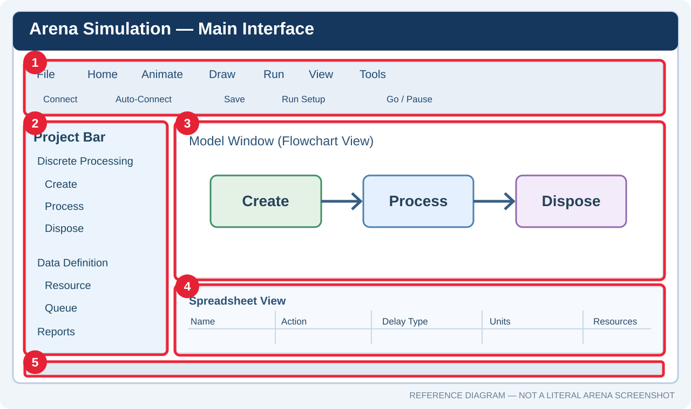
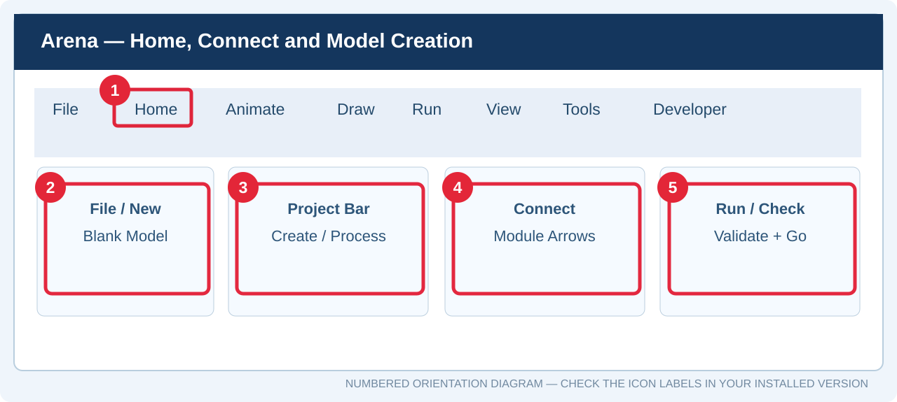
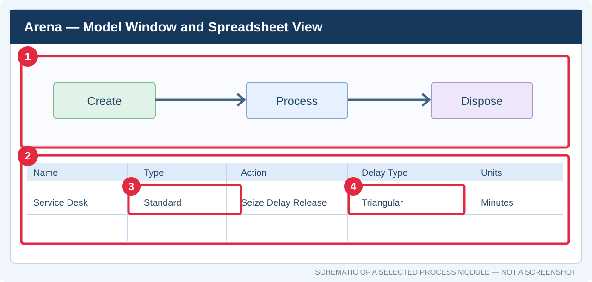

# **دليل استخدام Arena Simulation — الواجهات وبناء أول نموذج**

**إعداد:** Talal bin Ibrahim Alsultan  
**آخر تحديث:** 27 أكتوبر 2026  
**البرنامج المستهدف:** Arena 17 / واجهة Arena Professional Edition التي تعرض اسم Arena 2026 في بعض حزم التثبيت

بعد تثبيت برنامج **Arena Simulation**، قد تبدو كثرة التبويبات والوحدات غير واضحة في البداية. الهدف من هذا الدليل هو التعرف على نافذة البرنامج جزءًا جزءًا، ثم إنشاء نموذج **Discrete-Event Simulation** بسيط، وتشغيله وقراءة النتائج.

> **لم تثبّت Arena بعد؟** ابدأ من **[دليل تحميل وتثبيت Arena باللغة العربية](./README.md)**، ثم ارجع إلى هذا الدليل بعد تشغيل البرنامج. هذا **دليل استخدام مستقل**، ولا يحل محل دليل التثبيت أو يغيّر محتواه.

**عن هذا الشرح:** في محاضرة يوم الأحد **25 أكتوبر 2026**، استعرض لنا **الأستاذ الدكتور محمود الشربيني** برنامج Arena، وشرح الواجهات الأساسية وكيفية إنشاء نموذج أولي بسيط. ورتبت هذا الدليل لتوضيح أماكن الأدوات بالصور والخطوات المرقمة، ثم تطبيق نموذج عملي يمكن تجربته مباشرةً.

### البداية السريعة بالصور — شاهد موضع الأداة ثم نفّذ الخطوة

<small>**خريطة توضيحية مرقمة وليست لقطة فعلية**: (1) شريط التبويبات، (2) Project Bar، (3) مساحة النموذج، (4) جدول Spreadsheet View، (5) شريط الحالة. الصورة الفعلية للبرنامج موجودة في [الفقرة الأولى أدناه](#arena-use-01).</small>

<small>**المربعات الحمراء مرقمة:** (1) Home، (2) New، (3) Project Bar، (4) Connect، (5) Run. هذا رسم تعليمي يستكمل صور Arena الحقيقية داخل الأقسام التالية؛ تحقق من أسماء الأزرار على نسختك.</small>

**أسرع طريق لأول نموذج:**

1. **الخطوة الأولى:** افتح **File → New → Blank Model** واحفظ الملف.
2. **الخطوة الثانية:** افتح **Project Bar → Discrete Processing**.
3. **الخطوة الثالثة:** اسحب **Create** ثم **Process** ثم **Dispose**.
4. **الخطوة الرابعة:** صِل الوحدات بـ **Home → Connect**.
5. **الخطوة الخامسة:** أدخل أزمنة الوصول والخدمة، وعرّف المورد.
6. **الخطوة السادسة:** افتح **Run → Setup** واضبط فترة المحاكاة.
7. **الخطوة السابعة:** شغّل **Run / Go** ثم اقرأ **Reports**.

[انتقل مباشرة إلى المثال المصور](#arena-use-12) | [إلى جدول الاختصارات](#arena-use-shortcuts)

**مهم قبل القراءة:** توجد اختلافات في ترتيب بعض الأزرار بين الإصدارات القديمة والحديثة. أشرح هنا أسماء تبويبات الواجهة الحديثة مثل **Home وAnimate وDraw وRun وView وTools**، مع بيان وظيفة الأمر حتى إن تغيّر مكانه في إصدار آخر. الصور المدرجة **صور حقيقية للبرنامج من مصادر خارجية**؛ بعضها لواجهات أقدم، وقد تختلف ألوانها وأشكالها عن إصدار Arena الذي يظهر على جهازك.

---

## المحتويات

1. [التعرف على النافذة الرئيسية](#arena-use-01)
   - [Spreadsheet View — جدول البيانات أسفل النموذج](#arena-use-spreadsheet)
2. [تبويب File — الملفات والنماذج](#arena-use-02)
3. [تبويب Home — بناء النموذج وربط الوحدات](#arena-use-03)
4. [تبويب Animate — إظهار حركة النظام](#arena-use-04)
5. [تبويب Draw — الرسم والكتابة داخل النموذج](#arena-use-05)
6. [تبويب Run — تشغيل المحاكاة والتحقق](#arena-use-06)
7. [تبويب View — تنظيم طريقة العرض](#arena-use-07)
8. [تبويب Tools — أدوات التحليل والمساعدة](#arena-use-08)
9. [تبويبات إضافية مثل Developer](#arena-use-09)
10. [Project Bar — شرح اللوحات بالتفصيل](#arena-use-10)
   - [Data Definition — تعريف عناصر النموذج](#arena-use-10-data)
   - [Discrete Processing — أهم وحدات المحاكاة](#arena-use-10-discrete)
   - [Decisions وGrouping وInput Output وغيرها](#arena-use-10-other)
11. [كيف أبدأ نموذجًا جديدًا بطريقة صحيحة؟](#arena-use-11)
12. [مثال عملي: مركز خدمة بموظف واحد](#arena-use-12)
   - [إنشاء Create](#arena-use-12-create)
   - [ضبط Process وResource](#arena-use-12-process)
   - [إضافة Dispose وربط الوحدات](#arena-use-12-dispose)
   - [إعداد Run Setup وتشغيل النموذج](#arena-use-12-run)
13. [فهم تقارير النتائج والمقارنة بالمنطق](#arena-use-13)
14. [أخطاء شائعة وأسئلة سريعة](#arena-use-14)
   - [جدول اختصارات لوحة المفاتيح](#arena-use-shortcuts)
15. [مراجع الاستخدام والصور](#arena-use-15)

---

## 1. التعرف على النافذة الرئيسية

عند فتح نموذج جديد في Arena، تظهر أمامك عدة مناطق، لكل منها وظيفة مختلفة:

| المنطقة | أين أجدها؟ | فائدتها |
| :--- | :--- | :--- |
| **Ribbon / Tabs** | أعلى البرنامج | أوامر Home وAnimate وDraw وRun وView وTools وغيرها |
| **Project Bar** | غالبًا يسار النافذة | الوحدات ولوحات العمل التي يبنى منها النموذج |
| **Model Window / Flowchart View** | المساحة الكبيرة بوسط الشاشة | مكان وضع Create وProcess وDispose ورسم مسار الكيانات |
| **Spreadsheet View** | أسفل مساحة النموذج في بعض الأوضاع | جدول تعديل خصائص الوحدات والموارد والمتغيرات |
| **Status Bar** | أسفل نافذة Arena | معلومات حالة البرنامج والزمن الجاري والمحاكاة بحسب وضع التشغيل |
| **Quick Access Toolbar** | أعلى الواجهة غالبًا | اختصارات مثل Save وبعض أوامر التحرير |

<small>**الصورة 1 — واجهة Arena Professional Edition.** يظهر شريط التبويبات بالأعلى ولوحة **Project Bar** وفيها **Discrete Processing** إلى اليسار، وفي الوسط نموذج مكوّن من Create وProcess وDispose. [مصدر الصورة](https://coyosu.com/vi/arena-can-ban-nang-cao). هذه صورة مرجعية حقيقية للواجهة وليست لقطة من جهاز القارئ.</small>

الفكرة الأساسية هي أن **Project Bar** يقدم عناصر بناء النموذج، و**Model Window** يمثل مكان وضعها وتوصيلها، بينما **Run** يحوّل الرسم إلى تجربة محاكاة ويُنتج النتائج.

### Spreadsheet View — ما الجدول الموجود أسفل مساحة النموذج؟

الجزء الموجود **أسفل Model Window** اسمه **Spreadsheet View**. وهو ليس ملف Excel منفصلًا؛ بل **جدول داخلي في Arena** يعرض بيانات العنصر الذي تحدده في الرسم أو **Data Module** التي تختارها من Project Bar.

<small>**خريطة تعليمية مرقمة:** (1) النموذج العلوي، (2) جدول Spreadsheet View السفلي، (3) نوع العملية Action، (4) نوع زمن الخدمة Delay Type. تظهر مسميات الأعمدة المعروضة هنا **كمثال**؛ تتغير الأعمدة فعليًا عند اختيار Create أو Process أو Resource.</small>

**كيف أستخدمه؟**

1. **الخطوة الأولى:** اضغط مرة واحدة على وحدة **Process** الموجودة في مساحة النموذج، أو اختر **Resource** من Project Bar.
2. **الخطوة الثانية:** انظر إلى الجدول السفلي؛ ستظهر صفوف العنصر وحقول خصائصه بحسب الوحدة المحددة.
3. **الخطوة الثالثة:** راجع الأعمدة المطلوبة، وعدّل القيمة بالطريقة التي يسمح بها الإصدار (الضغط على الخلية أو النقر المزدوج عليها).
4. **الخطوة الرابعة:** ارجع إلى مساحة النموذج وتحقق من أن التعديل يخص الوحدة الصحيحة، ثم احفظ الملف.

| الحقل الذي قد يظهر | ماذا يعني؟ | مثال |
| :--- | :--- | :--- |
| **Name** | اسم الوحدة أو المورد | `Service Desk` |
| **Action** | نوع تنفيذ العملية | `Seize Delay Release` |
| **Delay Type** | شكل توزيع زمن العملية | `Triangular` |
| **Units** | وحدة قياس الزمن | `Minutes` |
| **Resource / Capacity** | اسم المورد وعدده عند عرض بيانات الموارد | `Service_Clerk / 1` |
| **Queue / Ranking** | اسم الطابور وقاعدة ترتيب الانتظار عند عرض بيانات الطوابير | `FIFO` |

**إذا اختفى الجدول:** قد تكون منطقة Spreadsheet View مطوية أسفل النافذة. حرّك مؤشر الفأرة إلى الفاصل السفلي ثم اسحبه لأعلى. وإذا كنت تستخدم شاشة صغيرة، كبّر نافذة Arena أولًا.

**فرق أساسي:** في **Flowchart View** ترسم مسار الكيانات، أما في **Spreadsheet View** فتراجع قيم الوحدات والموارد والجداول. لا يُنقل **Resource** إلى الرسم بالطريقة نفسها التي تُنقل بها وحدة **Create**.

---

## 2. تبويب File — الملفات والنماذج

من **File** تبدأ العمل على النماذج وتحفظه. أهم الأوامر التي تحتاجها:

| الأمر | متى أستخدمه؟ |
| :--- | :--- |
| **New / Blank Model** | إنشاء نموذج جديد من الصفر |
| **Open** | فتح نموذج سابق |
| **Save** | حفظ التعديلات الحالية |
| **Save As** | حفظ نسخة أخرى باسم مختلف |
| **Options / إعدادات البرنامج** | الوصول إلى إعدادات عامة إن أتاحها إصدارك |

**تطبيق سريع:** عند البدء اختر **File → New** أو **Blank Model**، ثم استخدم **Save As** وسمِّ الملف مثلًا \`Service_Center.doe\`. يُستخدم امتداد **.doe** لنماذج Arena في الإصدارات الشائعة. احتفظ بملف النموذج نفسه، وليس صور المخطط فقط.

## 3. تبويب Home — بناء النموذج وربط الوحدات

هذا من أكثر التبويبات استخدامًا أثناء التصميم. قد تظهر فيه مجموعات متقاربة من الأوامر الآتية:

| المجموعة / الأمر | استخدامه |
| :--- | :--- |
| **Template / Attach / Detach** | إظهار لوحة نمذجة في Project Bar أو إخفاؤها من قائمة اللوحات |
| **Clipboard** | Copy وPaste وCut وUndo بحسب الواجهة |
| **Select and Zoom** | تحديد الوحدات، التنقل والتكبير والتصغير |
| **Connect** | إنشاء مسار حركة بين وحدتين |
| **Auto-Connect** | ربط الوحدات الجديدة تلقائيًا عند وضعها بالتسلسل المناسب |
| **Smart Connect / Connector Arrows** | تحسين شكل الخطوط والأسهم واتجاه وصلاتها |
| **Editing / Arrange** | تحديد العناصر وتحريكها وترتيبها |

### الفرق بين Connect وAuto-Connect

- **Connect:** أبدأ من نقطة خروج الوحدة الأولى، ثم أضغط نقطة دخول الوحدة الثانية.
- **Auto-Connect:** يربط Arena بعض الوحدات تلقائيًا عند سحبها إلى **Model Window**، بشرط أن يكون الخيار مفعلًا وترتيب الاختيار مناسبًا.
- **Connector Arrows:** تظهر اتجاه انتقال الكيانات، وتساعد على اكتشاف وصلة تسير بعكس الاتجاه المطلوب.

إذا وضعت ثلاث وحدات بجانب بعضها ولم يظهر بينها خط، **فهي ليست متصلة تلقائيًا لمجرد قربها من بعضها**. افتح **Home → Connect** وتأكد من الاتجاه.

## 4. تبويب Animate — إظهار حركة النظام

الـ **Animation** تساعد على مشاهدة الكيانات أثناء انتقالها داخل النظام. وهي وسيلة لفهم سلوك النموذج والتحقق من طريقة التدفق، وليست بديلًا عن النتائج الإحصائية.

من الوظائف التي قد تجدها ضمن أدوات التحريك — بحسب الإصدار واللوحات المتاحة:

- تغيير **Entity Picture** حتى تمثل الكيانات عملاء أو مركبات أو أجزاء تصنيع.
- عرض **Resource Animation** لملاحظة حالة الموظف أو الآلة (مشغول / متاح).
- استخدام **Counters وVariables** لعرض أرقام حية أثناء المحاكاة.
- إضافة عناصر حركة خاصة بالنقل أو المواقع أو المسارات إذا كان النموذج يحتاجها.
- تحسين سرعة عرض الحركة أثناء تشغيل النموذج دون افتراض أن سرعة الرسم تغير الزمن المحاكى.

<small>**الصورة 2 — مثال Animation حقيقي من إصدار أقدم.** يظهر مسار عمليات وموارد وآلات وعناصر مرئية أثناء المحاكاة. [المصدر: Systems Simulation — Adding Animation](https://alg.manifoldapp.org/read/systems-simulation/section/d511bb7c-6f70-4201-b0de-3912b8a81d45).</small>

في أول نموذج ننشئه لاحقًا، يكفي مشاهدة الكيانات وهي تتحرك من **Create** إلى **Process** ثم **Dispose**. لا تحتاج إلى رسوم معقدة كي يكون النموذج صحيحًا.

## 5. تبويب Draw — الرسم والكتابة داخل النموذج

يُستخدم **Draw** لإضافة توضيحات بصرية حول النموذج، مثل:

- **Text:** كتابة عنوان النموذج أو أسماء الأقسام.
- **Line / Arrow:** إضافة خطوط وأسهم توضيحية ثابتة.
- **Rectangle / Ellipse / Shapes:** رسم مربعات ومناطق لخريطة العمل.
- **Color / Fill / Font:** تنسيق الألوان والحدود والخطوط.
- **Layers / Order / Arrange:** تنظيم ظهور العناصر فوق بعضها، عندما تتوفر هذه الخيارات.

**انتبه:** الخط الذي ترسمه لتزيين الشرح من **Draw** ليس بالضرورة **Connection** يحرك الكيانات. إذا أردت انتقال الكيانات بين الوحدات، فاستخدم أداة **Connect** الخاصة بالنموذج.

## 6. تبويب Run — تشغيل المحاكاة والتحقق

بعد إنشاء الوحدات وإدخال البيانات يأتي دور **Run**. غالبًا ستحتاج إلى هذه الأدوات:

| الأمر | فائدته |
| :--- | :--- |
| **Check Model** | البحث عن أخطاء إعداد النموذج قبل التشغيل إن كان متاحًا |
| **Setup** | تحديد زمن المحاكاة، عدد التكرارات والوحدات الزمنية |
| **Go / Run** | بدء المحاكاة |
| **Pause / Step / Stop** | إيقاف مؤقت أو التنفيذ بخطوات أو إنهاء التشغيل حسب الوضع |
| **Run Speed** | ضبط سرعة عرض الحركة، لا تغيير الوحدات الزمنية المستخدمة في الحساب |

**معلومة مهمة:** قد يكون **التشغيل في الزمن المحاكى مختلفًا عن الزمن الحقيقي**. عندما تضبط Replication Length على 480 دقيقة، فأنت تقول إن النظام سيمثّل ثماني ساعات تشغيل افتراضية؛ لا يعني ذلك الانتظار ثماني ساعات أمام الكمبيوتر.

## 7. تبويب View — تنظيم طريقة العرض

من **View** يمكن تحسين طريقة رؤية النموذج وتحريره. بحسب الإصدار، قد تجد:

- **Zoom / Fit:** تكبير المخطط أو إظهار كامل النموذج.
- **Grid:** إظهار شبكة تساعد على تنظيم الوحدات.
- **Snap to Grid:** محاذاة العناصر إلى نقاط الشبكة.
- **Project Bar:** إظهار أو إخفاء اللوحة الجانبية إذا أتاح الإصدار الأمر.
- **Spreadsheet / Split Screen:** إظهار جدول خصائص الوحدات مع الرسم.
- **Status Bar:** عرض معلومات الحالة عندما يكون هذا الخيار موجودًا.
- **Named Views / Layers:** حفظ طرق عرض محددة أو إدارة الطبقات في النماذج الكبيرة.

إذا اختفت منطقة البيانات أسفل الشاشة، ابحث عن **Spreadsheet View / Split Screen** أو اسحب الحد الفاصل بين مساحة الرسم والمنطقة السفلية.

## 8. تبويب Tools — أدوات التحليل والمساعدة

قد يضم **Tools** مجموعة من الأدوات المتقدمة. يختلف وجودها بحسب إصدار Arena والترخيص:

| الأداة أو الوظيفة | متى أحتاجها؟ |
| :--- | :--- |
| **Input Analyzer** | ملاءمة توزيع احتمالي لبيانات زمن الوصول أو الخدمة عندما تتوفر مشاهدات حقيقية |
| **Output Analyzer / أدوات تحليل النتائج** | مقارنة المخرجات وفهم نتائج التكرارات أو المقارنات عند توفر الأداة |
| **Expression Builder** | إنشاء تعبيرات ومعادلات داخل النموذج |
| **OptQuest / Optimization** | البحث عن إعدادات أفضل ضمن قيود، إذا كانت الإضافة مرخصة ومثبتة |
| **Options / Preferences** | تعديل إعدادات بيئة العمل |
| **Help** | معرفة وظيفة أمر أو حقل لا تتضح تسميته |

**ملاحظة:** لا أفترض أن **OptQuest** أو **Input Analyzer** يظهران في جميع النسخ. إذا لم تجد أداة من هذه الأدوات فراجع الترخيص ومكونات التثبيت.

## 9. تبويبات إضافية مثل Developer

بعض إصدارات Arena الحديثة تعرض **Developer** بجانب Tools. يتعلق هذا الجزء بوظائف التطوير والتكامل والأتمتة، وقد تختلف تفاصيله بحسب نسخة البرنامج والإضافات المرخصة. لا تحتاج إليه لإنشاء نموذجك الأول، لذلك لا أنصح بتغيير إعداداته قبل إتقان الوحدات الأساسية.

---

## 10. Project Bar — أهم جزء في بناء النموذج

**Project Bar** هي اللوحة الجانبية التي تحتوي على **Panels**، وكل Panel تجمع وحدات لها وظيفة مشتركة. بعض الوحدات تُسحب إلى الرسم، والبعض الآخر يمثل جدول إعدادات.

<small>**الصورة 3 — مكونات Arena الأساسية.** المصدر: [Simulation Modeling and Arena — The Arena Environment](https://rossetti.github.io/RossettiArenaBook/ch2-ArenaEnv.html). الصورة قديمة، لكنها توضح بوضوح موقع **Project Bar** و**Model Window** و**Spreadsheet View**.</small>

### كيف أعرف الفرق بين نوعَي الوحدات؟

| النوع | ماذا أفعل به؟ | مثال |
| :--- | :--- | :--- |
| **Flowchart Module** | أسحبه إلى مساحة النموذج وأوصله بوحدة أخرى | Create، Process، Dispose |
| **Data Module** | أضغطه في Project Bar فتظهر بياناته في Spreadsheet View؛ غالبًا لا أسحبه إلى الرسم | Resource، Entity، Queue، Variable |

قد تظهر الوحدات في لوحات مختلفة حسب نسخة Arena أو الـTemplate Panel الملحق بالنموذج. **إن لم تجد Discrete Processing، فلا تفترض أن البرنامج معطّل**؛ تحقق من قائمة اللوحات أو Attach Template أولًا.

### 10.1 لوحة Data Definition — تعريف عناصر النظام

تستخدمها لوصف العناصر الموجودة في المحاكاة، مثل:

| الوحدة | معناها | مثال |
| :--- | :--- | :--- |
| **Entity** | تعريف نوع الكيان | Customer |
| **Resource** | مورد يقدم خدمة أو ينفذ عملية | Service_Clerk |
| **Queue** | قائمة الانتظار وخصائصها | Service_Line |
| **Variable** | متغير على مستوى النظام | TotalServed |
| **Attribute** | قيمة تخص كل كيان على حدة | CustomerType |
| **Schedule** | جدول تغير الطاقة أو مواعيد الموارد | ShiftSchedule |
| **Set** | مجموعة موارد أو كيانات تتبع منطقًا مشتركًا | ServiceClerks |
| **Expression** | تعبير يستخدم داخل خصائص الوحدات | زمن معالجة محسوب |

**في المثال العملي** نحتاج إلى مورد واحد باسم **Service_Clerk** بطاقته **Capacity = 1**. ويمكن أن يُنشئه Arena من داخل إعدادات Process أو تعريفه من لوحة Resource بحسب النموذج والإصدار.

### 10.2 لوحة Discrete Processing — الوحدات الأساسية للمحاكاة المنفصلة

هذه **أهم لوحة للمبتدئ**. ما المقصود بالمحاكاة المنفصلة؟ إن النظام لا يتغير بصورة مستمرة، بل عند وقوع أحداث مثل **وصول عميل** أو **بدء الخدمة** أو **انتهاء الخدمة** أو **مغادرة النظام**.

تضم لوحة **Discrete Processing** وحدات تختلف وظائفها كما يأتي:

| الوحدة | وظيفتها داخل النموذج | مثال عملي |
| :--- | :--- | :--- |
| **Create** | توليد الكيانات وإدخالها للنظام | وصول عميل كل فترة عشوائية |
| **Process** | تنفيذ خدمة أو عملية، مع المورد والتأخير والانتظار عند الحاجة | خدمة عميل بواسطة موظف |
| **Dispose** | إخراج الكيان بعد اكتمال مساره | مغادرة العميل |
| **Delay** | إيقاف تقدم الكيان زمنًا معينًا من دون استخدام المورد بالضرورة | انتظار نقل مستند |
| **Seize** | تخصيص مورد أو حجزه | حجز موظف متاح |
| **Release** | تحرير مورد كان محجوزًا سابقًا | انتهاء استخدام الموظف |
| **Assign** | تعديل قيمة متغير أو خاصية الكيان | تعيين أولوية |
| **Assign Attribute** | إسناد قيمة لخاصية تخص الكيان | تصنيف العميل |
| **Clone** | إنشاء نسخة/نسخ من الكيان وفق القواعد المحددة | نسخ مهمة عمل |
| **Gather** | جمع وحدات من مجموعة موارد وفق شروط | اختيار طاقم عمل |
| **Disperse** | تحرير وحدات من مجموعة جرى جمعها | إرجاع أعضاء الطاقم |
| **Go to Label / Label** | الانتقال إلى نقطة مسماة داخل منطق التدفق | متابعة مسار آخر |
| **Station / Route** | تعريف محطة أو توجيه كيان إلى محطة | الانتقال إلى قسم آخر |
| **PickStation** | اختيار محطة بحسب معيار | اختيار الأقصر انتظارًا |

وتوجد لوحات أخرى مخصصة للقرارات والتجميع والإدخال والإخراج؛ لذلك قد تختلف مواضع بعض الوظائف عند استعمال قالب أو إصدار آخر.

<small>**الصورة 4 — Discrete Processing في الواجهة الحديثة.** [مصدر الصورة](https://coyosu.com/vi/arena-can-ban-nang-cao). تظهر الوحدات الأساسية في القائمة الجانبية، والمسار Create → Process → Dispose في مساحة النموذج.</small>

#### ما الفرق بين Process وDelay وSeize وRelease؟

- **Process (Seize Delay Release):** يجمع **حجز المورد → تنفيذ الخدمة → تحريره** في وحدة واحدة. وهو الخيار الأسهل لأول نموذج طوابير.
- **Process (Delay فقط):** يضيف زمن معالجة دون إدارة مورد محجوز بالضرورة، فلا ينتج تلقائيًا طابور انتظار بسبب انشغال موظف.
- **Seize** مع **Delay** ثم **Release:** يستخدم عند الرغبة في تقسيم منطق الموارد إلى خطوات منفصلة أكثر تقدمًا.
- **Dispose:** يزيل الكيان من نطاق النموذج بعد اكتماله؛ لا يمكن اعتباره بديلًا عن Release، لأنهما عمليتان مختلفتان.

<small>**الصورة 5 — نافذة Process الحقيقية** من إصدار أقدم، وفيها **Action = Seize Delay Release** و**Resources** و**Delay Type**. [المصدر: Rossetti — Routing Sequences](https://rossetti.github.io/RossettiArenaBook/ch4-RoutingSequences.html).</small>

### 10.3 لوحات أخرى في Project Bar

| اللوحة | فائدتها ومتى أحتاجها؟ |
| :--- | :--- |
| **Decisions** | تقسيم سير الكيانات بحسب شرط أو احتمال |
| **Grouping** | جمع الكيانات أو فصلها وتكوين مجموعات |
| **Input Output** | تسجيل إحصاءات أو قراءة/كتابة معلومات عند توفر الوحدات |
| **Animation** | أدوات تحريك خاصة بالكيانات والموارد |
| **Material Handling** | حركة المواد ووسائط النقل عندما يتطلب النموذج ذلك |
| **Reports** | الوصول إلى نتائج المحاكاة بعد التشغيل |
| **Navigate** | التنقل داخل المخطط والنماذج الفرعية |

**تنبيه اختلاف الإصدارات:** قد ترى في شروحات قديمة لوحة **Basic Process** بدلًا من التقسيم الحديث **Discrete Processing / Data Definition / Decisions**. المبدأ العام متشابه، لكن لا تتوقع أن كل عنصر يظهر في المكان نفسه أو باللون نفسه.

---

## 11. كيف أبدأ نموذجًا جديدًا بطريقة صحيحة؟

قبل سحب أي Module اسأل نفسك أربعة أسئلة:

1. **ما الكيان؟** عميل، معاملة، سيارة، قطعة تصنيع؟
2. **ما الذي يُنشئ الكيان؟** وصول العميل يمثل **Create**.
3. **ما المورد والعملية؟** موظف أو جهاز، ووقت الخدمة، ويمثلهما **Process**.
4. **متى ينتهي الكيان؟** عند المغادرة، ويمثل ذلك **Dispose**.

بعدها أنشئ النموذج فارغًا، واحفظه فورًا، وحدد **وحدات الزمن** من البداية. لا تخلط بين الدقائق والساعات؛ فهذا من أكثر الأسباب شيوعًا لنتائج غير منطقية.

---

## 12. مثال عملي متكامل — مركز خدمة بموظف واحد

سننشئ نموذجًا بسيطًا لخدمة العملاء. يصل العملاء إلى مركز خدمة، وينتظر كل عميل إذا كان الموظف مشغولًا، ثم يحصل على الخدمة ويغادر.

**اتبع الأرقام بالترتيب، ولا تنتقل للخطوة التالية قبل تنفيذ السابقة.** النموذج يتكوّن من ثلاث وحدات فقط: **Create → Process → Dispose**. أبدأ بصورة عامة، ثم أشرح كل وحدة بالبيانات التي أضعها داخلها.

<small>مخطط مرقم للتوضيح، وليس تصويرًا حرفيًا لنتيجة برنامجك. أما صور Arena الحقيقية وحقول Create وProcess وRun Setup فتجدها ضمن خطوات الدليل.</small>

**الهدف:** معرفة عدد العملاء الذين يمرون بالنظام، ومتوسط انتظارهم، ومدى انشغال الموظف.

### بيانات المثال

| العنصر | الإعداد |
| :--- | :--- |
| **Entity** | Customer |
| **زمن ما بين الوصولات** | توزيع أسي \`EXPO(6)\` دقائق، بمتوسط 6 دقائق |
| **Resource** | \`Service_Clerk\` |
| **عدد الموظفين Capacity** | 1 |
| **زمن الخدمة** | توزيع مثلثي \`TRIA(2,4,6)\` دقائق |
| **فترة التشغيل Replication Length** | 480 دقيقة (8 ساعات) |
| **Warm-up Period** | 0 في هذا المثال ذي الفترة المحددة |
| **Number of Replications** | 10 تكرارات مستقلة لأغراض التدريب |
| **Base Time Units** | Minutes |

القيم **افتراضية للتعلّم**. اختيار توزيع أسي لوصول العملاء وتوزيع مثلثي للخدمة مثال تدريبي، وليس نتيجة ملاءمة بيانات حقيقية.

### الشكل النهائي المتوقع لمسار الكيانات

\`\`\`mermaid
flowchart LR
    A["Create: Customer Arrives"] --> B["Process: Service Desk"]
    B --> C["Dispose: Customer Leaves"]
\`\`\`

إذا كانت الأسهم أو اتجاه النموذج غير واضح، افتح الصورة التالية؛ وهي لقطة حقيقية لواجهة حديثة فيها العناصر الثلاثة المطلوبة.

### الخطوة الأولى (1): إنشاء Create — وصول العملاء

1. افتح **File → New / Blank Model**، واحفظ الملف باسم \`Service_Center.doe\`.
2. من **Project Bar → Discrete Processing** اسحب **Create** إلى يسار مساحة النموذج.
3. انقر مرتين على Create وافتح خصائصه.
4. استخدم الإعدادات التالية حيث تتوفر الحقول بهذه الأسماء:

| الحقل | القيمة |
| :--- | :--- |
| **Name** | \`Customer Arrives\` |
| **Entity Type** | \`Customer\` |
| **Time Between Arrivals → Type** | \`Random (Expo)\` |
| **Value / Mean** | \`6\` |
| **Units** | \`Minutes\` |
| **Entities per Arrival** | \`1\` |
| **Max Arrivals** | \`Infinite\` |
| **First Creation** | \`0\` |

5. اضغط **OK**.

**ما معنى \`EXPO(6)\`؟** هذا لا يعني وصول عميل بالضبط كل ست دقائق؛ بل يعني أزمنة وصول عشوائية لها **متوسط 6 دقائق**.

### الخطوة الثانية (2): إنشاء Process — الخدمة والانتظار

1. من **Discrete Processing** اسحب **Process** إلى يمين Create.
2. انقر مرتين على Process واكتب:

| الحقل | القيمة |
| :--- | :--- |
| **Name** | \`Service Desk\` |
| **Type** | \`Standard\` |
| **Action** | \`Seize Delay Release\` |
| **Delay Type** | \`Triangular\` |
| **Minimum** | \`2\` |
| **Most Likely / Mode** | \`4\` |
| **Maximum** | \`6\` |
| **Units** | \`Minutes\` |

3. من قسم **Resources** اضغط **Add**.
4. اختر **Type = Resource** ثم أنشئ أو اختر المورد \`Service_Clerk\`، واجعل **Quantity = 1**.
5. من **Project Bar → Data Definition → Resource** تأكد من أن **Capacity = 1** لهذا المورد، إذا لم يكن مضبوطًا بهذه القيمة.
6. احفظ خصائص العملية.

**كيف يعمل هذا الجزء؟** إذا وصل عميل والموظف متاح، يستخدم المورد ثم يقضي مدة خدمة عشوائية. وإذا كان الموظف مشغولًا، ينتظر العميل في الطابور إلى أن يتاح المورد. في النهاية يحرر **Process** المورد لعميل آخر.

### الخطوة الثالثة (3): إضافة Dispose وتوصيل الوحدات

1. اسحب **Dispose** إلى يمين Process.
2. غيّر اسمه إلى \`Customer Leaves\`.
3. تأكد من وجود وصلتين فعليتين:

   - \`Customer Arrives → Service Desk\`
   - \`Service Desk → Customer Leaves\`

4. إذا لم تظهر الوصلات تلقائيًا، استخدم **Home → Connect** وحدد نقطة خروج الوحدة الأولى ثم نقطة دخول الوحدة التالية.
5. احفظ النموذج.

**اختبار منطقي سريع:** يجب أن يصل كل عميل إلى **Service Desk** قبل **Customer Leaves**. إذا وضعت Dispose مباشرة بعد Create، فلن تُسجل تجربة الخدمة المقصودة.

### الخطوة الرابعة (4): إعداد Run Setup وتشغيل النموذج

افتح **Run → Setup**، ثم انتقل إلى **Replication Parameters** أو التبويب المناظر في إصدارك.

| الإعداد | القيمة |
| :--- | :--- |
| **Number of Replications** | \`10\` |
| **Replication Length** | \`480\` |
| **Time Units** | \`Minutes\` |
| **Base Time Units** | \`Minutes\` |
| **Warm-up Period** | \`0\` |

<small>**الصورة 6 — Run Setup الفعلية** لإصدار أقدم: تظهر فيها حقول Replication Length وNumber of Replications وBase Time Units. [مصدر الصورة](https://aurumuyunaas.medium.com/make-a-queuing-simulation-with-arena-software-5c2e7a511e70). **لا تنسخ أرقام الصورة**؛ استخدم قيم مثالنا أعلاه.</small>

بعد حفظ الإعدادات:

1. استخدم **Run → Check Model** إن كان ظاهرًا.
2. إذا ظهرت رسالة خطأ، افتح تفاصيلها وحدد الوحدة أو الحقل الناقص قبل المتابعة.
3. اضغط **Run / Go**.
4. تابع الأعداد التي تظهر قرب الوحدات وحركة الكيانات.
5. بعد اكتمال التشغيل، افتح **Reports** أو نافذة تقرير النتائج، بحسب إصدارك.

**إذا ظهرت نافذة تشغيل معطّلة:** تأكد من وجود نموذج مفتوح، ومن اتصال الوحدات ومن سلامة الترخيص. يمكن الرجوع إلى [دليل تثبيت Arena وحل المشكلات](./README.md) عند وجود مشكلة بيئة تشغيل.

---

## 13. كيف أقرأ نتائج النموذج؟

المخرجات المهمة في نموذج مركز الخدمة هي:

| المؤشر داخل التقارير | ماذا يعني؟ | كيف أفسره؟ |
| :--- | :--- | :--- |
| **Number In / Number Out** | عدد العملاء الذين دخلوا/غادروا | للتحقق من حجم الخدمة وتدفق الكيانات |
| **Waiting Time** | مدة انتظار العميل قبل بدء الخدمة | كلما زادت قد تحتاج إلى مورد إضافي أو تصميم أفضل |
| **Number Waiting** | طول طابور الانتظار | يدل على حجم الازدحام خلال التشغيل |
| **Resource Utilization** | نسبة الزمن الذي يكون فيه الموظف مشغولًا | الاقتراب من 100% قد يرفع الانتظار |
| **Time in System** | مدة بقاء العميل من الوصول إلى المغادرة | تشمل الخدمة والانتظار في هذا المثال |
| **Half Width / Confidence Interval** | تقدير عدم اليقين عبر التكرارات | لا تكفي قراءة المتوسط وحده عند المقارنة بين السيناريوهات |

<small>**الصورة 7 — نتائج فعلية من Arena.** يظهر على اليمين تقرير يشمل **Waiting** و**Number Waiting** و**Usage**. [المصدر: Simulation Modeling and Arena — Results](https://rossetti.github.io/RossettiArenaBook/modeling-a-simple-discrete-event-dynamic-system.html). **أرقام الصورة تخص نموذج صيدلية آخر** وليست ناتجة عن مركز الخدمة التدريبي المذكور هنا.</small>

### ما النتيجة التي أتوقعها منطقيًا؟

في بيانات المثال: **متوسط زمن الوصول بين العملاء = 6 دقائق**، و**متوسط زمن الخدمة المثلثية = (2 + 4 + 6) / 3 = 4 دقائق**. لذلك فإن متوسط معدل وصول العملاء هو تقريبًا \`1/6\` عميل في الدقيقة، ومتوسط معدل الخدمة النظري \`1/4\` عميل في الدقيقة.

\`\`\`text
Arrival rate (lambda) = 1 / 6 customers per minute
Mean service time   = (2 + 4 + 6) / 3 = 4 minutes

Nominal traffic intensity = lambda × Mean service time
                          = (1/6) × 4
                          = 0.667 ≈ 66.7%
\`\`\`

**66.7%** هي قيمة مرجعية تقريبية لشدة الحركة في نظام مستقر ذي مورد واحد وليست **نتيجة تشغيل حقيقية** لهذا النموذج. معدل **Resource Utilization** الفعلي في تشغيل محدود لثماني ساعات قد يختلف عنها بسبب عشوائية الوصول والخدمة وبداية النظام فارغًا وحالات تنتهي قبل انتهاء المحاكاة. لذلك يجب قراءة مخرجات Arena الفعلية وعدم وضع نسبة 66.7% في التقرير باعتبارها ناتج المحاكاة.

**ملاحظة عن عدد العملاء:** خلال 480 دقيقة نتوقع نظريًا نحو 80 وصولًا من متوسط الوصولات، **لكن العدد الفعلي عشوائي**، ولا يلزم أن يساوي عدد المغادرين عدد القادمين تمامًا عند نهاية فترة التشغيل، فقد يبقى بعضهم في طابور الانتظار أو الخدمة.

**إذا أردت التأكد من صحة النموذج:** راجع أن الموظف يستخدم موردًا واحدًا فعلًا، وأن جميع الكيانات تتبع الوصلات الصحيحة، وأن زمن الوصول والخدمة كلاهما بالدقائق، وأن أرقام النتائج معقولة بالنظر إلى المعطيات.

---

### جدول الاختصارات الرئيسية للوحة المفاتيح

هذه اختصارات Windows الشائعة في واجهات Arena، ويمكن استخدامها لتسريع إنشاء النموذج وتعديله. **تحقق من الاختصار المكتوب بجانب الأمر في قائمة File أو شريط Run في إصدارك**؛ فقد تختلف اختصارات التشغيل أو تتأثر بتفعيل مربع إدخال.

| الاختصار | الوظيفة | وقت استخدامه |
| :---: | :--- | :--- |
| **`Ctrl + N`** | New Model | إنشاء نموذج جديد |
| **`Ctrl + O`** | Open | فتح نموذج محفوظ |
| **`Ctrl + S`** | Save | حفظ النموذج الحالي |
| **`Ctrl + Z`** | Undo | التراجع عن آخر إجراء قابل للتراجع |
| **`Ctrl + Y`** | Redo — عند دعمه | إعادة الإجراء الذي تم التراجع عنه |
| **`Ctrl + X`** | Cut | قص عنصر محدد |
| **`Ctrl + C`** | Copy | نسخ وحدة أو عنصر محدد |
| **`Ctrl + V`** | Paste | لصق ما تم نسخه |
| **`Ctrl + A`** | Select All — حسب السياق | تحديد العناصر في مساحة العمل أو النص الحالي |
| **`Delete`** | Delete Selected | حذف العنصر المحدد |
| **`Esc`** | Cancel / Exit Mode | إلغاء تحديد أو الخروج من وضع Connect في بعض الإصدارات |
| **`F1`** | Help | فتح المساعدة بحسب سياق الشاشة |
| **`F5`** | Run / Go — في الإصدارات الداعمة | تشغيل النموذج بعد Check Model؛ افحص Run للتأكد من تعيينه |

> **مهم:** اختصارات **Ctrl + N/O/S** وغيرها اختصارات شائعة، أما **F5** واختصارات تشغيل المحاكاة الأخرى فتختلف بحسب الإصدار ووضع التشغيل. لا تعتمد عليها قبل التحقق من القائمة عندك. ويمكن تنفيذ جميع خطوات المثال من الأزرار مباشرةً حتى دون استخدام اختصارات.

## 14. أخطاء شائعة وأسئلة سريعة

| المشكلة | التفسير أو الحل |
| :--- | :--- |
| لا أجد **Discrete Processing** | تحقق من **Project Bar** أو إرفاق اللوحة من **Template / Attach**. قد يظهر قالب Basic Process في شرح قديم |
| لا تنتقل الكيانات من Create إلى Process | تحقق من **Connection** الحقيقي، وليس مجرد رسم خط |
| العميل لا ينتظر رغم انشغال الموظف | تحقق من **Action = Seize Delay Release** ومن المورد **Service_Clerk** وطاقته |
| لا أرى جدول Resource | افتح **Data Definition → Resource** أو Spreadsheet View بحسب القالب |
| أرقام التقرير مرتفعة بصورة غير منطقية | افحص **Time Units** و**Replication Length** ومعلمات التوزيعات |
| توقف التشغيل أو ظهر خطأ | استخدم **Check Model** واقرأ نص الرسالة قبل تغيير القيم عشوائيًا |
| لا أجد Reports | شغّل النموذج أولًا ثم افتح التقارير المتاحة في الإصدار |
| تعذّر حفظ النموذج | اختر مجلدًا تملك صلاحية الكتابة فيه واستخدم اسم ملف بسيطًا |
| لم يظهر الموظف يتحرك | هذا لا يعني فشل منطق الخدمة؛ Animation إعداد عرض إضافي |
| شكل القوائم مختلف عن الصور | بعض الصور لإصدارات أقدم؛ ابحث عن **اسم الوظيفة** لا شكل الرمز فقط |

---

## 15. المصادر والمراجع

جمعت المعلومات الأساسية من دليل **Getting Started with Arena** الصادر عن Rockwell Automation، ومن مراجع تعليمية متخصصة في المحاكاة. كما أضفت روابط مباشرة لمصادر صور البرنامج المضمنة أعلاه.

- [Rockwell Automation — Arena Simulation Training](https://www.rockwellautomation.com/en-us/products/software/arena-simulation/support/training.html)
- [Rockwell Automation — Arena Training Course Agenda](https://www.rockwellautomation.com/en-mde/products/software/arena-simulation/support/training/course-agenda.html)
- [Getting Started with Arena — دليل المستخدم](https://studylib.net/doc/28102816/getting-started-with-arena)
- [Simulation with Arena — شرح Project Bar وDiscrete Processing](https://studylib.net/doc/28129246/randall-p.-sadowski-nancy-b.-zupick-w.-david-kelton---ise...)
- [Systems Simulation — التعرف على واجهة Arena](https://alg.manifoldapp.org/read/systems-simulation/section/aeccee9c-513a-453f-91cd-35140703891a)
- [Simulation Modeling and Arena — مرجع عملي](https://rossetti.github.io/RossettiArenaBook/ch2-ArenaEnv.html)

**حول الصور:** جميع الصور في هذا الدليل صور مرجعية حقيقية لبرنامج Arena منشورة في مواقع المصادر المدرجة، وليست لقطات من جهاز صاحب الدليل. قد تتوقف بعض الصور الخارجية عن الظهور إذا تغير رابطها؛ في هذه الحالة افتح **مصدر الصورة** الموجود أسفلها. لا تفترض أن لون الوحدة أو ترتيب القائمة في صورة قديمة يطابق بالضرورة إصدار Arena 2026.

---

**إعداد: Talal bin Ibrahim Alsultan**  
*Applied Information System • Data Science • Decision Sciences*  
King Saud University

[العودة إلى مركز أدلة البرامج](../../README.md) | [فتح دليل تحميل Arena وتثبيته](./README.md)

