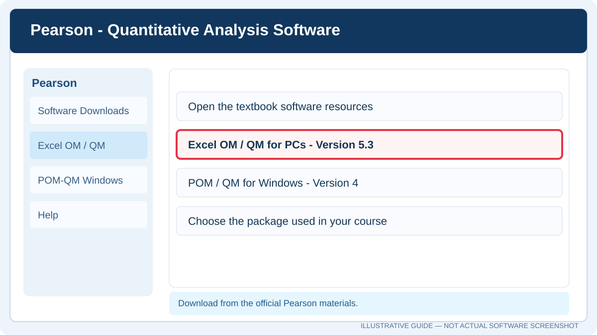
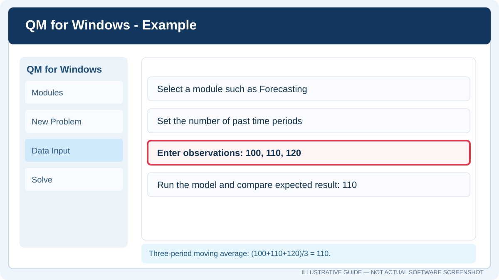

<div dir="rtl" align="right">

<h1><strong>دليل تثبيت واستخدام Excel QM وQM for Windows</strong></h1>

<p><strong>إعداد:</strong> Talal bin Ibrahim Alsultan &nbsp; | &nbsp; <strong>آخر تحديث:</strong> 26 أكتوبر 2026</p>

إذا كانت لديك مسائل في بحوث العمليات أو إدارة العمليات أو التنبؤ الكمي، فقد تحتاج إلى **Excel QM** أو **QM for Windows**. سأوضح لك الفرق بينهما، وكيف تحمّل كل برنامج وتبدأ باستخدامه، ثم نجرب مسألة حسابية بسيطة حتى تتأكد من صحة النتائج.

## 1. أي البرنامجين تحتاج؟

قبل التحميل انتبه إلى اسم البرنامج الذي طلبه الدكتور؛ لأن الاسمين متشابهان لكن طريقة العمل مختلفة.

| البرنامج | أين يعمل؟ | متى تختاره؟ |
| :---: | :---: | :---: |
| **Excel QM / Excel OM-QM** | إضافة داخل Microsoft Excel | عندما تريد حل المسألة مع الاحتفاظ بجدول البيانات داخل Excel |
| **QM for Windows / POM-QM** | برنامج مستقل | عندما تريد إدخال بيانات السؤال في نافذة البرنامج والحصول على النتائج مباشرة |

توفّر [Pearson](https://media.pearsoncmg.com/ph/bp/bridgepages/bp_render_bridgepage/qam_13e/index.html) روابط لحزم **Excel OM/QM for PCs, Version 5.3** و**POM/QM for Windows, Version 4** ضمن الموارد الخاصة بالكتاب. اختر إصدار المقرر إذا كان الدكتور قد حدده.

## 2. تحميل Excel QM وتثبيته

<p align="center"></p>

*الصورة توضيحية للخطوات وليست لقطة حرفية من موقع Pearson.*

اتبع هذه الخطوات إذا كنت ستستخدم الإضافة داخل Excel:

1. تأكد من تثبيت **Microsoft Excel Desktop** على جهازك؛ نسخة Excel عبر المتصفح ليست بديلًا عن البرنامج المكتبي لتشغيل هذه الإضافة.
2. افتح [صفحة Pearson الرسمية](https://media.pearsoncmg.com/ph/bp/bridgepages/bp_render_bridgepage/qam_13e/index.html).
3. ابحث عن قسم **Software Downloads** ثم اختر **Excel OM/QM for PCs, Version 5.3** إذا كانت هذه النسخة مطلوبة لديك.
4. حمّل ملف التثبيت الرسمي، وافتحه واتبع تعليمات المثبّت.
5. افتح Excel بعد انتهاء التثبيت، وابحث عن تبويب الإضافة، أو افحص **Add-ins**.
6. جرّب أحد النماذج الجاهزة داخل الإضافة؛ إن ظهرت ورقة إدخال البيانات ونتائج الحل، فقد اكتملت التجربة الأولية.

### إذا لم يظهر اسم الإضافة في Excel

<p align="center"></p>

*اتبع العناصر الموضحة، وقد يختلف ترتيب النافذة بحسب إصدار Excel.*

1. افتح **File → Options → Add-ins**.
2. من أسفل النافذة اختر **Manage: Excel Add-ins**، ثم **Go**.
3. إذا وجدت الإضافة ضع علامة أمامها. وإن لم تظهر، استخدم **Browse** لاختيار ملف الإضافة الصحيح، مثل `.xlam` أو `.xla` إذا كان متوفرًا ضمن ملفاتها.
4. أغلق Excel وافتحه مجددًا.

إذا ظهرت رسالة تتعلق بالماكرو، تحقق من مصدر الملف وتعليمات Pearson وسياسة جهازك. لا تُعطّل حماية الماكرو بالكامل.

## 3. تحميل QM for Windows وتثبيته

<p align="center"></p>

*هذا رسم إرشادي لإدخال البيانات وليس تصويرًا من نسخة معينة من QM.*

هذه الخطوات للبرنامج المستقل، وليست لإضافة Excel:

1. افتح [Software Downloads من Pearson](https://media.pearsoncmg.com/ph/bp/bridgepages/bp_render_bridgepage/qam_13e/index.html).
2. اختر **POM/QM for Windows, Version 4** إذا كان هو الإصدار المستخدم في مقررك.
3. حمّل الحزمة ثم فك الضغط عن الملفات إذا كانت مضغوطة.
4. افتح ملف المثبّت الموجود داخل الحزمة وأكمل خطوات التثبيت.
5. شغّل QM من قائمة Start، ثم اختر نوع المسألة الذي يتوافق مع واجبك.
6. أدخل عدد المتغيرات أو الفترات، ثم البيانات المطلوبة، واضغط أمر الحل المتاح في نسختك.
7. قارن نتيجة البرنامج مع خطوة حسابية يدوية للتأكد من صحة إدخال السؤال.

## 4. ما المسائل التي أستطيع حلها؟

| نوع المسألة | مثال لما تقوم به |
| :---: | :---: |
| **Linear Programming** | اختيار كميات الإنتاج لزيادة الربح ضمن قيود الموارد |
| **Forecasting** | حساب التنبؤ بالمتوسطات المتحركة والتنعيم الأسي |
| **Inventory** | دراسة كمية الطلب والتكاليف المرتبطة بالمخزون |
| **Transportation** | توزيع الكميات على وجهات بتكلفة أقل |
| **Assignment** | إسناد المهام إلى الموارد |
| **Waiting Lines** | تحليل بعض نماذج الطوابير وأوقات الانتظار |

قد تختلف الوحدات المتاحة وأسماء القوائم بحسب نوع البرنامج والإصدار الذي ثبته.

## 5. مثال سريع: المتوسط المتحرك

افترض أن الطلب في آخر ثلاث فترات كان **100، ثم 110، ثم 120**. إذا طلب منك السؤال حساب متوسط متحرك لثلاث فترات، فالحل يكون:

</div>

```text
Moving Average (3 periods)
Forecast = (100 + 110 + 120) / 3
Forecast = 110
```

<div dir="rtl" align="right">

وفي Excel، إذا وضعت القيم في الخلايا من `B2` إلى `B4`، اكتب:

</div>

```excel
=AVERAGE(B2:B4)
```

<div dir="rtl" align="right">

**الناتج المتوقع: 110.** إذا حصلت على نتيجة مختلفة في QM، راجع عدد الفترات وترتيب البيانات التي أدخلتها. بهذا تستطيع ربط الإجابة المحسوبة يدويًا بنتيجة البرنامج.

## 6. ماذا أفعل إذا ظهرت مشكلة؟

| المشكلة | أول شيء تفحصه |
| :---: | :---: |
| Excel QM لا يظهر | **File → Options → Add-ins** ثم أعد تشغيل Excel |
| رسالة Macro Disabled | أصل الملف وإعدادات Trust Center وسياسة الجهاز |
| مثبت QM لا يعمل | توافق Windows وOffice وإصدار البرنامج |
| النتيجة تختلف عن الحل اليدوي | عدد المتغيرات أو الفترات ونوع النموذج والمدخلات |
| البرنامج يطلب ترخيصًا | اتبع تعليمات Pearson أو الترخيص المرتبط بالكتاب والمقرر |
| رابط قديم لا يعمل | ارجع إلى صفحة Pearson الرسمية بدل تنزيل نسخة من موقع غير موثوق |

## 7. المصادر الرسمية

- [Pearson — موارد التحميل](https://media.pearsoncmg.com/ph/bp/bridgepages/bp_render_bridgepage/qam_13e/index.html)
- [Pearson — Quantitative Analysis for Management](https://www.pearson.com/en-us/subject-catalog/p/quantitative-analysis-for-management/P200000006031)

إذا كان مطلوبًا منك استخدام **QM for Windows** تحديدًا، فلا تستبدله بإضافة Excel QM دون التأكد من تعليمات المقرر.

[العودة إلى صفحة جميع الأدلة](../../README.md)

</div>