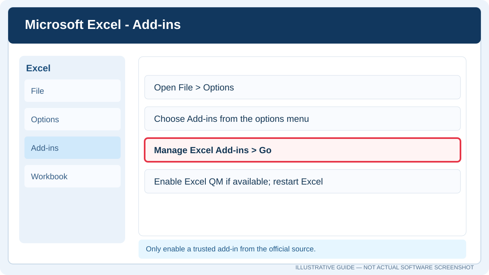

<div dir="rtl" align="right">

# **دليل Excel QM وPOM-QM for Windows**

**إعداد:** Talal bin Ibrahim Alsultan  
**آخر تحديث:** 27 أكتوبر 2026

أعددت هذا الدليل لمساعدة من يريد التعرف على **Excel QM** و**POM-QM / QM for Windows**: ما الفرق بينهما، وكيفية تحميل كل برنامج وتثبيته، وطريقة استخدام واجهته في حل المسائل الكمية. وفي النهاية يوجد مثال واحد بسيط على المخزون للتحقق من خطوات الإدخال والنتيجة.

> **قبل أن تبدأ:** **Excel QM** إضافة داخل **Microsoft Excel**، أما **POM-QM for Windows** فهو برنامج مستقل. قد يظهر باسم **QM for Windows** في بعض الإصدارات؛ فلا تخلط بين ملف الإضافة وملف تثبيت البرنامج المستقل.

> **دليل عملي لتحميل البرنامجين وتثبيتهما، والتعرّف على الواجهات والنماذج الكمية، وتطبيق مثال واحد خطوة بخطوة.**

<a name="qm-toc"></a>
## المحتويات

1. [التحميل والتثبيت](#qm-section-01)
   - [تحديد الإصدار المناسب](#qm-section-01-01)
   - [تثبيت Excel QM](#qm-section-01-02)
   - [تثبيت POM-QM / QM for Windows](#qm-section-01-03)
2. [التعرف على الواجهة وطريقة العمل](#qm-section-02)
   - [واجهة Excel QM](#qm-section-02-01)
   - [واجهة POM-QM / QM for Windows](#qm-section-02-02)
3. [الاستخدامات والنماذج المتاحة](#qm-section-03)
   - [روابط موثوقة للتثبيت والتعلّم](#qm-section-03-01)
4. [مثال تطبيقي واحد — Economic Order Quantity](#qm-section-04)
   - [صور المخزون ومخرجات المثال](#qm-eoq-screenshot)
   - [المطلوب](#qm-section-04-01)
   - [الحل يدويًا للمقارنة](#qm-section-04-02)
   - [كيف أطبق المثال في Excel QM؟](#qm-section-04-03)
   - [كيف أطبقه في QM for Windows؟](#qm-section-04-04)
5. [الأخطاء الشائعة وحلولها](#qm-section-05)

---
<a name="qm-section-01"></a>
## 1. التحميل والتثبيت

<a name="qm-section-01-01"></a>
### 1. تحديد الإصدار المناسب

أولًا، تأكد من الفرق بين **Excel QM** (إضافة داخل Excel) و**POM-QM for Windows** (برنامج مستقل). تختلف إصداراتهما وطريقة تثبيتهما؛ مثلًا تتوفر حزم باسم **Excel OM/QM 5.3** وأخرى باسم **POM-QM for Windows 4 أو 5**، وهذه ليست أسماء لإصدار واحد.

يمكن البدء من [صفحة موارد Pearson لبرامج Excel OM/QM وPOM-QM](https://media.pearsoncmg.com/ph/bp/bridgepages/bp_render_bridgepage/qam_13e/index.html) للعثور على نسخة متوافقة مع جهازك. تأكد من الإصدار والترخيص قبل التثبيت.

<a name="qm-section-01-02"></a>
### 2. تثبيت Excel QM

1. تأكد من تثبيت **Excel Desktop** على Windows، وليس نسخة المتصفح فقط.
2. افتح صفحة Pearson الرسمية وحدد **Excel QM / Excel OM-QM** المتوافق مع إصدار Excel الموجود على جهازك.
3. نزّل ملف الإضافة أو المثبّت من المصدر المرخّص واتبع تعليماته.
4. افتح Excel وابحث عن تبويب **Excel QM** ضمن الشريط العلوي **Ribbon**. في بعض الإصدارات يمكن تشغيل Excel QM من اختصار يبدأ معه Excel.
5. إذا لم يظهر، افتح **File → Options → Add-ins**، ثم **Manage: Excel Add-ins → Go**؛ تحقق من أن الإضافة مفعّلة أو حدد ملفها الأصلي من **Browse**.
6. اختر نموذجًا من قوائم الإضافة وتأكد من أن Excel يُنشئ ورقة تحتوي على خلايا للمدخلات وصيغ أو نتائج.

<p align="center"></p>

<small>هذه صورة إرشادية لمكان إدارة إضافات Excel، وليست لقطة حرفية من Excel QM؛ قد تختلف القوائم بحسب نسخة Excel.</small>

<a name="qm-section-01-03"></a>
### 3. تثبيت POM-QM / QM for Windows

يُثبّت البرنامج المستقل من خلال حزمة التثبيت المناسبة. بعد تنزيلها من المصدر المرخّص، اتبع معالج الإعداد الذي يظهر على الشاشة.

1. نزّل الحزمة المناسبة من Pearson أو مصدر الترخيص المعتمد.
2. أغلق البرامج المفتوحة وشغّل مثبت الحزمة بالطريقة الموثقة.
3. اتبع خطوات الإعداد وأدخل معلومات المستخدم المطلوبة حسب الترخيص.
4. بعد التثبيت افتح **POM-QM for Windows** من اختصار سطح المكتب أو قائمة Start.
5. ستظهر شاشة البداية، ثم النافذة الرئيسية. تحقق من رقم الإصدار من الشاشة أو قائمة البرنامج، لأنه قد يختلف عن نسخة الصور في المرجع.

**تنبيه:** تحقّق من مصدر المثبّت وتوقيعه الرقمي قبل تشغيل أي ملف تنفيذي على جهازك.

<a name="qm-section-02"></a>
## 2. التعرف على الواجهة وطريقة العمل

<a name="qm-section-02-01"></a>
### 4. واجهة Excel QM

عندما تفتح التبويب **Excel QM** فإنك تختار الوحدة المرتبطة بنوع المسألة. بعدها ينشئ البرنامج ورقة Excel تحتوي على أماكن مخصصة للبيانات، مثل **Demand Rate** و**Ordering Cost** و**Holding Cost** في مسائل المخزون، مع خلايا للمخرجات.

يمكن عرض نافذة Excel QM من داخل Excel، ثم اختيار النموذج الذي تحتاجه وإدخال البيانات في ورقة العمل. فيما يلي **صور حقيقية من واجهة Excel QM** منشورة في مراجع تعليمية، مع العلم أنها لإصدارات أقدم وقد تختلف عن نسختك الحالية:

<div align="center">

</div>

<small>لقطة واجهة Excel QM القديمة منشورة ضمن [عرض تعليمي عن التحليل الكمي](https://www.slideserve.com/orien/introduction-to-quantitative-analysis-powerpoint-ppt-presentation). المصدر الخارجي يعرض الصورة الأصلية؛ إذا تعذر تحميلها يمكن فتحه مباشرةً.</small>

<div align="center">

</div>

<small>صورة فعلية لنافذة Excel QM أثناء استخدام ورقة التنبؤ، من [شرح فيديو](https://www.youtube.com/watch?v=w_4iiFXZ7zs).</small>

من أبرز المدخلات والمخرجات بحسب النموذج:

| نوع النموذج | أهم المدخلات | ما الذي يظهر في النتيجة؟ |
| :--- | :--- | :--- |
| **Decision Analysis** | البدائل والسيناريوهات واحتمالاتها | المقارنة بين البدائل والعائد المتوقع |
| **Inventory / EOQ** | الطلب السنوي وتكلفتا الطلب والتخزين | كمية الطلب الاقتصادية والتكلفة |
| **Production Order Quantity** | الطلب ومعدل الإنتاج والتكاليف | كمية الإنتاج الاقتصادية |
| **Waiting Lines** | معدلات الوصول والخدمة وعدد الخوادم | وقت الانتظار وانشغال الخوادم |


<a name="qm-section-02-02"></a>
### 5. واجهة POM-QM / QM for Windows

البرنامج المستقل له مسار عمل مختلف عن Excel. بعد تشغيله، ستتعامل غالبًا مع هذه العناصر، وقد يختلف مكانها قليلًا بحسب الإصدار:

| العنصر | استخدامه |
| :--- | :--- |
| **Module Tree** | شجرة على يسار الواجهة لبدء مسألة في إحدى الوحدات |
| **Module** | قائمة بجميع الوحدات، ويمكن عرض وحدات QM فقط |
| **File → New / Open** | إنشاء مسألة جديدة أو فتح ملف محفوظ |
| **Problem Creation** | إدخال عنوان المسألة واختيار النموذج وعدد الصفوف أو البدائل |
| **Data Screen** | إدخال المعطيات في جدول يشبه Excel |
| **Solve** | حل المسألة بعد التأكد من صحة المدخلات |
| **Solution Screen** | قراءة النتائج والجداول والرسوم المتاحة |
| **File → Save as Excel File** | في كثير من النماذج يمكن نقل بيانات وحسابات المسألة إلى Excel؛ ليست كل الوحدات مدعومة بنفس الطريقة |

**التسلسل العملي:** اختر **Module** المناسب ← أنشئ **New Problem** ← أدخل البيانات ← اختر **Solve** ← اقرأ **Solution Screen** ← احفظ النتيجة عند الحاجة.

<div align="center">

</div>

<small>واجهة حقيقية من [شرح POM-QM for Windows](https://caraindustri.blogspot.com/2020/05/cara-melakukan-forecasting-metode.html)، وليست رسمًا افتراضيًا. يمكنك فتح صفحة المصدر إذا تعذر عرض الصورة.</small>

### صور إضافية من واجهات البرامج الحقيقية

توضح الصور التالية كيف تظهر القوائم والحلول في **POM-QM for Windows**. بعض الصور مأخوذ من إصدارات قديمة، لذلك قد يتغير شكل الأزرار أو أسماء الخيارات مع بقاء طريقة العمل الأساسية متقاربة.

**صورة: شاشة إدخال البيانات داخل برنامج POM-QM for Windows**

<div align="center">

</div>

<small>مصدر الصورة: [POM-QM Location Analysis](https://www.slideserve.com/rehan/pom-qm-location-analysis). لاحظ جدول **Data Table** وشريط الأدوات في أعلى النافذة؛ هذا المثال مستقل عن مثال المخزون الموجود لاحقًا.</small>

**صورة: جدول النتائج Decision Table Results في QM for Windows**

<div align="center">

</div>

<small>مصدر الصورة: [Decision Analysis with QM for Windows](https://www.slideserve.com/drew/chapter-12-decision-analysis). يوضح الجدول كيف يقارن البرنامج البدائل عند اختلاف معايير اتخاذ القرار.</small>

**صورة: مخرجات Forecasting داخل POM-QM for Windows**

<div align="center">

</div>

<small>مصدر الصورة: [Forecasting with POM-QM for Windows](https://caraindustri.blogspot.com/2020/05/cara-melakukan-forecasting-metode.html). عند اختيار نموذج التنبؤ تظهر أعمدة المقارنة بين القيم الفعلية والمتوقعة ومقاييس الأخطاء.</small>

<a name="qm-section-03"></a>
## 3. الاستخدامات والنماذج المتاحة

فيما يلي أهم الاستخدامات التي يمكن تعلمها من وحدات Excel QM أو POM-QM for Windows، بحسب النسخة الموجودة لديك:

- **Decision Analysis:** المقارنة بين البدائل باستخدام جداول القرار و**Maximax** و**Maximin** و**EMV** و**EVPI**.
- **Inventory Control:** حساب **EOQ** و**EPQ/POQ** ونقطة إعادة الطلب **ROP** ومخزون الأمان وخصومات الكمية.
- **Waiting Lines / Queuing:** دراسة معدلات الوصول والخدمة وانشغال الخوادم وأوقات الانتظار.
- **Markov Analysis:** إدخال مصفوفات انتقال الحالات وحساب احتمالاتها المستقبلية.
- **Forecasting:** تطبيق النماذج الكمية للتنبؤ ومقارنة الأخطاء.
- **Linear Programming / Transportation / Assignment:** حل نماذج التحسين وتوزيع الموارد.
- **Project Management / Quality Control / Simulation:** استخدام الوحدات المخصصة لهذه المجالات عند توفرها في نسخة البرنامج.

**مهم:** قد تختلف الوحدات المتاحة في **Excel QM** عن **POM-QM for Windows**؛ استخدم قائمة البرنامج المثبت للتأكد من الخيارات الموجودة لديك.


<a name="qm-section-03-01"></a>
### روابط موثوقة للتثبيت والتعلّم

- [Pearson — Excel OM/QM وPOM/QM](https://media.pearsoncmg.com/ph/bp/bridgepages/bp_render_bridgepage/qam_13e/index.html) — صفحة الموارد والتحميل.
- [Microsoft — تثبيت إضافات Excel وإدارتها](https://support.microsoft.com/en-us/office/add-or-remove-add-ins-in-excel-0af570c4-5cf3-4fa9-9b88-403625a0b460) — إدارة الإضافات.
- [Cedar Crest College — معلومات تثبيت Excel QM](https://cedarcrest.teamdynamix.com/TDClient/2020/Portal/KB/Article/90472/Excel-QM-Installation-Links-and-Information) — شرح مرتبط بإضافة Excel QM.
- [Pearson — ملحق مصور لاستخدام Excel QM](https://www.pearsonhighered.com/assets/samplechapter/0/2/7/3/0273752863.pdf) — صور حقيقية لواجهة البرنامج.


<a name="qm-section-04"></a>
## 4. مثال تطبيقي واحد — Economic Order Quantity

سنجرب مثالًا مبسطًا على **Economic Order Quantity (EOQ)** لحساب كمية الطلب المثلى والتحقق من النتيجة يدويًا.

<a name="qm-section-04-01"></a>
### المطلوب

نفترض أن منشأة ترغب في تحديد عدد الوحدات الأنسب في كل طلبية لتقليل مجموع تكلفتَي الطلب والتخزين. المعطيات هي:

| المدخل | الرمز | القيمة |
| :--- | :---: | ---: |
| الطلب السنوي | `D` | 1,000 وحدة |
| تكلفة إصدار الطلبية | `S` | 10 دولارات |
| تكلفة الاحتفاظ بالوحدة سنويًا | `H` | 0.50 دولار |

<a name="qm-section-04-02"></a>
### الحل يدويًا للمقارنة

</div>

```text
EOQ = SQRT((2 × D × S) / H)
EOQ = SQRT((2 × 1000 × 10) / 0.50)
EOQ = 200 units

Annual orders = D / EOQ = 1000 / 200 = 5
Average inventory = EOQ / 2 = 100 units
Annual ordering cost = (1000 / 200) × 10 = $50
Annual holding cost = (200 / 2) × 0.50 = $50
Total relevant annual cost = $100
```

<div dir="rtl" align="right">

<a name="qm-section-04-03"></a>
### كيف أطبق المثال في Excel QM؟

1. افتح Excel وشغّل تبويب **Excel QM**.
2. اختر وحدة **Inventory** ثم نموذج **Economic Order Quantity** إذا كان متوفرًا باسم مماثل في إصدارك.
3. أدخل `D = 1000` و`S = 10` و`H = 0.5`.
4. راجع الخلايا الناتجة في الورقة وقارنها بالنتائج السابقة.
5. يجب أن تكون **كمية الطلب الاقتصادية 200 وحدة** إذا أدخلت المدخلات في النموذج القياسي الصحيح.

<a name="qm-section-04-04"></a>
### كيف أطبقه في QM for Windows؟

1. افتح **Module → Inventory** ثم اختر **Economic Order Quantity**.
2. أنشئ مسألة جديدة وأدخل **Demand rate = 1000**، و**Setup cost = 10**، و**Holding cost = 0.50**.
3. اختر **Solve** ثم اقرأ النتائج في **Solution Screen**.
4. طابق قيمة **Optimal order quantity = 200** وعدد الطلبيات السنوية **5** والتكلفة ذات الصلة **100 دولار**.

يفترض المثال شروط **EOQ القياسي**: الطلب معروف وثابت، ولا توجد خصومات كمية أو نقص مخزون، وتكلفة الاحتفاظ والطلب ثابتتان. **لا تضف سعر الوحدة ضمن الـ100 دولار**؛ فهذا مجموع تكلفتَي الطلب والاحتفاظ فقط، دون تكلفة شراء الوحدات.

<a name="qm-eoq-screenshot"></a>
### صور حقيقية لنتائج المخزون وكيف أقرأها

**صورة: نافذة Inventory Results في QM for Windows**

<div align="center">

</div>

<small>المصدر: [شرح EOQ Analysis with QM for Windows](https://present5.com/inventory-management-chapter-16-copyright-2010-pearson/). **قيم هذه الصورة من مسألة مختلفة**؛ لا تخلط بينها وبين قيم مثال الدليل.</small>

في النتائج ابحث عن هذه الخانات: **Optimal Order Quantity** لمعرفة كمية الطلب المقترحة، و**Orders per Period** لمعرفة عدد الطلبات، و**Annual Setup Cost** و**Annual Holding Cost** لمعرفة التكاليف. ثم قارنها بالحساب اليدوي السابق.

**صورة: رسم التكلفة مقابل كمية الطلب في ورقة Excel**

<div align="center">

</div>

<small>المصدر: [Economic Order Quantity — Excel Illustration](https://www.svtuition.org/2010/08/economic-order-quantity.html). **هذا نموذج Excel عادي وليس بالضرورة إضافة Excel QM**؛ يعرض شكل الناتج والرسم البياني للمقارنة.</small>

**مراجعة نتائج المثال الحالي:** في مثالنا `D = 1000` و`S = 10` و`H = 0.50`، والناتج الصحيح **EOQ = 200 وحدة**، و**5 طلبيات سنويًا**، و**100 دولار** للتكاليف السنوية ذات الصلة (الطلب والتخزين معًا)، وفق افتراضات EOQ القياسي.

<a name="qm-section-05"></a>
## 5. الأخطاء الشائعة وحلولها

| المشكلة | ما الذي تفحصه؟ |
| :--- | :--- |
| لم يظهر تبويب Excel QM | تفعيل الإضافة من **File → Options → Add-ins** وتوافقها مع نسخة Excel |
| برنامج QM المستقل لا يظهر داخل Excel | هذا طبيعي؛ **POM-QM for Windows** برنامج منفصل عن إضافة Excel |
| لا تظهر نفس القوائم في الصور | تأكد من الإصدار: **POM-QM 4 أو 5** يختلف عن **Excel QM 5.3** |
| النتيجة تختلف عن الحل اليدوي | افحص نوع النموذج ووحدات الزمن وقيم `D` و`S` و`H` |
| ملف التثبيت من مصدر مجهول | لا تشغله قبل التحقق من المصدر والتوقيع والترخيص |
| ظهور `#VALUE!` في نموذج Excel | تحقق من أن المدخلات أرقام، وأن نسبة التخزين لم تُدخل على أنها نص غير قابل للحساب |

[العودة إلى مركز أدلة البرامج](../../README.md)

---

### إعداد الدليل

**Talal bin Ibrahim Alsultan**  
*Applied Information System • Data Science • Decision Sciences*  
King Saud University

</div>