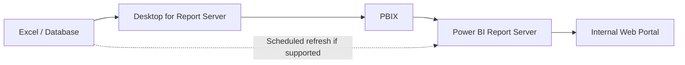

# **دليل Power BI Report Server**

**إعداد:** Talal bin Ibrahim Alsultan  
**آخر تحديث:** 27 أكتوبر 2026

إذا كنت تعمل على تقارير Power BI وتحتاج إلى نشرها داخل شبكة الجهة بدلًا من رفعها إلى الخدمة السحابية، فهذا الدليل يوضح طريقة استخدام **Power BI Report Server (PBIRS)**. سنبدأ بالفرق بينه وبين Power BI Desktop، ثم متطلبات التثبيت، وكيفية إعداد تقرير ونشره وتحديث بياناته.

**ملاحظة قبل البدء:** تثبيت الخادم وإدارته مهمة مسؤول الأنظمة الذي يملك الصلاحيات المناسبة. إذا كنت محلل بيانات، فغالبًا يكفيك البدء من قسم تنزيل Desktop المتوافق مع الخادم ونشر التقرير.

> **دليل عملي لفهم Power BI Report Server وتثبيته، وإعداد البوابة الداخلية، ونشر تقرير ومتابعة تحديث بياناته.**

## المحتويات

1. [ما الفرق بين Desktop وReport Server؟](#pbirs-section-01)
2. [كيف تنتقل البيانات من Excel إلى لوحة التقارير؟](#pbirs-section-02)
3. [تحميل الخادم وتثبيته](#pbirs-section-03)
4. [تنزيل Power BI Desktop المناسب للخادم](#pbirs-section-04)
5. [نشر أول تقرير على بوابة الخادم](#pbirs-section-05)
6. [ضبط تحديث البيانات Scheduled Refresh](#pbirs-section-06)
   - [مثال نشر تقرير وتجربة التحديث](#pbirs-example)
7. [أهم المشكلات والحلول](#pbirs-section-07)
8. [روابط Microsoft الرسمية](#pbirs-section-08)

---

## 1. ما الفرق بين Desktop وReport Server؟

| Power BI Desktop | Power BI Report Server |
| :---: | :---: |
| تستخدمه لإنشاء نماذج البيانات والرسوم | يستضيف التقارير ويتيح عرضها للمستخدمين |
| يعمل على جهاز المحلل | يعمل على خادم الجهة |
| يحفظ التقارير عادةً بصيغة `.pbix` | يستقبل ملفات PBIX المتوافقة مع إصداره |
| يتيح تصميم التقرير دون خادم | يحتاج إلى إعداد الخدمات وقاعدة البيانات والصلاحيات |

**النقطة المهمة:** إذا كان النشر على PBIRS، فلا تفترض أن أي نسخة من Power BI Desktop ستعمل معه. استخدم **Power BI Desktop for Report Server** المتوافق مع إصدار الخادم.

## 2. كيف تنتقل البيانات من Excel إلى لوحة التقارير؟

*لقطة فعلية لبوابة **Power BI Report Server** من [توثيق Microsoft](https://learn.microsoft.com/en-us/power-bi/report-server/get-started).*

لنفترض أن القسم يحدّث ملف Excel محفوظًا في مجلد مشترك داخل الشبكة. يمكنك قراءة البيانات من الملف باستخدام Desktop، وبناء الرسوم والمؤشرات، ثم نشر تقرير متوافق على الخادم ليشاهده المستخدمون المصرح لهم. وإذا كانت طريقة الاتصال مدعومة، يمكن جدولة تحديث البيانات.

## 3. تحميل الخادم وتثبيته

*لقطة فعلية لنافذة **Report Server Configuration Manager** منشورة في [Microsoft Fabric Community](https://community.fabric.microsoft.com/t5/Report-Server/Scheduled-data-refresh-for-local-excel-file/m-p/299893). الأسماء الظاهرة مثال من صاحب الصورة، وليست إعدادات موصى بنسخها.*

**هذا القسم مخصص لمسؤول الأنظمة.**

1. ابدأ من [تعليمات Microsoft لتنزيل Power BI Report Server](https://learn.microsoft.com/en-us/power-bi/report-server/download-powerbi-report-server)، وحدد الإصدار المراد تثبيته.
2. راجع متطلبات Windows Server والترخيص والصلاحيات، ثم جهّز قاعدة بيانات Report Server على محرك SQL Server مناسب.
3. نزّل ملف تثبيت PBIRS من Microsoft وشغّله بالصلاحيات المخوّلة.
4. اختر **Install Power BI Report Server** واتبع تعليمات المثبّت وخيار الترخيص الصحيح.
5. بعد التثبيت افتح **Report Server Configuration Manager**. لا تعتبر التثبيت مكتملًا قبل إعداد الخدمة.
6. اضبط **Service Account** و**Database** و**Web Service URL** و**Web Portal URL** وفق إعدادات الشبكة والجهة.
7. احفظ مفاتيح التشفير بحسب سياسة النسخ الاحتياطي لدى الجهة، ثم اختبر البوابة من متصفح داخل الشبكة.

لمزيد من التفصيل راجع [دليل تثبيت Report Server من Microsoft](https://learn.microsoft.com/en-us/power-bi/report-server/install-report-server).

## 4. تنزيل Power BI Desktop المناسب للخادم

إذا كان الخادم مثبتًا أصلًا، فاتبع هذه الخطوات لإنشاء تقارير متوافقة معه:

1. افتح بوابة Report Server التي أعطاك إياها مسؤول الخادم.
2. إذا ظهر خيار **Download → Power BI Desktop** في البوابة، استخدمه للحصول على النسخة المرتبطة بالخادم.
3. يمكنك كذلك مراجعة [تعليمات Microsoft لتنزيل Desktop for Report Server](https://learn.microsoft.com/en-us/power-bi/report-server/install-powerbi-desktop).
4. تأكد من توافق **إصدار Desktop** مع إصدار **Report Server** المثبت في الجهة.
5. بعد التثبيت افتح Desktop المناسب، ثم أنشئ ملف PBIX أو افتح تقريرًا موجودًا وقابلًا للتشغيل عليه.

قد توجد على الجهاز نسخة Power BI Desktop عادية ونسخة مخصصة لـ Report Server. انتبه إلى اسم النسخة المفتوحة، خاصة عند النقر المزدوج على ملفات PBIX.

### صورة فعلية لنسخة Power BI Desktop المخصصة للخادم

<small>المصدر: [Microsoft Learn — Power BI Desktop for Report Server](https://learn.microsoft.com/en-us/power-bi/report-server/install-powerbi-desktop). الصورة لنسخة قديمة توضح ظهور الإصدار في شريط العنوان؛ استخدم النسخة المتوافقة مع خادمك الحالي.</small>

## 5. نشر أول تقرير على بوابة الخادم

بعد تجهيز البيانات والرسوم، اتبع الخطوات التالية:

1. افتح التقرير في **Power BI Desktop for Report Server** واحفظه بصيغة `.pbix`.
2. افتح مجلدك في بوابة الخادم وتأكد من امتلاك صلاحية إضافة التقارير.
3. ارفع ملف PBIX من بوابة الخادم، أو استخدم خيار الحفظ إلى Report Server المتاح في نسختك.
4. افتح التقرير من المتصفح، وجرّب الرسوم والمرشحات.
5. اختبر الحساب الذي يملك دور **Browser** فقط للتأكد من قدرة القارئ على العرض دون صلاحيات تعديل.

إذا لم يظهر زر النشر، فافحص الصلاحية أولًا؛ ليس بالضرورة أن تكون مشكلة في البرنامج نفسه.

### صور فعلية من نشر وإدارة التقرير

**الصورة الأولى: حفظ ملف التقرير مباشرة إلى Power BI Report Server**

<small>المصدر: [Microsoft Learn — Create a Power BI report for Report Server](https://learn.microsoft.com/en-us/power-bi/report-server/quickstart-create-powerbi-report). هذه لقطة لنسخة من البرنامج توضح اختيار جهة الحفظ.</small>

**الصورة الثانية: إدارة خصائص التقرير وبياناته وصلاحيات عرضه**

<small>المصدر: [Microsoft Learn — Manage content in the web portal](https://learn.microsoft.com/en-us/power-bi/report-server/getting-around). تظهر الخيارات حسب نوع التقرير والدور الممنوح للمستخدم.</small>

## 6. ضبط تحديث البيانات Scheduled Refresh

*لقطة فعلية من [Microsoft Learn](https://learn.microsoft.com/en-us/power-bi/report-server/configure-scheduled-refresh)، توضّح فتح قائمة **Manage** تمهيدًا لإعداد مصدر البيانات وجدولة التحديث.*

إذا كان التقرير يستورد البيانات من مصدر تدعمه ميزة التحديث المجدول، يمكن إعداد خطة تحديث من بوابة الخادم:

1. افتح التقرير المنشور ثم **Manage**.
2. راجع إعدادات **Data Sources** وحدد بيانات الاعتماد المناسبة للوصول إلى المصدر.
3. افتح **Scheduled Refresh** إن كانت الميزة متاحة لهذا النوع من التقارير، ثم اختر **New Scheduled Refresh Plan**.
4. حدد أوقات التحديث وفق احتياج العمل واحفظ الإعدادات.
5. راقب حالة التحديث والسجل لمعرفة نجاح العملية أو أسباب الفشل.

**مثال مهم:** إذا كان تقريرك يقرأ ملف Excel من مجلد شخصي على جهازك، فقد يعجز خادم PBIRS عن الوصول إليه أثناء التحديث. غالبًا ستحتاج إلى نقل المصدر إلى مسار شبكي يمكن للخادم قراءته مع ضبط صلاحيات الحساب الذي ينفذ التحديث، وتعديل مصدر التقرير تبعًا لذلك.

راجع [Microsoft — Scheduled Refresh](https://learn.microsoft.com/en-us/power-bi/report-server/scheduled-refresh) للتأكد من أنواع البيانات المدعومة والإعدادات المناسبة لإصدارك.

### صورة فعلية لخطة التحديث المجدول

<small>المصدر: [Microsoft Fabric Community — PBIRS Scheduled Refresh Frequency](https://community.fabric.microsoft.com/t5/Report-Server/PBIRS-Scheduled-Refresh-Frequency-Setting/m-p/2527961). إعدادات الصورة تخص بيئة صاحب السؤال، **ولا يُنصح بنسخ فترة التحديث كما هي** دون مراعاة المصدر وحجم البيانات.</small>

### مثال عملي صغير: نشر تقرير مبيعات تجريبي

نفترض أن تقرير `Sales.pbix` يحتوي على جدول مبيعات بأربع مناطق، وأن مجموع المبيعات قبل تطبيق أي مرشح **3300** وحدة نقدية (بيانات افتراضية). يمكن اختبار عملية النشر بالخطوات التالية:

1. افتح `Sales.pbix` بواسطة **Power BI Desktop for Report Server** المتوافق مع خادمك.
2. احفظ التقرير في مجلد التجربة الموجود داخل بوابة Report Server.
3. افتح البوابة من المتصفح بحساب يملك صلاحية العرض، ثم ادخل المجلد وافتح التقرير.
4. تأكد من ظهور بطاقة إجمالي المبيعات **3300** وأن المرشح يستطيع عرض منطقة واحدة عند اختيارها.
5. إذا كانت البيانات مستوردة من ملف Excel مشترك وتتوفر شروط **Scheduled Refresh**، فعّل خطة مناسبة ثم راجع حالة آخر تحديث في البوابة.

**النتيجة المتوقعة:** ظهور تقرير قابل للفتح داخل **Web Portal** وتفاعل الرسوم والفلاتر مع بيانات المثال. إذا فشل تحديث البيانات فهذا لا يعني بالضرورة فشل النشر؛ افحص **Data Sources** والاتصال الشبكي وبيانات الاعتماد بشكل منفصل.

**تنبيه:** صور Microsoft المعروضة في هذا الدليل أمثلة حقيقية لواجهة المنتج، لكنها لا تمثل نتيجة تقرير `Sales.pbix` الافتراضي المذكور هنا، ولا توثق خادمًا فعليًا تابعًا لأي جهة.

## 7. أهم المشكلات والحلول

| المشكلة | ماذا تفحص أولًا؟ |
| :---: | :---: |
| ملف PBIX لا يفتح على الخادم | مدى توافق إصدار Desktop مع إصدار PBIRS |
| لا تظهر مجلدات البوابة | صلاحيات المستخدم والدور الممنوح له |
| لا يوجد خيار رفع التقرير | صلاحية النشر وإدارة المحتوى |
| التحديث المجدول يفشل | مسار مصدر البيانات وبيانات الاعتماد واتصال الخادم |
| يظهر تقرير قديم | هل حدث المصدر الأصلي؟ وهل اكتمل Refresh بنجاح؟ |
| رابط البوابة لا يعمل | إعداد Web Portal URL والخدمة والشبكة والجدار الناري |
| التقارير تستغرق وقتًا طويلًا | حجم النموذج والعلاقات والاستعلامات وموارد الخادم |

## 8. روابط Microsoft الرسمية

- [Power BI Report Server — Get Started](https://learn.microsoft.com/en-us/power-bi/report-server/get-started)
- [تنزيل Power BI Report Server](https://learn.microsoft.com/en-us/power-bi/report-server/download-powerbi-report-server)
- [تثبيت Report Server](https://learn.microsoft.com/en-us/power-bi/report-server/install-report-server)
- [Power BI Desktop for Report Server](https://learn.microsoft.com/en-us/power-bi/report-server/install-powerbi-desktop)
- [Scheduled Refresh](https://learn.microsoft.com/en-us/power-bi/report-server/scheduled-refresh)

**ملاحظة:** قد تتغير أسماء الأزرار وترتيب الإعدادات بين الإصدارات. ابدأ دائمًا من النسخة التي يستخدمها خادم جهتك قبل تطبيق الخطوات.

[العودة إلى الصفحة الرئيسية للأدلة](../../README.md)

---

### إعداد الدليل

**Talal bin Ibrahim Alsultan**  
*Applied Information System • Data Science • Decision Sciences*  
King Saud University

