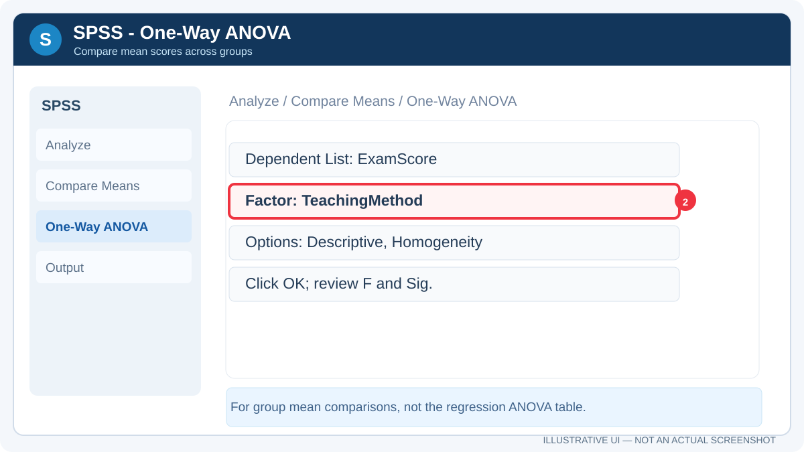

<div dir="rtl" align="right">

# **دليل IBM SPSS Statistics: التحميل والتثبيت والتحليل الإحصائي**

**إعداد:** Talal bin Ibrahim Alsultan  
**آخر تحديث:** 26 أكتوبر 2026

إذا كنت تريد استخدام **SPSS** في واجب أو مشروع جامعي، فهذا الدليل يبدأ معك من تحميل البرنامج وتفعيله، ثم يعرّفك على أهم القوائم، وبعد ذلك يوضح طريقة تنفيذ التحليل الوصفي والارتباط والانحدار وANOVA. حاولت ترتيب الخطوات بالطريقة التي يحتاجها الطالب وهو يعمل على جهازه، بدل الاكتفاء بسرد أسماء الأدوات.

</div>

<div align="center">


</div>

<div dir="rtl" align="right">

## 1. ما SPSS ومتى أحتاجه؟

**IBM SPSS Statistics** برنامج إحصائي يستخدم في إدخال البيانات وتنظيمها وإجراء التحليلات وعرض النتائج. من أمثلته: وصف عينة بحث، اختبار علاقة بين متغيرين، مقارنة متوسطات مجموعات، وتقدير نموذج انحدار.

المسار المعتاد عند العمل هو:

**تجهيز البيانات ← تعريف المتغيرات ← اختيار الاختبار المناسب ← تشغيل التحليل ← قراءة الجداول ← كتابة النتيجة.**

> **قبل البدء:** اعرف نوع ترخيصك ونسخة Windows لديك. استخدام النسخة الرسمية أو ترخيص الجامعة أفضل من تنزيل ملفات معدّلة من مواقع خارجية.

## 2. روابط التحميل والتفعيل

| المصدر | ما الذي ستجده فيه؟ |
| :---: | :---: |
| **[IBM SPSS Statistics](https://www.ibm.com/products/spss-statistics)** | صفحة البرنامج الرسمية وخيارات الشراء والتجربة |
| **[IBM SPSS Resources](https://www.ibm.com/products/spss-statistics/resources)** | خطوات التسجيل وتجربة البرنامج وشروحات الاستخدام |
| **[IBM SPSS Documentation](https://www.ibm.com/docs/en/spss-statistics)** | دليل البرنامج والقوائم الإحصائية |
| **[IBM — شرح ترخيص المستخدم](https://www.ibm.com/docs/en/spss-statistics/32.0.0?topic=installation-authorized-user-license-instructions-spss-statistics)** | خطوات License Authorization Wizard والرمز الرسمي |

### خطوات تحميل النسخة الرسمية

1. افتح [صفحة IBM الرسمية](https://www.ibm.com/products/spss-statistics)، ثم اختر تجربة البرنامج أو الاشتراك أو الطريقة التي تتيحها جامعتك.
2. إذا طلب الموقع إنشاء حساب، سجّل باستخدام **IBMid**. عندما يكون ترخيص الجامعة مرتبطًا ببريدك الجامعي، استخدم ذلك البريد.
3. نزّل إصدار Windows أو macOS المناسب، ثم شغّل ملف التثبيت الرسمي وأكمل المعالج.
4. افتح SPSS بعد التثبيت. إذا ظهر طلب تفعيل، اختر المسار المناسب لنوع رخصتك كما هو موضح في القسم التالي.
5. افتح ملف بيانات تجريبيًا وتحقق من ظهور **Data View** و**Variable View**.

**ملاحظة:** التجربة الرسمية لدى IBM مدتها **14 يومًا** وفق صفحة الموارد الحالية، وتبدأ بعد التسجيل. قد تختلف شروط عروض الجامعات.

### صورة إرشادية لتنزيل SPSS من IBM

<div align="center">


<sub>رسم إرشادي أعددته لتوضيح الفكرة، وليس لقطة شاشة فعلية من إصدار IBM الحالي. استخدم رابط الشركة الموجود أعلاه.</sub>

</div>

### كيف أفعّل SPSS بطريقة صحيحة؟

| نوع الترخيص | طريقة التفعيل |
| :---: | :---: |
| **Subscription / Trial** | سجّل الدخول إلى SPSS باستخدام حساب **IBMid** المرتبط بالاشتراك أو التجربة |
| **Authorized User (Traditional)** | افتح **License Authorization Wizard** وأدخل **Authorization Code** الذي حصلت عليه من IBM أو الجهة المرخّصة |
| **Concurrent / Network License** | اتبع تعليمات جهة الجامعة أو مسؤول التراخيص للاتصال بمدير الترخيص |

في تراخيص المستخدم التقليدية، قد تصل إلى معالج التفعيل من **File → Manage License → Launch License Wizard** بحسب إصدار SPSS. اتبع الرسائل التي تظهر أمامك ولا تستخدم رمزًا عشوائيًا؛ فمجرد إدخال مفتاح متداول على الإنترنت لا يثبت أن النسخة أصلية أو مرخّصة.

### رابط Traidsoft الذي قد تصادفه

يمكن الاطلاع على [صفحة SPSS في Traidsoft](https://apps.traidsoft.net/download-ibm-spss-statistics/) **بوصفها صفحة لطرف ثالث غير تابع لـ IBM**، وليست رابط التحميل المعتمد في هذا الدليل.

الصفحة تذكر ملفات تفعيل معدّلة (Crack)، وتطلب تعطيل إعدادات مكافحة الفيروسات لإجراء التنزيل أو التشغيل. **لا أنصح باتباع هذه التعليمات أو تشغيل أداة التفعيل**، ولم أتحقق من سلامة ملفاتها أو من امتلاكها حق توزيع البرنامج. استخدم روابط IBM أو الترخيص الجامعي للحصول على نسخة مرخّصة.

<div align="center">

</div>

<sub><em>إخلاء مسؤولية: هذا الرابط خارجي وغير رسمي. إدراجه للتعريف بالمصدر الذي ذُكر فقط، وليس ضمانًا لسلامته أو صحة ترخيصه. لا تُعطّل Windows Security، ولا تُشغّل ملفات تنفيذية أو أدوات تفعيل غير موثوقة. الفحص الأمني بعد التنزيل وقبل التشغيل إجراء احترازي، لكنه لا يضمن سلامة الملف ولا يمنح البرنامج ترخيصًا قانونيًا.</em></sub>

## 3. تعرّف على واجهة SPSS بالصور

عند فتح البرنامج ستجد نافذة **Data Editor**. أهم جزأين فيها هما **Data View** لإدخال البيانات، و**Variable View** لتعريف المتغيرات قبل التحليل.

### الصورة الأولى: Data View

<div align="center">


<sub>رسم إرشادي محفوظ داخل المستودع؛ توزيع عناصر النافذة قد يختلف حسب إصدار SPSS.</sub>

</div>

**طريقة القراءة:** كل **صف** يمثل حالة، مثل طالب أو معاملة، وكل **عمود** يمثل متغيرًا، مثل العمر أو الدرجة أو المنطقة. انتبه إلى أن الصف الأول ليس عنوان الأعمدة كما في Excel؛ أسماء المتغيرات تُعرّف من Variable View.

### الصورة الثانية: Variable View

<div align="center">


<sub>رسم إرشادي محفوظ داخل المستودع يشرح أنواع المتغيرات؛ ليس لقطة أصلية من البرنامج.</sub>

</div>

عند إنشاء متغير جديد ركز على هذه الخانات:

| الخانة | ماذا تضع فيها؟ |
| :---: | :---: |
| **Name** | اسم المتغير، مثل `Score` أو `StudyHours` |
| **Type** | نوع البيانات: رقم أو نص أو تاريخ |
| **Label** | وصف أوضح للمتغير يظهر في النتائج |
| **Values** | معنى الرموز للفئات، مثل 1 = ذكر، 2 = أنثى إن كان ذلك ينطبق على الدراسة |
| **Missing** | القيم التي تعتبرها مفقودة وفق تصميم البيانات |
| **Measure** | مستوى القياس: Nominal أو Ordinal أو Scale |

## 4. جرب أول تحليل وصفي Descriptive Statistics

ابدأ بخمس درجات تدريبية: **70، 75، 80، 85، 90**.

1. من **Variable View** أنشئ متغيرًا اسمه `Score`، واجعل نوعه **Numeric** ومستوى قياسه **Scale**.
2. في **Data View** أدخل الدرجات، قيمة واحدة في كل صف.
3. افتح **Analyze → Descriptive Statistics → Descriptives**.
4. اختر `Score` واضغط **OK**، ثم افتح نافذة النتائج **Output Viewer**.

</div>

**Output (مثال محسوب، وليس لقطة من جلسة SPSS):**

```text
Variable     N       Mean     Std. Deviation
Score        5       80.00          7.906
```

<div dir="rtl" align="right">

المتوسط الحسابي هنا **80**، والانحراف المعياري العيني **7.906** تقريبًا. إذا حصلت على نتيجة أخرى، راجع القيم ونوع المتغير والصفوف المدخلة.

## 5. الارتباط Correlation

نستخدم الارتباط عندما نريد معرفة **اتجاه العلاقة وقوتها** بين متغيرين، مثل ساعات الدراسة والدرجة.

1. تأكد أن المتغيرين معرّفان بصورة صحيحة.
2. افتح **Analyze → Correlate → Bivariate**.
3. انقل المتغيرين إلى القائمة، ثم اختر **Pearson** إذا كان مناسبًا لطبيعة بياناتك وافتراضاته، أو **Spearman** للعلاقات الرتبية عند الحاجة.
4. اضغط **OK**، واقرأ قيمة معامل الارتباط `r`، وحجم العينة، وقيمة الدلالة `Sig.`.

**تفسير مختصر:** قيمة `r` الموجبة تعني علاقة طردية خطية، والسالبة علاقة عكسية. الاقتراب من صفر يعني ضعف العلاقة الخطية، وليس بالضرورة غياب أي علاقة. **الارتباط وحده لا يثبت السببية**.

## 6. Simple Linear Regression — الانحدار الخطي البسيط

هذا من أهم التحليلات التي نستخدمها في تطبيقات التنبؤ. هدفه تقدير العلاقة بين **متغير مستقل واحد X** و**متغير تابع Y**، مثل أثر ساعات الدراسة في الدرجة.

</div>

```text
Simple Linear Regression:
Y = b0 + b1 X + error
```

<div dir="rtl" align="right">

### الخطوات داخل SPSS

1. افتح **Analyze → Regression → Linear**.
2. انقل المتغير الذي تريد التنبؤ به إلى **Dependent** (مثل `ExamScore`).
3. ضع المتغير الذي تتوقع أن يفسره في **Independent(s)** (مثل `StudyHours`).
4. من **Statistics** اختر تقديرات المعاملات و**Model fit**؛ ويمكن تفعيل **Confidence intervals** عند الحاجة.
5. اضغط **Continue** ثم **OK**.

### رسم توضيحي لواجهة Linear Regression

<div align="center">


<sub>رسم إرشادي محفوظ داخل المستودع يوضح موضع المتغير التابع والمستقل.</sub>

</div>

### مثال تدريبي تستطيع تنفيذه مباشرة

أدخل هذه البيانات في متغيرين رقميين:

| StudyHours (X) | ExamScore (Y) |
| :---: | :---: |
| 1 | 2 |
| 2 | 3 |
| 3 | 5 |
| 4 | 4 |
| 5 | 7 |

يمكن كذلك إنشاء البيانات وتشغيل الانحدار باستخدام **SPSS Syntax** من نافذة **File → New → Syntax**:

</div>

```spss
DATA LIST FREE / StudyHours ExamScore.
BEGIN DATA
1 2
2 3
3 5
4 4
5 7
END DATA.
EXECUTE.

REGRESSION
  /STATISTICS COEFF R ANOVA
  /DEPENDENT ExamScore
  /METHOD=ENTER StudyHours.
```

<div dir="rtl" align="right">

**قيم تقريبية متوقعة لهذه البيانات التدريبية، وليست نتائج مشروع حقيقي:**

</div>

```text
Estimated regression line: ExamScore = 0.90 + 1.10 × StudyHours
R Square ≈ 0.818
```

<div dir="rtl" align="right">

هذا يعني أن النموذج الخطي يفسر نحو **81.8% من تباين الدرجات في المثال الصغير**. لا تفسر هذه النسبة على أنها دليل سببي، ولا تعممها على طلاب حقيقيين؛ المثال يتكون من خمس حالات تدريبية فقط.

## 7. Multiple Linear Regression — الانحدار الخطي المتعدد

الفرق الأساسي أنه يستخدم **متغيرين مستقلين أو أكثر** لتفسير المتغير التابع، مثل ساعات الدراسة والحضور والاختبارات القصيرة لتفسير درجة الاختبار النهائي.

</div>

```text
Multiple Linear Regression:
Y = b0 + b1 X1 + b2 X2 + ... + bk Xk + error
```

<div dir="rtl" align="right">

**الطريقة:** افتح **Analyze → Regression → Linear** مثلما فعلت في الانحدار البسيط، لكن ضع أكثر من متغير في **Independent(s)**. بعد الحصول على النتيجة، افحص المعاملات و`Adjusted R Square` وفحوص البواقي والارتباط العالي بين المتغيرات المستقلة (**Multicollinearity**).

### كيف أقرأ الجداول التي تظهر بعد الانحدار؟

| الجدول | ما الذي أبحث عنه؟ |
| :---: | :---: |
| **Model Summary** | `R Square` و`Adjusted R Square` والخطأ المعياري للتقدير |
| **ANOVA** | اختبار `F` وقيمة `Sig.` لمعرفة الدلالة الإحصائية الإجمالية للنموذج |
| **Coefficients** | `B` لتكوين معادلة التنبؤ، و`t` و`Sig.` لكل معامل |
| **Residuals / Plots** | فحص افتراضات النموذج والقيم الشاذة ونمط الأخطاء |

**مهم:** ظهور جدول اسمه **ANOVA** ضمن نتائج الانحدار أمر طبيعي. هذا الجدول يختبر الدلالة الإجمالية لنموذج الانحدار، وليس بالضرورة نفس تحليل **One-Way ANOVA** الذي نقارن فيه متوسطات مجموعات مختلفة.

## 8. One-Way ANOVA — تحليل التباين الأحادي

عندما تريد مقارنة **متوسط متغير رقمي** بين ثلاث مجموعات أو أكثر، مثل متوسط درجات الطلاب باختلاف ثلاث طرق تدريس، يمكن استخدام **One-Way ANOVA** بشرط ملاءمة بياناتك وافتراضات الاختبار.

1. جهز عمودًا للدرجات، وعمودًا لتحديد المجموعة أو طريقة التدريس.
2. افتح **Analyze → Compare Means → One-Way ANOVA**.
3. ضع الدرجات في **Dependent List** والمجموعة في **Factor**.
4. من **Options** اختر الإحصاءات الوصفية واختبار تجانس التباينات المناسب عند الحاجة.
5. اضغط **OK** لعرض جدول ANOVA.
6. إذا ظهرت فروق دالة وكانت المقارنات مطلوبة، اختر اختبار **Post Hoc** مناسبًا للبيانات وتجانس التباين.

### رسم توضيحي لتحليل التباين

<div align="center">



<sub>رسم إرشادي محفوظ داخل المستودع لمسار One-Way ANOVA؛ التفاصيل الدقيقة قد تختلف حسب الإصدار.</sub>

</div>

**كيف تفسر النتيجة؟** افحص `F` و`Sig.`، ثم حجم الأثر مثل `eta squared` عند توفره. إذا كانت القيمة `p < 0.05` مثلًا فهذا يشير إلى دليل إحصائي ضد تساوي المتوسطات عند مستوى الدلالة المحدد، **وليس** إلى أن كل مجموعتين تختلفان. تحتاج للمقارنات اللاحقة لمعرفة الأزواج المختلفة، ولحجم الأثر لتقدير الأهمية العملية.

### ما الفرق بين التحليلين؟

| تحليل ANOVA داخل الانحدار | One-Way ANOVA |
| :---: | :---: |
| يختبر دلالة نموذج الانحدار ككل | يختبر تساوي متوسطات المجموعات |
| يظهر ضمن نتائج **Regression → Linear** | يُشغّل من **Compare Means → One-Way ANOVA** |
| مرتبط بمتغيرات تتنبأ بمتغير تابع | مرتبط بمتغير تابع كمي وعامل تصنيفي |

## 9. مشاكل SPSS الشائعة وحلولها

| المشكلة | ماذا أفعل أولًا؟ |
| :---: | :---: |
| لا أجد البرنامج بعد التثبيت | ابحث عن **IBM SPSS Statistics** في Start وتحقق من اكتمال التثبيت |
| تظهر رسالة ترخيص أو Authorization | راجع نوع رخصتك؛ الاشتراك يعتمد على IBMid، والرخص التقليدية على رمز تفويض رسمي |
| لا يظهر ملف Excel بالشكل الصحيح | تحقق من أسماء الأعمدة ونوعها واستخدم **File → Open → Data** |
| أرقام لا تدخل في التحليل | افتح **Variable View** وتأكد أن **Type = Numeric** |
| لا تظهر نتائج التحليل | افتح **Output Viewer** من قائمة Window |
| لا يمكن الضغط على OK | تأكد من وضع المتغير التابع والمستقل/العامل في الخانات المطلوبة |
| نتائج الانحدار تبدو غير منطقية | تحقق من حجم العينة والقيم المفقودة والقيم الشاذة وخطية العلاقة |
| برنامج الحماية يحذر من المثبّت | لا تتجاوز التحذير؛ تحقق من الناشر والتوقيع الرقمي والمصدر الرسمي |
| صفحة التنزيل غير الرسمية تطلب تعطيل Defender | تجاهل هذه التعليمات واستخدم IBM أو رخصة الجامعة |

## 10. امتدادات الملفات التي ستتعامل معها

| الامتداد | نوع المحتوى |
| :---: | :---: |
| `.sav` | ملف البيانات وتعريفات المتغيرات |
| `.sps` | أوامر SPSS Syntax لتنفيذ التحليل مرة أخرى |
| `.spv` | جداول ونتائج Output Viewer |
| `.csv` | بيانات نصية يمكن استيرادها |

## 11. روابط المصادر والشروحات

- [IBM — SPSS Statistics Resources](https://www.ibm.com/products/spss-statistics/resources)
- [IBM — Getting Started with Installation and Licensing](https://www.ibm.com/docs/en/spss-statistics/32.0.0?topic=installation-getting-started-licensing-spss-statistics)
- [IBM — Linear Regression](https://www.ibm.com/docs/en/spss-statistics/32.0.0?topic=data-standard-linear-regression-analysis)
- [IBM — One-Way ANOVA](https://www.ibm.com/docs/en/spss-statistics/30.0.0?topic=features-one-way-anova)
- [University of Illinois — SPSS Statistical Tests](https://guides.library.illinois.edu/spss/statistics_tests)
- [Kent State University — Creating Data in SPSS](https://libguides.library.kent.edu/SPSS/CreateData)

الصور المضمنة في هذا الدليل رسومات إرشادية توضح الخطوات المطلوبة، وليست لقطات شاشة حرفية. جميع ملفات الصور محفوظة داخل المستودع لتعمل مع الدليل دون الاعتماد على روابط صور خارجية.

[العودة إلى الصفحة الرئيسية لجميع الأدلة](../../README.md)

---

**Talal bin Ibrahim Alsultan**  
Applied Information System · Data Science · Decision Sciences

</div>