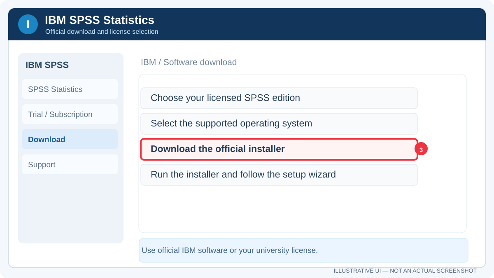
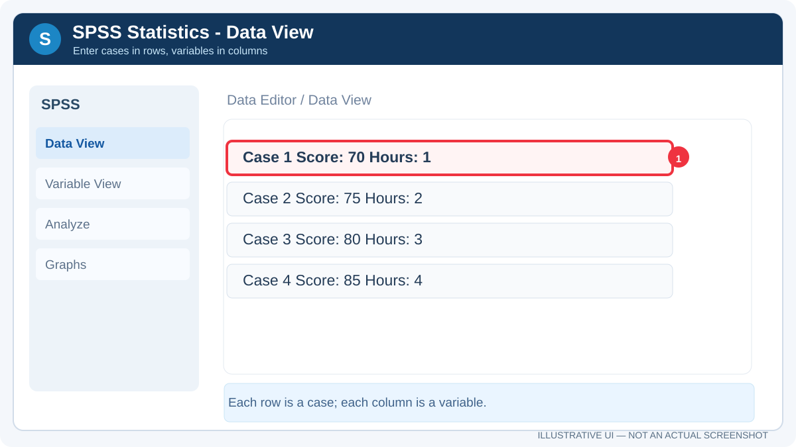
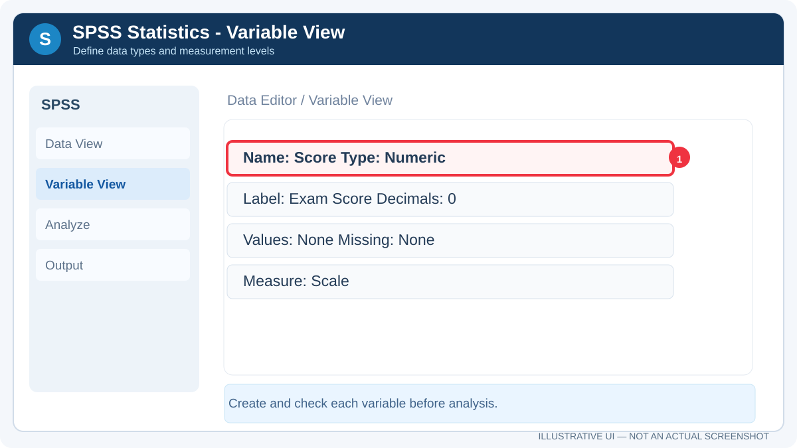
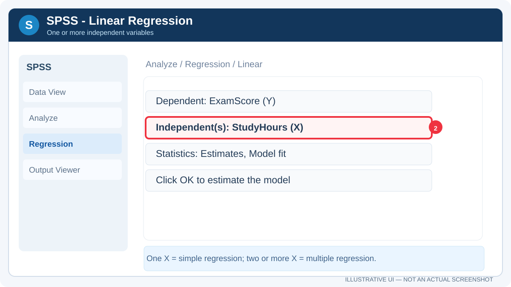

<div dir="rtl" align="right">

# **دليل IBM SPSS Statistics — التثبيت والتعرف على البرنامج وتطبيق الانحدار**

**إعداد:** Talal bin Ibrahim Alsultan  
**تحديث الدليل:** 27 أكتوبر 2026

إذا كانت لديك بيانات لاستبانة أو مشروع جامعي وتحتاج إلى تحليلها، فإن **IBM SPSS Statistics** يساعدك في تجهيز البيانات وإجراء التحليلات الإحصائية وقراءة نتائجها. في هذا الدليل سنمر بثلاث مراحل واضحة: **تحميل البرنامج وتفعيله، التعرف على واجهاته واستخداماته، ثم تطبيق مثال واحد على الانحدار الخطي البسيط**.

</div>

<div align="center">

</div>

<div dir="rtl" align="right">

## الجزء الأول: تحميل SPSS وتثبيته وتفعيله

### 1. تنزيل النسخة المناسبة

1. ابدأ من [IBM SPSS Statistics — الصفحة الرسمية](https://www.ibm.com/products/spss-statistics).
2. حدد نوع الاستخدام: **تجربة رسمية** أو **اشتراك** أو **ترخيص الجامعة**. إذا حصلت على SPSS من جامعتك فالتزم بالإصدار وطريقة التفعيل اللذين توفرهما.
3. سجّل الدخول باستخدام **IBMid** عند الطلب، ثم نزّل المثبّت المناسب لنظامك.
4. شغّل ملف التثبيت الرسمي، واتبع التعليمات ثم افتح البرنامج.
5. أكمل التفعيل بالطريقة المطابقة لرخصتك، ثم تأكد من ظهور محرر البيانات **Data Editor**.

يمكنك مراجعة [صفحة موارد SPSS](https://www.ibm.com/products/spss-statistics/resources) و[توثيق IBM الرسمي](https://www.ibm.com/docs/en/spss-statistics) إذا اختلفت الواجهة أو تفاصيل التثبيت.

<div align="center">

</div>

<small>هذه صورة إرشادية وليست لقطة شاشة فعلية. لواجهة التنزيل الحقيقية والمحدثة استخدم رابط IBM الرسمي أعلاه؛ فقد تتغير الشاشة من إصدار إلى آخر.</small>

### 2. تنشيط النسخة بطريقة نظامية

| نوع الترخيص | طريقة التشغيل |
| :--- | :--- |
| **Subscription / Trial** | تسجيل الدخول بحساب **IBMid** المرتبط بالاشتراك أو التجربة |
| **Authorized User License** | استخدام **License Authorization Wizard** مع **Authorization Code** الرسمي |
| **Concurrent / Network License** | تطبيق تعليمات جهة الترخيص أو الجامعة للوصول إلى خادم التراخيص |

قد تصل إلى المعالج من **File → Manage License → Launch License Wizard** بحسب الإصدار. لا يعني وجود مفتاح متداول في موقع خارجي أنه يحوّل البرنامج إلى نسخة أصلية.

### 3. ماذا عن الروابط غير الرسمية؟

سبق أن طُرح رابط [Traidsoft — صفحة SPSS](https://apps.traidsoft.net/download-ibm-spss-statistics/). أدرجه هنا **للتعريف بالمصدر الخارجي فقط**، وليس كرابط التنزيل المعتمد أو دليل على الترخيص الأصلي. الصفحة تعرض أداة تفعيل غير رسمية؛ لذلك لا أوصي باستخدامها أو بتعطيل برنامج الحماية لتشغيلها.

<div align="center">

</div>

<small><em>إخلاء مسؤولية: الرابط الخارجي غير تابع لشركة IBM، ولا يمكن ضمان سلامة الملفات أو صحة حقوق توزيعها. افحص الملفات قبل التشغيل ولا تعطل أنظمة الحماية. فحص الفيروسات لا يمنح البرنامج ترخيصًا رسميًا.</em></small>

## الجزء الثاني: التعرف على الواجهة ومجالات الاستخدام

### 4. النوافذ الأساسية

أول ما يفتح البرنامج عادةً ستتعامل مع **Data View** و**Variable View**، وبعد تشغيل أي تحليل ستظهر نافذة **Output Viewer**.

<div align="center">

</div>

**Data View:** أدخل البيانات هنا؛ كل صف يمثل سجلًا أو حالة، وكل عمود يمثل متغيرًا. تأكد من وضع الأرقام في الأعمدة الرقمية وعدم إضافة العناوين على أنها سجلات.

<div align="center">

</div>

<small>**لقطة شاشة فعلية من البرنامج:** [مصدرها التعليمي — Kent State University](https://libguides.library.kent.edu/SPSS/CreateData). تتغير واجهة SPSS باختلاف الإصدار؛ إذا تعذر عرض الصورة الخارجية، فالرسم الإرشادي الموجود أعلاها محفوظ داخل المستودع.</small>

<div align="center">

</div>

**Variable View:** حدد اسم المتغير **Name**، ونوعه **Type**، ووصفه **Label**، ومستوى قياسه **Measure**، والقيم المفقودة **Missing**. اختيار نوع المتغير الصحيح خطوة مهمة قبل أي تحليل.

<div align="center">

</div>

<small>**لقطة شاشة فعلية من البرنامج:** [جامعة Wisconsin — SPSS for the Classroom](https://sscc.wisc.edu/sscc/pubs/spss/classintro/spss_students1.html). اللقطة لإصدار أقدم، لكنها توضح نوع المتغيرات وأعمدتها. الرسم المحلي أعلاه مرجع بديل إذا تعذر تحميل الصورة.</small>

| الجزء | ماذا تستخدمه لأجله؟ |
| :--- | :--- |
| **Data View** | قراءة البيانات وإدخال الحالات |
| **Variable View** | تعريف المتغيرات ومستوى القياس |
| **Analyze** | اختيار الاختبار أو النموذج الإحصائي |
| **Graphs** | الرسوم البيانية والتوزيعات |
| **Transform** | إنشاء متغيرات وحساب قيم جديدة |
| **Output Viewer** | قراءة الجداول والرسوم التي أنتجها التحليل |
| **Syntax Editor** | حفظ أوامر التحليل وإعادة تنفيذها بصورة قابلة للتكرار |

### 5. ما الذي يمكن استخدام SPSS فيه؟

- **Descriptive Statistics:** المتوسط الحسابي والانحراف المعياري والتكرارات وتلخيص البيانات.
- **Correlation:** دراسة اتجاه الارتباط وقوته بين المتغيرات المناسبة.
- **Simple Linear Regression:** دراسة علاقة متغير مستقل واحد بمتغير تابع واحد، وتكوين معادلة تنبؤ.
- **Multiple Linear Regression:** استخدام عدة متغيرات مستقلة لتفسير أو التنبؤ بالمتغير التابع.
- **One-Way ANOVA:** مقارنة متوسطات مجموعات وتفسير اختبار `F` والمقارنات اللاحقة عند الحاجة.
- **Binary Logistic Regression:** نمذجة ناتج ثنائي، مثل نجاح/فشل أو نعم/لا، عندما يناسب نوع البيانات والنموذج.
- **Time Series / Forecasting:** دراسة الاتجاهات الزمنية وتقدير نماذج ملائمة للسلاسل الزمنية.
- **ACF / Autocorrelation:** فحص الارتباط الذاتي عبر الفجوات الزمنية.
- **Residual Diagnostics:** فحص بواقي الانحدار ومخططاتها وتقييم افتراضات النماذج.
- **Graphs and Tables:** الرسوم البيانية وجداول النتائج الإحصائية.

#### ما الذي استخرجته من ملفات مشروع SPSS المرفقة؟

راجعت بنية ملف **Land_Forecasting_Complete_Output.spv** الذي رفعته. يتضمن مخرجات فعلية لإجراءات **Regression** تتصل بجداول **Model Summary** و**ANOVA** و**Coefficients**، ورسوم للبواقي مثل **Histogram** و**Normal P–P Plot** و**Scatterplot**. ويتضمن أيضًا **ACF** و**Time Series Modeler** و**Sequence Plot**. لذلك أدرجت هذه الاستخدامات ضمن القدرات التي طبقتها أو ظهرت في مخرجات مشروعك.

أما ملف **Binary Logistic updated.sav** فهو ملف بيانات بامتداد **SAV**؛ اسمه وحده **لا يكفي لإثبات** تنفيذ الانحدار اللوجستي أو الحصول على نتائجه. ولذلك ذكرت **Binary Logistic Regression** كإمكان تحليلي للبرنامج فقط، وليس كنتيجة موثقة من ملف المخرجات.

**حفاظًا على خصوصية المشروع:** لم أنقل بيانات الأراضي أو مسارات ملفات الجهاز أو القيم الإحصائية أو صور المخرجات الخاصة إلى المستودع العام.

### 6. كيف أفهم الجداول بعد تشغيل Regression؟

| اسم الجدول | ماذا تقرأ فيه؟ |
| :--- | :--- |
| **Model Summary** | `R Square` و`Adjusted R Square` عند ملاءمتهما |
| **ANOVA** | قيمة `F` و`Sig.` للدلالة الإحصائية الإجمالية لنموذج الانحدار |
| **Coefficients** | المعاملات `B` وصيغة معادلة الانحدار وقيم `t` و`Sig.` |
| **Residual Plots** | فحص طبيعة الأخطاء والتوزيع والقيم غير المعتادة |

**ملاحظة مهمة:** جدول **ANOVA** الذي يظهر في تقرير الانحدار يختبر دلالة نموذج الانحدار ككل؛ وهو يختلف في الغرض المباشر عن **One-Way ANOVA** الذي تُقارن فيه متوسطات مجموعات.

## الجزء الثالث: مثال واحد — Simple Linear Regression

سنجرب علاقة **ساعات الدراسة** بدرجة اختبار افتراضية. هذه بيانات تعليمية من خمسة سجلات، وليست بيانات مأخوذة من مشروعك.

| StudyHours (X) | ExamScore (Y) |
| :---: | :---: |
| 1 | 2 |
| 2 | 3 |
| 3 | 5 |
| 4 | 4 |
| 5 | 7 |

### الخطوات داخل البرنامج

1. من **Variable View** أنشئ متغيرين رقميين بمستوى قياس **Scale**: `StudyHours` و`ExamScore`.
2. أدخل الجدول السابق في **Data View**.
3. افتح **Analyze → Regression → Linear**.
4. ضع `ExamScore` في **Dependent**، وضع `StudyHours` في **Independent(s)**.
5. من **Statistics** يمكنك تحديد **Estimates** و**Model fit**، ثم اضغط **Continue → OK**.
6. اقرأ نتائج **Model Summary** و**ANOVA** و**Coefficients**، وقارنها بالحساب المتوقع أدناه.

<div align="center">

</div>

<small>الرسم إرشادي للتعرف على مواضع الخيارات؛ ليس صورة حقيقية لنسخة بعينها من SPSS. يمكنك مقارنة الخطوات بما يظهر في الإصدار المثبت على جهازك.</small>

</div>

```text
Simple Linear Regression

Y = b0 + b1 X + error

Estimated equation:
ExamScore = 0.90 + 1.10 × StudyHours

R Square ≈ 0.818
```

<div dir="rtl" align="right">

**قراءة النتيجة:** في البيانات التعليمية الخمس، تزداد الدرجة المتوقعة بمقدار **1.10** تقريبًا مقابل كل ساعة إضافية من الدراسة وفق النموذج الخطي. ويقارب `R Square` نسبة **81.8%** من تباين درجات المثال. لا تستخدم هذه العينة الصغيرة للاستنتاج بشأن أداء طلاب حقيقيين أو لإثبات علاقة سببية.

إذا أردت تكرار المثال بسرعة في SPSS يمكنك وضع الأمر التالي داخل **Syntax Editor** وتشغيله:

</div>

```spss
DATA LIST FREE / StudyHours ExamScore.
BEGIN DATA
1 2
2 3
3 5
4 4
5 7
END DATA.
EXECUTE.

REGRESSION
  /STATISTICS COEFF R ANOVA
  /DEPENDENT ExamScore
  /METHOD=ENTER StudyHours.
```

<div dir="rtl" align="right">

## أسئلة متكررة عند الاستخدام

| المشكلة | ماذا تفعل؟ |
| :--- | :--- |
| لا يعمل ترخيص البرنامج | تحقق من نوع الترخيص واستخدم معالج التفعيل الرسمي أو الدعم الجامعي |
| لا يمكنك الضغط على **OK** | تأكد من وضع المتغيرات في المربعات الصحيحة |
| النتائج لا تظهر | افتح نافذة **Output Viewer** |
| المتغير لا يظهر في الاختبارات | افحص **Type** و**Measure** في Variable View |
| تختلف معادلة الانحدار | راجع إدخال البيانات والمتغير التابع والمستقل والقيم المفقودة |
| نتائج `ANOVA` مربكة | حدد هل تقرأ **ANOVA داخل الانحدار** أم تحليل مقارنة المتوسطات |

## مصادر الاستخدام والتحقق

- [IBM — SPSS Statistics](https://www.ibm.com/products/spss-statistics)
- [IBM — Documentation](https://www.ibm.com/docs/en/spss-statistics)
- [IBM — SPSS Statistics Resources](https://www.ibm.com/products/spss-statistics/resources)
- [IBM — Variable View](https://www.ibm.com/docs/en/spss-statistics/31.0.0?topic=editor-variable-view)
- [IBM — One-Way ANOVA](https://www.ibm.com/docs/en/spss-statistics/30.0.0?topic=features-one-way-anova)

**المصدر الإضافي لهذا الدليل:** تحليل أنواع الإجراءات والجداول في ملف SPV المرفق. لم أضع نتائجك الخاصة في المستودع، لأن الغرض هنا تعليم القارئ ما الذي يمكن فعله داخل SPSS وليس نشر مشروع التنبؤ.

[العودة إلى مركز أدلة البرامج](../../README.md)

</div>