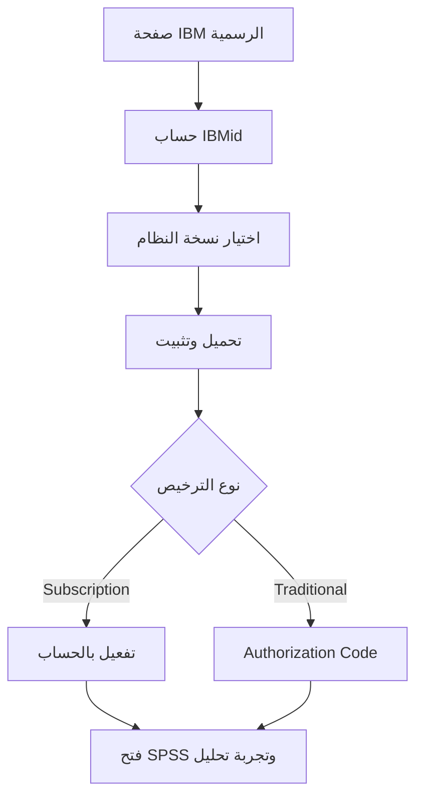

<div dir="rtl" align="right">

# دليل IBM SPSS Statistics
**التحميل، التثبيت، أول تحليل، وحلول المشكلات الشائعة**

إعداد: **Talal Alsultan** | تحديث: أكتوبر 2026

برنامج SPSS من IBM يساعد في إدخال البيانات وتنظيفها وتحليلها باستخدام الإحصاء الوصفي، واختبارات الفرضيات، والانحدار، وغيرها. هذا الدليل يشرح البداية للطالب الذي لم يستخدمه من قبل، ثم أهم الأشياء التي يفحصها إذا واجه مشكلة في التثبيت أو التشغيل.

## 1. روابط رسمية

| الرابط | الاستخدام |
| :---: | :---: |
| [IBM SPSS Statistics](https://www.ibm.com/products/spss-statistics) | صفحة المنتج والاشتراكات |
| [IBM SPSS Resources](https://www.ibm.com/products/spss-statistics/resources) | تعليمات التحميل والتجربة والدعم |
| [IBM SPSS Documentation](https://www.ibm.com/docs/en/spss-statistics) | شرح القوائم والوظائف |

> **قبل التحميل:** لدى IBM نسخة تجريبية لمدة 14 يومًا بحسب صفحة الموارد. يبدأ احتسابها عند التسجيل، وتحتاج اتصالًا بالإنترنت. الطالب الذي يملك ترخيصًا جامعيًا يتبع طريقة التفعيل التي تعطيه إياها الجامعة. لا تفترض أن نسخة التجربة تساوي الترخيص الدائم.

## 2. تثبيت SPSS خطوة بخطوة

1. افتح [صفحة IBM SPSS](https://www.ibm.com/products/spss-statistics) واختر الخيار المتاح لك: **Trial** أو **Subscription** أو تعليمات ترخيص جامعي.
2. أنشئ حساب **IBMid** أو سجّل الدخول. استخدم بريدك الجامعي إذا كان الترخيص مرتبطًا به.
3. اختر نسخة **Windows 64-bit** أو **macOS** المناسبة لجهازك، ثم نزّل مثبت IBM الرسمي.
4. افتح الملف الذي نزّلته واتبع معالج التثبيت. قد يتطلب التثبيت صلاحية Administrator.
5. افتح البرنامج بعد انتهاء التثبيت وأكمل التفعيل بالطريقة التي تنطبق على ترخيصك.
6. إذا كان لديك اشتراك، قد تُطلب منك بيانات **IBMid**. أما التراخيص التقليدية فربما تتطلب **Authorization Code** مقدمًا من جهة الشراء أو الجامعة.
7. افتح ملفًا جديدًا وتأكد من ظهور نافذتي **Data View** و**Variable View**.



## 3. ما الذي ستجده داخل SPSS؟

| الجزء | وظيفته |
| :---: | :---: |
| Variable View | تعريف المتغيرات ونوع البيانات والقيم المفقودة |
| Data View | إدخال السجلات في صفوف والمتغيرات في أعمدة |
| Analyze | الإحصاء الوصفي والاختبارات والانحدار |
| Graphs | الرسوم البيانية |
| Transform | إنشاء متغيرات وتحويلها |
| Data | الفرز والدمج وإعادة هيكلة البيانات |
| Output Viewer | عرض نتائج التحليل والجداول |

## 4. أول تجربة عملية

لنفترض أنك تريد تحليل درجات خمسة طلاب (قيم تدريبية، وليست بيانات حقيقية):

1. من **Variable View** أنشئ متغيرًا اسمه `Score` واجعل `Type = Numeric` و`Measure = Scale`.
2. من **Data View** أدخل القيم `70, 75, 80, 85, 90`.
3. اختر **Analyze → Descriptive Statistics → Descriptives**، ثم انقل `Score` إلى قائمة المتغيرات.
4. اختر **OK**. ستظهر النتائج في نافذة Output Viewer.

**مثال نتيجة متوقعة:**

```text
Variable     N     Mean     Std. Deviation
Score        5     80.00       7.906
```

القيم أعلاه محسوبة من المثال التدريبي. قد تختلف طريقة عرض الأعمدة باختلاف إعدادات SPSS.

للانحدار الخطي: استخدم **Analyze → Regression → Linear** واختر المتغير التابع `Dependent` والمتغيرات المستقلة `Independent(s)`. ثم افحص `R Square` ومعاملات الانحدار ودلالاتها، مع التحقق من افتراضات النموذج، وليس قيمة `p` وحدها.

## 5. أخطاء تتكرر عند التثبيت

| المشكلة | ماذا تفعل؟ |
| :---: | :---: |
| لا أجد البرنامج بعد التثبيت | ابحث عن IBM SPSS Statistics في قائمة Start وتأكد من اكتمال المثبت |
| رسالة License/Authorization | تحقق من نوع رخصتك؛ حساب IBMid لا يحل محل Authorization Code للتراخيص التقليدية |
| انتهت التجربة | ارجع إلى IBM أو ترخيص الجامعة، ولا تستخدم رموز تفعيل غير معتمدة |
| لا يمكن فتح ملف Excel | أغلق Excel، واستورد الملف من File → Open → Data وتحقق من أسماء الأعمدة |
| النتائج لا تظهر | افتح نافذة Output Viewer من قائمة Window |
| القيم مخزنة كنص | راجع Type وValues وMissing في Variable View |
| ظهور رموز عربية بشكل غير صحيح | راجع ترميز الملفات وإعدادات الاستيراد وأسماء المتغيرات |

## 6. الملفات المستخدمة

- `.sav` ملف بيانات SPSS.
- `.sps` ملف أوامر SPSS Syntax.
- `.spv` ملف نتائج Output Viewer.
- `.csv` ملف بيانات نصي يمكن استيراده.

## 7. مراجع التحقق

- [IBM — SPSS Statistics Resources](https://www.ibm.com/products/spss-statistics/resources)
- [IBM — SPSS Statistics Docs](https://www.ibm.com/docs/en/spss-statistics)

**ملاحظة:** تختلف أسماء القوائم الدقيقة وطريقة الترخيص بحسب النسخة. تم التحقق من الروابط والإرشادات العامة، أما صور شاشة التثبيت المباشرة فتحتاج لقطات من الجهاز والإصدار المستخدم.

</div>